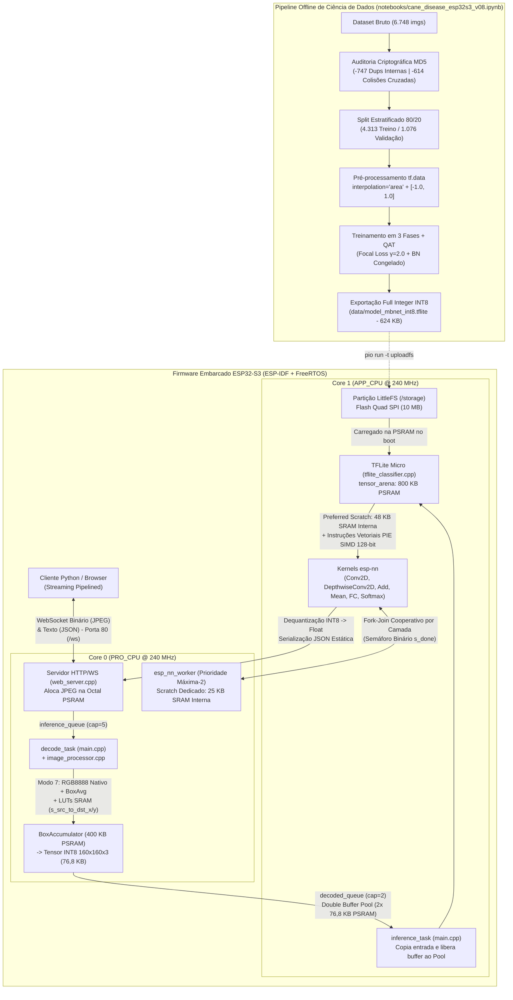

# 🌿 Documentação Técnica e Arquitetural — Classificador Embarcado de Doenças da Cana-de-Açúcar (ESP32-S3)

**Projeto:** `sugarcane` — Diagnóstico Fitopatológico Foliar em Borda (*Edge AI / TinyML*)  
**Plataforma Alvo:** Espressif ESP32-S3 (`esp32-s3-devkitm-1` — Dual-Core Xtensa LX7 @ 160/240 MHz, 512 KB SRAM Interna, 8 MB Octal PSRAM, 16 MB Quad SPI Flash)  
**Framework e Stack:** ESP-IDF 5.5.x (PlatformIO), FreeRTOS, TensorFlow Lite Micro (`esp-tflite-micro`), Kernels Vetoriais SIMD PIE (`esp-nn`), `JPEGDEC`, `LittleFS` e Servidor WebSocket Assíncrono (`esp_http_server`).

---

## Sumário

1. [Visão Geral e Arquitetura End-to-End do Sistema](#1-visão-geral-e-arquitetura-end-to-end-do-sistema)
2. [Estrutura do Repositório e Mapa de Módulos](#2-estrutura-do-repositório-e-mapa-de-módulos)
3. [Engenharia de Hardware, Particionamento e Hierarquia de Memória](#3-engenharia-de-hardware-particionamento-e-hierarquia-de-memória)
4. [Arquitetura de Concorrência Híbrida: Pipeline FreeRTOS + Fork-Join Dual-Core](#4-arquitetura-de-concorrência-híbrida-pipeline-freertos--fork-join-dual-core)
5. [Processamento Digital de Imagens e Teoria de Sinais na Decodificação JPEG](#5-processamento-digital-de-imagens-e-teoria-de-sinais-na-decodificação-jpeg)
6. [Motor de Inferência Neural (TFLite Micro) e Otimizações Assembly SIMD (`esp-nn`)](#6-motor-de-inferência-neural-tflite-micro-e-otimizações-assembly-simd-esp-nn)
7. [Subsistema de Rede e Protocolo WebSocket Binário Assíncrono](#7-subsistema-de-rede-e-protocolo-websocket-binário-assíncrono)
8. [Curadoria Criptográfica do Dataset (MD5) e Engenharia de Treinamento (`v07` → `v08`)](#8-curadoria-criptográfica-do-dataset-md5-e-engenharia-de-treinamento-v07--v08)
9. [Infraestrutura de Testes, Benchmarking e Resultados Empíricos Consolidados](#9-infraestrutura-de-testes-benchmarking-e-resultados-empíricos-consolidados)
10. [Síntese das Decisões de Engenharia e Suas Justificativas](#10-síntese-das-decisões-de-engenharia-e-suas-justificativas)

---

## 1. Visão Geral e Arquitetura End-to-End do Sistema

O projeto implementa um sistema completo de **Visão Computacional e Inteligência Artificial Embarcada (*TinyML*)** capaz de receber imagens comprimidas em formato JPEG via rede local (WebSocket), decodificá-las e redimensioná-las em tempo real com filtragem anti-aliasing matemática (*Box Averaging* em 24 bits), e classificá-las em **11 categorias fitopatológicas da cana-de-açúcar** utilizando uma rede neural convolucional totalmente quantizada em inteiros de 8 bits (`INT8`), executada diretamente no microcontrolador **ESP32-S3**.

As 11 classes diagnosticadas pelo sistema são:
1. `Banded Chlorosis` (Clorose Zonada)
2. `Brown Spot` (Mancha Parda — *Cercospora longipes*)
3. `BrownRust` (Ferrugem Marrom — *Puccinia melanocephala*)
4. `Dried Leaves` (Folhas Secas)
5. `Grassy shoot` (Enfezamento / Brotamento Graminoso — Fitoplasma)
6. `Healthy Leaves` (Folhas Sadias)
7. `Pokkah Boeng` (*Fusarium moniliforme*)
8. `Sett Rot` (Podridão Abacaxi do Colmo — *Ceratocystis paradoxa*)
9. `Viral Disease` (Viroses — Mosaico / Estria)
10. `Yellow Leaf` (Síndrome da Folha Amarela — *SCYLV*)
11. `smut` (Carvão da Cana — *Sporisorium scitamineum*)

### Diagrama de Arquitetura Global



---

## 2. Estrutura do Repositório e Mapa de Módulos

O projeto está organizado de forma modular, separando o código-fonte do firmware C/C++, bibliotecas otimizadas de baixo nível, pipelines de treinamento em Python/Jupyter, scripts de avaliação automatizada e relatórios de engenharia:

| Caminho / Arquivo | Papel Arquitetural no Sistema |
| :--- | :--- |
| **[`platformio.ini`](file:///home/victor/projects/sugarcane/platformio.ini)** | Configuração de build PlatformIO, definição da placa (`esp32-s3-devkitm-1`), tamanho de Flash (16 MB), sistema de arquivos (`littlefs`), flags de compilação (`-D CONFIG_NN_SKIP_NUDGE=1`, `-D SKIP_NUDGE=1`) e dependência `JPEGDEC`. |
| **[`sdkconfig.defaults`](file:///home/victor/projects/sugarcane/sdkconfig.defaults)** | Diretivas base do ESP-IDF: habilitação da Octal PSRAM, realocação de código/rodata em PSRAM, tick FreeRTOS a 1000 Hz, aceleração SIMD (`CONFIG_ESP32S3_SIMD=y`, `CONFIG_NN_OPTIMIZED=y`, `CONFIG_NN_SKIP_NUDGE=y`) e suporte a WebSocket (`CONFIG_HTTPD_WS_SUPPORT=y`). |
| **[`partitions.csv`](file:///home/victor/projects/sugarcane/partitions.csv)** | Tabela de partições da Flash de 16 MB (`nvs`, `otadata`, `phy_init`, `factory` com 4 MB para firmware e `storage` com 10 MB para o LittleFS). |
| **[`src/main.cpp`](file:///home/victor/projects/sugarcane/src/main.cpp)** | Ponto de entrada (`app_main`), montagem do LittleFS, criação das filas FreeRTOS, alocação do *Double Buffer* na PSRAM e orquestração das tasks fixadas por núcleo ([`decode_task`](file:///home/victor/projects/sugarcane/src/main.cpp#L53-L79) no Core 0 e [`inference_task`](file:///home/victor/projects/sugarcane/src/main.cpp#L84-L115) no Core 1). |
| **[`src/image_processor.h`](file:///home/victor/projects/sugarcane/src/image_processor.h)** / **[`src/image_processor.cpp`](file:///home/victor/projects/sugarcane/src/image_processor.cpp)** | Motor de decodificação JPEG em blocos MCU, conversão de espaço de cor (`RGB565` vs `RGB8888` 24-bit), redimensionamento espacial via *Box Averaging* ou *FastLUT* com tabelas de busca em SRAM e quantização afim `uint8 -> int8`. |
| **[`src/tflite_classifier.h`](file:///home/victor/projects/sugarcane/src/tflite_classifier.h)** / **[`src/tflite_classifier.cpp`](file:///home/victor/projects/sugarcane/src/tflite_classifier.cpp)** | Inicialização do interpretador TensorFlow Lite Micro, alocação dos *Scratch Buffers* dedicados na SRAM Interna (48 KB principal + 25 KB worker), ativação do motor *Fork-Join* Dual-Core ([`classifier_enable_dual_core`](file:///home/victor/projects/sugarcane/src/tflite_classifier.cpp#L56-L64)), execução da inferência ([`classifier_run`](file:///home/victor/projects/sugarcane/src/tflite_classifier.cpp#L148-L182)) e formatação JSON. |
| **[`src/web_server.h`](file:///home/victor/projects/sugarcane/src/web_server.h)** / **[`src/web_server.cpp`](file:///home/victor/projects/sugarcane/src/web_server.cpp)** | Servidor HTTP e endpoint WebSocket (`/ws`), recepção binária zero-copy para a PSRAM ([`ws_handler`](file:///home/victor/projects/sugarcane/src/web_server.cpp#L12-L36)) e transmissão assíncrona dos resultados JSON ([`web_server_send_ws_text`](file:///home/victor/projects/sugarcane/src/web_server.cpp#L52-L60)). |
| **[`src/wifi_setup.h`](file:///home/victor/projects/sugarcane/src/wifi_setup.h)** / **[`src/wifi_setup.cpp`](file:///home/victor/projects/sugarcane/src/wifi_setup.cpp)** | Inicialização da interface Wi-Fi em modo Station (`WIFI_MODE_STA`), máquina de estados orientada a eventos ([`event_handler`](file:///home/victor/projects/sugarcane/src/wifi_setup.cpp#L18-L33)) com auto-reconexão e bloqueio sincronizado por `EventGroup` até aquisição de IP via DHCP. |
| **[`data/model_mbnet_int8.tflite`](file:///home/victor/projects/sugarcane/data/model_mbnet_int8.tflite)** | Modelo neural quantizado em `int8` (`639.272 bytes`), gravado na partição LittleFS e carregado em tempo de execução. |
| **[`managed_components/espressif__esp-nn/`](file:///home/victor/projects/sugarcane/managed_components/espressif__esp-nn)** | Biblioteca oficial da Espressif contendo os kernels em C e Assembly SIMD (Xtensa PIE 128-bit) e suporte multi-core (`esp_nn_multicore.c`), incluindo customização em [`esp_nn_conv_esp32s3.c`](file:///home/victor/projects/sugarcane/managed_components/espressif__esp-nn/src/convolution/esp_nn_conv_esp32s3.c#L787-L802). |
| **[`notebooks/cane_disease_esp32s3_v07.ipynb`](file:///home/victor/projects/sugarcane/notebooks/cane_disease_esp32s3_v07.ipynb)** e **[`v08.ipynb`](file:///home/victor/projects/sugarcane/notebooks/cane_disease_esp32s3_v08.ipynb)** | Notebooks de treinamento comparando CNN Customizada vs. MobileNet, auditoria criptográfica MD5, *split* estratificado, *Data Augmentation*, *Focal Loss*, *Quantization-Aware Training* (QAT) e exportação TFLite `int8`. |
| **[`scripts/test_inference.py`](file:///home/victor/projects/sugarcane/scripts/test_inference.py)** | Utilitário CLI em Python para validação local rápida do modelo `.tflite` no computador host sem necessidade da placa física. |
| **[`model_inference_tests/`](file:///home/victor/projects/sugarcane/model_inference_tests)** | Suite de avaliação de desempenho em hardware real ([`run_evaluation.py`](file:///home/victor/projects/sugarcane/model_inference_tests/run_evaluation.py) e [`run_evaluation_dualcore.py`](file:///home/victor/projects/sugarcane/model_inference_tests/run_evaluation_dualcore.py)), planilhas CSV com milhares de inferências auditadas e relatórios comparativos. |
| **[`docs/`](file:///home/victor/projects/sugarcane/docs)** | Documentos matemáticos aprofundados sobre conversão de cor/redimensionamento ([`ANALISE_JPEGDRAW_CONVERSAO_COR.md`](file:///home/victor/projects/sugarcane/docs/ANALISE_JPEGDRAW_CONVERSAO_COR.md)), auditoria do dataset ([`AUDITORIA_DATASET_E_MELHORIAS_TREINAMENTO_V08.md`](file:///home/victor/projects/sugarcane/docs/AUDITORIA_DATASET_E_MELHORIAS_TREINAMENTO_V08.md)) e otimização de SRAM/Dual-Core ([`OTIMIZACAO_SRAM_E_PARALELISMO_DUAL_CORE_ESP_NN.md`](file:///home/victor/projects/sugarcane/docs/OTIMIZACAO_SRAM_E_PARALELISMO_DUAL_CORE_ESP_NN.md)). |

---

## 3. Engenharia de Hardware, Particionamento e Hierarquia de Memória

Sistemas embarcados que combinam conectividade Wi-Fi, processamento de imagem em alta resolução ($768 \times 1024$) e redes neurais profundas sofrem severas restrições de memória e largura de banda de barramento. O projeto adota um conjunto coordenado de estratégias no nível do sistema operacional (ESP-IDF) e do alocador de memória (`esp_heap_caps`) para contornar esses limites.

### 3.1. Estratégia de Particionamento Flash e Uso do LittleFS

Na tabela [`partitions.csv`](file:///home/victor/projects/sugarcane/partitions.csv), a memória Flash de 16 MB é dividida estrategicamente:

```csv
# Name,   Type, SubType, Offset,  Size, Flags
nvs,      data, nvs,     ,        0x4000,
otadata,  data, ota,     ,        0x2000,
phy_init, data, phy,     ,        0x1000,
factory,  app,  factory, ,        4M,
storage,  data, spiffs,  ,        10M,
```

* **Por que armazenar o modelo em uma partição LittleFS (`/storage`) em vez de embuti-lo como um array C (`const unsigned char[]`) no código-fonte?**
  1. **Desacoplamento entre Firmware e Pesos da Rede:** O binário do firmware ocupa apenas ~11,8% da partição `factory` (4 MB). Quando um novo modelo `.tflite` é treinado (como na transição da versão `v07` para a `v08`), basta substituir [`data/model_mbnet_int8.tflite`](file:///home/victor/projects/sugarcane/data/model_mbnet_int8.tflite) e executar `pio run -t uploadfs`, sem necessidade de recompilar o código C++ ou o ESP-IDF.
  2. **Capacidade para Múltiplos Modelos:** A partição `storage` de 10 MB comporta até **15 modelos de ~640 KB** simultaneamente, permitindo A/B testing embarcado.
  3. **Resiliência e *Wear Leveling*:** O sistema de arquivos `LittleFS` (montado em [`init_littlefs()`](file:///home/victor/projects/sugarcane/src/main.cpp#L35-L48)) oferece proteção contra corrupção por queda de energia (*power-loss resilience*) e nivelamento de desgaste superior ao SPIFFS legado.

### 3.2. Otimizações de Barramento via `sdkconfig.defaults`

Em [`sdkconfig.defaults`](file:///home/victor/projects/sugarcane/sdkconfig.defaults), destacam-se quatro configurações estruturais:

1. **`CONFIG_SPIRAM=y` e `CONFIG_SPIRAM_MODE_OCT=y`:** Habilita a PSRAM externa de 8 MB em modo **Octal SPI** (8 linhas de dados paralelas em DDR/SDR), fornecendo largura de banda significativamente superior à PSRAM Quad SPI tradicional.
2. **`CONFIG_SPIRAM_FETCH_INSTRUCTIONS=y` e `CONFIG_SPIRAM_RODATA=y`:** Durante a inicialização do chip (visível no log de boot em [`error.txt`](file:///home/victor/projects/sugarcane/error.txt#L49-L50): `mmu_psram: Read only data copied and mapped to SPIRAM` e `Instructions copied and mapped to SPIRAM`), a MMU copia os segmentos `.flash.text` (instruções executáveis) e `.flash.rodata` (constantes) da Flash para a Octal PSRAM.
   * **Justificativa:** Evita *stalls* de CPU causados por leituras na Flash SPI e libera a cache de instruções para operar na velocidade da Octal PSRAM.
3. **`CONFIG_SPIRAM_USE_MALLOC=y`:** Integra os ~7,2 MB restantes da PSRAM ao alocador padrão `malloc()`, enquanto reservas críticas de DMA permanecem protegidas na SRAM interna.
4. **`CONFIG_FREERTOS_HZ=1000`:** Eleva a frequência do *tick* do escalonador FreeRTOS do padrão de 100 Hz (fatia de tempo de 10 ms) para **1000 Hz (fatia de 1 ms)**.
   * **Justificativa:** Como uma camada convolucional individual dura entre 1 ms e 15 ms e a decodificação JPEG dura ~47 ms, um *tick* de 10 ms introduziria latência excessiva na troca de contexto entre a recepção WebSocket, a `decode_task` e o worker multi-core.

### 3.3. Engenharia da Hierarquia de Memória: SRAM Interna vs. Octal PSRAM

O ESP32-S3 possui dois níveis principais de memória RAM endereçável:
* **SRAM Interna (~512 KB totais, ~309 KB livres para heap no boot):** Opera na frequência da CPU (zero *wait-states*) e suporta acesso direto de 128 bits pelo coprocessador SIMD PIE sem passar pela cache externa.
* **Octal PSRAM Externa (8 MB @ 40/80 MHz):** Ampla capacidade, porém compartilha a cache de dados (DCache) e possui latência de barramento caso ocorram *cache misses* frequentes.

O projeto particiona explicitamente cada alocação entre essas duas memórias usando `heap_caps_malloc()` e `heap_caps_aligned_alloc()`:

| Estrutura / Buffer | Tamanho Exato | Local de Alocação | Função / Arquivo | Justificativa Técnica |
| :--- | :---: | :---: | :--- | :--- |
| **`s_sram_scratch_buf`** (`preferred_scratch_buffer`) | `49.152 B` (**48 KB**) | **SRAM Interna** (`MALLOC_CAP_INTERNAL \| DMA`, `alignas(16)`) | [`classifier_init()`](file:///home/victor/projects/sugarcane/src/tflite_classifier.cpp#L73-L88) | Hospeda 100% dos *workspaces* de `im2col`, *padding* e transposição de painéis SIMD de todas as 52 camadas `Conv2D` (máx ~24,5 KB) e `DepthwiseConv2D` (máx ~43,9 KB). Evita gravar/reler dados temporários na PSRAM dezenas de vezes por camada. |
| **`worker_sram`** (`esp_nn_dual_core_scratch`) | `25.600 B` (**25 KB**) | **SRAM Interna** (`MALLOC_CAP_INTERNAL \| SIMD`, `alignas(16)`) | [`classifier_init()`](file:///home/victor/projects/sugarcane/src/tflite_classifier.cpp#L99-L103) | Área de rascunho exclusiva para o 2º núcleo (`esp_nn_worker` no Core 0) durante a divisão *Fork-Join*, impedindo colisão de memória ou contenção de PSRAM com o Core 1. |
| **LUTs de Mapeamento Espacial** (`s_src_to_dst_x/y` e `s_target_src_x/y`) | `8.832 B` (**~8,6 KB**) | **SRAM Interna** (`.bss` estática) | [`image_processor.cpp`](file:///home/victor/projects/sugarcane/src/image_processor.cpp#L37-L43) | Lidas até 1,57 milhão de vezes por imagem (`786.432` pixels $\times$ 2 eixos). Na SRAM interna, cada consulta de coordenada custa 1 ciclo de clock e substitui divisões inteiras caras. |
| **`result_json`** | `1.024 B` (**1 KB**) | **SRAM Interna** (`.bss` estática) | [`tflite_classifier.cpp`](file:///home/victor/projects/sugarcane/src/tflite_classifier.cpp#L36) | Buffer estático pré-alocado para formatação da resposta JSON, eliminando `malloc`/`free` e fragmentação de heap a cada inferência. |
| **`tensor_arena`** | `819.200 B` (**800 KB**) | **Octal PSRAM** (`MALLOC_CAP_SPIRAM`) | [`classifier_init()`](file:///home/victor/projects/sugarcane/src/tflite_classifier.cpp#L123) | O pico de ativações *ping-pong* das camadas iniciais de resolução $80 \times 80$ (Tensor 13 `[1,80,80,48]` de 300 KB + Tensor `[1,80,80,16]` de 100 KB) exige **~409 KB**, o que jamais caberia na SRAM interna. |
| **`model_buffer`** | `639.272 B` (**~624 KB**) | **Octal PSRAM** (`MALLOC_CAP_SPIRAM`) | [`classifier_init()`](file:///home/victor/projects/sugarcane/src/tflite_classifier.cpp#L116) | Armazena o modelo FlatBuffer lido do LittleFS em RAM contígua para leitura sequencial rápida de pesos. |
| **`s_box_acc`** (`BoxAccumulator[25600]`) | `409.600 B` (**400 KB**) | **Octal PSRAM** (`MALLOC_CAP_SPIRAM`, `alignas(16)`) | [`ensure_box_accumulator_allocated()`](file:///home/victor/projects/sugarcane/src/image_processor.cpp#L56-L71) | Acumula somas de 32 bits (`sum_r`, `sum_g`, `sum_b`) e contagem (`count`) para os 25.600 blocos do *Box Averaging*. O alinhamento de 16 bytes garante que cada struct caiba exatamente em uma meia linha de cache sem cruzar fronteiras. |
| **Pool *Double Buffer* de Tensores** (`2 × TENSOR_SIZE`) | `153.600 B` (**150 KB**) | **Octal PSRAM** (`MALLOC_CAP_SPIRAM`) | [`app_main()`](file:///home/victor/projects/sugarcane/src/main.cpp#L135-L141) | Dois buffers de `76.800 B` (`160×160×3`) gerenciados pela fila `free_tensor_queue`, permitindo desacoplar a decodificação no Core 0 da inferência no Core 1. |
| **Payload JPEG WebSocket** (`ws_pkt.payload`) | Variável (~30–150 KB) | **Octal PSRAM** (`MALLOC_CAP_SPIRAM`) | [`ws_handler()`](file:///home/victor/projects/sugarcane/src/web_server.cpp#L23) | Alocado sob demanda ao receber o pacote binário na rede e liberado imediatamente após a descompressão JPEG em [`decode_task()`](file:///home/victor/projects/sugarcane/src/main.cpp#L66). |

---

## 4. Arquitetura de Concorrência Híbrida: Pipeline FreeRTOS + Fork-Join Dual-Core

Um dos maiores diferenciais técnicos do projeto é sua **arquitetura de paralelismo em dois níveis**, que combina **Paralelismo de Tarefas (*Task Pipelining*)** no nível macro com **Paralelismo de Dados (*Fork-Join Cooperativo*)** no nível micro das camadas da rede neural.

### 4.1. Nível 1: Macro-Pipeline Assíncrono com *Double Buffering* ([`src/main.cpp`](file:///home/victor/projects/sugarcane/src/main.cpp))

Em uma implementação ingênua (*Single-Core Sequencial*), o microcontrolador executaria em série:
$$\text{Receber WS} \longrightarrow \text{Decodificar JPEG (Core 0)} \longrightarrow \text{Inferência TFLite (Core 0)} \longrightarrow \text{Responder WS}$$
Nesse modelo sequencial, enquanto a CPU decodifica o JPEG, o motor neural está parado; enquanto a rede neural executa, o decodificador está parado.

Para eliminar esse tempo ocioso em transmissões contínuas, [`src/main.cpp`](file:///home/victor/projects/sugarcane/src/main.cpp) implementa um pipeline produtor-consumidor composto por **duas tasks fixadas em núcleos distintos (`xTaskCreatePinnedToCore`)** e **três filas FreeRTOS (`QueueHandle_t`)**:

```mermaid
sequenceDiagram
    participant WS as WebSocket (Core 0)
    participant IQ as inference_queue (cap=5)
    participant FTQ as free_tensor_queue (cap=2)
    participant DEC as decode_task (Core 0)
    participant DQ as decoded_queue (cap=2)
    participant INF as inference_task (Core 1)
    participant WKR as esp_nn_worker (Core 0)

    Note over FTQ: Boot: 2 buffers de 76,8 KB pré-alocados na PSRAM (Buf_A, Buf_B)
    WS->>IQ: Envia InferenceRequest (Foto 1)
    IQ->>DEC: xQueueReceive(inference_queue)
    FTQ->>DEC: xQueueReceive(free_tensor_queue) -> Obtém Buf_A
    DEC->>DEC: process_jpeg(Foto 1 -> Buf_A) + free(jpeg_buf)
    DEC->>DQ: xQueueSend(decoded_queue, Job 1 c/ Buf_A)
    
    par Streaming Concorrente (Foto 2 chega enquanto Foto 1 vai para Inferência)
        DQ->>INF: xQueueReceive(decoded_queue) -> Recebe Job 1
        INF->>INF: memcpy(input_tensor, Buf_A, 76800)
        INF->>FTQ: xQueueSend(free_tensor_queue, Buf_A) [LIBERA IMEDIATAMENTE!]
        INF->>INF: classifier_run() [interpreter->Invoke()]
        INF<-->WKR: Fork-Join Cooperativo nas camadas Conv2D / Depthwise / Add
        INF->>WS: web_server_send_ws_text(JSON Foto 1)
    and Decodificação em Paralelo no Core 0
        WS->>IQ: Envia InferenceRequest (Foto 2)
        IQ->>DEC: xQueueReceive(inference_queue)
        FTQ->>DEC: xQueueReceive(free_tensor_queue) -> Obtém Buf_B (já livre!)
        DEC->>DEC: process_jpeg(Foto 2 -> Buf_B)
        DEC->>DQ: xQueueSend(decoded_queue, Job 2 c/ Buf_B)
    end
```

#### Detalhe Crítico de Implementação — Devolução Antecipada do Buffer ([`src/main.cpp`](file:///home/victor/projects/sugarcane/src/main.cpp#L98-L107)):
Observe as linhas 99–107 de [`src/main.cpp`](file:///home/victor/projects/sugarcane/src/main.cpp#L99-L107):
```cpp
// Copia dados para a entrada do modelo
memcpy(classifier_get_input_ptr(), job.tensor_buf, TENSOR_SIZE);

// Libera o buffer de volta ao pool IMEDIATAMENTE!
// O Core 0 já pode decodificar a próxima foto ou auxiliar no Fork-Join do esp-nn
xQueueSend(free_tensor_queue, &job.tensor_buf, portMAX_DELAY);

// Inferência acelerada com SIMD + SRAM Scratch + Fork-Join Dual-Core
classifier_run(job.decode_time_ms);
```
* **Justificativa:** Se o buffer `job.tensor_buf` só fosse devolvido à `free_tensor_queue` *após* o término de `classifier_run()`, ele ficaria retido inutilmente durante toda a inferência neural. Ao copiá-lo em menos de 1 ms (`memcpy` de 76,8 KB) para o tensor de entrada da `tensor_arena` e devolvê-lo imediatamente à `free_tensor_queue`, ambos os buffers do pool ficam livres quase 100% do tempo e o Core 0 nunca sofre bloqueio por falta de memória ao decodificar o quadro seguinte.

---

### 4.2. Nível 2: Paralelismo de Dados Intra-Inferência (`Fork-Join` Cooperativo no `esp-nn`)

O Macro-Pipeline acima acelera lotes contínuos de imagens, mas o que acontece quando o usuário envia **uma única foto** por vez (uso interativo) ou quando o `Core 0` termina de decodificar o JPEG em ~47 ms enquanto o `Core 1` ainda tem centenas de milissegundos de cálculos matriciais pela frente? Sem paralelismo intra-inferência, o `Core 0` ficaria ocioso durante a maior parte do tempo da rede neural.

Para resolver isso, ativamos e integramos o motor **Fork-Join Dual-Core nativo do `esp-nn`** ([`esp_nn_multicore.h`](file:///home/victor/projects/sugarcane/managed_components/espressif__esp-nn/include/esp_nn_multicore.h) / [`esp_nn_multicore.c`](file:///home/victor/projects/sugarcane/managed_components/espressif__esp-nn/src/common/esp_nn_multicore.c)):

1. **Regra de Afinidade de Núcleo (Por que [`classifier_enable_dual_core()`](file:///home/victor/projects/sugarcane/src/tflite_classifier.cpp#L56-L64) é chamado na `inference_task` e não no `app_main`?):**
   Na implementação interna da Espressif em [`esp_nn_multicore.c`](file:///home/victor/projects/sugarcane/managed_components/espressif__esp-nn/src/common/esp_nn_multicore.c#L78-L82):
   ```c
   const BaseType_t core = (xPortGetCoreID() == 0) ? 1 : 0;
   xTaskCreatePinnedToCore(esp_nn_worker_main, "esp_nn_worker", 8 * 1024,
                           NULL, configMAX_PRIORITIES - 2, &s_worker, core);
   ```
   E durante o despacho de cada camada em [`esp_nn_dual_core_run()`](file:///home/victor/projects/sugarcane/managed_components/espressif__esp-nn/src/common/esp_nn_multicore.c#L106-L108):
   ```c
   if (xPortGetCoreID() == s_worker_core) {
       return false;
   }
   ```
   A função `app_main()` do ESP-IDF executa sempre no **Core 0**. Se `esp_nn_dual_core_enable()` fosse chamada dentro de `app_main()`, o `s_worker` seria fixado no **Core 1** (`s_worker_core = 1`). Quando a `inference_task` (que também roda no **Core 1**) chamasse `interpreter->Invoke()`, a verificação `xPortGetCoreID() == s_worker_core` (`1 == 1`) falharia silenciosamente em 100% das camadas e o segundo núcleo jamais seria utilizado!
   Ao invocar [`classifier_enable_dual_core()`](file:///home/victor/projects/sugarcane/src/main.cpp#L93) no início da [`inference_task()`](file:///home/victor/projects/sugarcane/src/main.cpp#L84-L93) (que roda no **Core 1**), o `esp_nn_worker` é corretamente fixado no **Core 0** (`s_worker_core = 0`).

2. **Divisão Matemática de Trabalho entre Core 1 (Mestre) e Core 0 (`esp_nn_worker`):**
   Durante `interpreter->Invoke()`, cada camada pesada divide seu domínio de saída entre os dois núcleos:
   * **`CONV_2D` ($1\times1$ com filtros $> 24\text{ KB}$):** Divide os canais de saída ao meio (`oc0 = ((out_ch / 2) + 7) & ~7`, mantendo múltiplo de 8 para alinhamento SIMD). O Core 0 calcula os canais `[0 .. oc0-1]` usando seu `worker_sram` (25 KB), enquanto o Core 1 calcula `[oc0 .. out_ch-1]` usando `s_sram_scratch_buf` (48 KB).
   * **`DEPTHWISE_CONV_2D` ($3\times3$):** Para mapas $\le 40\text{ KB}$, divide a altura espacial da imagem ao meio (`out_ht / 2`) via `dw3x3_run_split`. Para mapas grandes ($> 40\text{ KB}$, como nas camadas $80 \times 80$), aplica *strip-tiling* onde cada núcleo processa metade das faixas horizontais em seu respectivo buffer SRAM.
   * **`ADD` e `MUL` (Conexões Residuais):** Para tensores com $\ge 4096$ bytes, divide o vetor linearmente ao meio (alinhado em múltiplos de 16 bytes para instruções de 128 bits).

---

## 5. Processamento Digital de Imagens e Teoria de Sinais na Decodificação JPEG

As imagens do dataset possuem resolução típica de **$768 \times 1024$ pixels** ($786.432$ pixels), enquanto o tensor de entrada da rede neural exige **$160 \times 160 \times 3$ bytes** ($25.600$ pixels em formato `int8`). O módulo [`src/image_processor.cpp`](file:///home/victor/projects/sugarcane/src/image_processor.cpp) realiza a descompressão JPEG, conversão de espaço de cor, redução de escala (*downsampling*) e quantização em uma única passagem (*streaming* por blocos MCU).

### 5.1. Por que Decodificar em Blocos MCU via `JPEGDEC`?
Descomprimir uma imagem $768 \times 1024$ inteira em um framebuffer RGB888 antes de redimensioná-la exigiria $768 \times 1024 \times 3 = \mathbf{2,35\text{ MB}}$ de memória RAM apenas para uma foto bruta. A biblioteca `JPEGDEC` decodifica o bitstream Huffman/DCT em blocos MCU (*Minimum Coded Units*, tipicamente $16 \times 16$ ou $8 \times 8$ pixels) usando um buffer estático interno de apenas 4 KB (`MAX_BUFFERED_PIXELS = 2048` words) e invoca o callback `JPEGDraw(JPEGDRAW* pDraw)` a cada faixa de blocos decodificada.

### 5.2. Por que a Decodificação de um Único JPEG é Mantida Sequencial?
Um arquivo JPEG baseline utiliza **Codificação de Entropia de Huffman** (símbolos de comprimento variável de bits, sem alinhamento de byte) combinada com **Codificação Diferencial dos Coeficientes DC** ($DC_k = DC_{k-1} + \Delta$). Por essa razão matemática, é impossível determinar em qual bit do arquivo começa o bloco MCU da metade inferior da imagem sem antes decodificar bit a bit toda a metade superior. Assim, a estratégia correta implementada no projeto é manter a entropia JPEG sequencial por frame no Core 0 e acelerar o laço interno de pixels com **Look-Up Tables (LUTs) na SRAM interna**.

### 5.3. Diagnóstico Matemático dos Problemas da Abordagem Tradicional (`Modo 0`)

Em implementações embarcadas convencionais (referenciadas no projeto como `Modo 0: RGB565 ZeroFill + Overwrite`), utiliza-se `jpeg.setPixelType(RGB565_LITTLE_ENDIAN)` seguido de deslocamento de bits e escrita direta no tensor $160 \times 160$:

```cpp
// Abordagem tradicional (Modo 0 - Descartada após auditoria de sinal)
int dst_y = (src_y * 160) / original_h;
int dst_x = (src_x * 160) / original_w;
uint8_t r = (pixel & 0xF800) >> 8; // 5 bits << 3 (Zero-Fill)
uint8_t g = (pixel & 0x07E0) >> 3; // 6 bits << 2 (Zero-Fill)
uint8_t b = (pixel & 0x001F) << 3; // 5 bits << 3 (Zero-Fill)
out_tensor[(dst_y * 160 + dst_x) * 3 + 0] = (int8_t)(r - 128);
```

A auditoria matemática documentada em [`docs/ANALISE_JPEGDRAW_CONVERSAO_COR.md`](file:///home/victor/projects/sugarcane/docs/ANALISE_JPEGDRAW_CONVERSAO_COR.md) provou que esse código introduz **três degradações severas**:

1. **Truncamento de Faixa Dinâmica e Viés DC de Escurecimento (*Brightness Bias*):**
   Ao converter YCbCr para `RGB565`, o decodificador descarta 3 bits de R, 2 bits de G e 3 bits de B. Ao preencher os bits inferiores com zeros (*Zero-Fill*), o branco puro ($255$) torna-se inatingível ($31 \times 8 = 248$ em R/B e $63 \times 4 = 252$ em G), truncando o tensor `int8` em $+120$ (R/B) e $+124$ (G) em vez de $+127$. Além disso, sob distribuição uniforme dos bits descartados, introduz um erro sistemático negativo esperado de:
   $$\text{Bias}_R = \text{Bias}_B = -\frac{1}{8}\sum_{k=0}^{7} k = -3,50\text{ LSB}, \quad \text{Bias}_G = -\frac{1}{4}\sum_{k=0}^{3} k = -1,50\text{ LSB} \implies \text{Bias}_{\text{médio}} = \mathbf{-2,833\text{ LSB}}$$
   Nas 550 fotos do dataset, o viés medido empiricamente foi de **`-2,90 LSB`**, escurecendo sistematicamente todas as folhas enviadas à rede.

2. **Violação do Teorema de Nyquist-Shannon (*Spatial Aliasing* por Sobrescrita *Last-Pixel-Wins*):**
   Para reduzir $768 \times 1024$ ($786.432$ pixels) para $160 \times 160$ ($25.600$ pixels), cada célula $(dst\_x, dst\_y)$ recebe uma janela de $4,8 \times 6,4 \approx \mathbf{30,72\text{ pixels}}$ da imagem original. Como o laço simplesmente sobrescreve o mesmo endereço `out_idx`, as primeiras **29 a 34 gravações de cada janela são perdidas**, restando apenas o último pixel do canto inferior direito. Lesões fitopatológicas finas — como o chicote estreito de esporos escuros da classe `smut` ou estrias cloróticas iniciais de `Pokkah Boeng` — que caem nas linhas intermediárias desaparecem completamente do tensor, degradando a relação sinal-ruído global para apenas **$27,1\text{ dB}$** ($\text{RMSE} = 11,25\text{ LSB}$).

3. **Desperdício de 96,74% das Escritas de Memória e Divisões Inteiras:**
   O laço calcula duas divisões inteiras e grava na PSRAM $786.432$ vezes por imagem, mas descarta $760.832$ ($96,74\%$) dessas gravações por sobrescrita.

### 5.4. As Três Estratégias Implementadas em [`src/image_processor.cpp`](file:///home/victor/projects/sugarcane/src/image_processor.cpp)

O código-fonte preserva três implementações de engenharia completas e documentadas, sendo a **Opção C (Modo 7)** a implementação ativa por padrão em [`process_jpeg()`](file:///home/victor/projects/sugarcane/src/image_processor.cpp#L289-L291):

| Estratégia / Função em [`src/image_processor.cpp`](file:///home/victor/projects/sugarcane/src/image_processor.cpp) | Espaço de Cor | Redimensionamento Espacial | Fidelidade de Sinal (vs Ideal) | Quando Utilizar / Justificativa |
| :--- | :---: | :---: | :---: | :--- |
| **Opção A (Modo 5):** [`process_jpeg_option_a_boxavg_rgb565()`](file:///home/victor/projects/sugarcane/src/image_processor.cpp#L133-L150) | `RGB565` (16-bit) | **Box Averaging** (Média dos ~30,7 pixels) + LUT SRAM | $\text{RMSE} = 3,14\text{ LSB}$<br/>$\text{PSNR} = 38,2\text{ dB}$ | Registro histórico de compatibilidade com modelos treinados sob leve viés `RGB565` (`82,73%` no `v07` e `90,55%` no `v08`). |
| **Opção B (Modo 4):** [`process_jpeg_option_b_fastlut_rgb8888()`](file:///home/victor/projects/sugarcane/src/image_processor.cpp#L195-L219) | **`RGB8888` Nativo (24-bit)** | **FastLUT** (Amostra apenas as 160 linhas/colunas finais) | $\text{MAE Cor} = 0,00$<br/>$\text{PSNR} = 25,8\text{ dB}$ | **Máxima velocidade e zero alocação PSRAM:** reduz o tempo de CPU em **18,2%** em relação ao `Modo 0` eliminando 96,7% das escritas redundantes (`90,18%` no `v08`). |
| **Opção C (Modo 7 — ATIVA):** [`process_jpeg_option_c_boxavg_rgb8888()`](file:///home/victor/projects/sugarcane/src/image_processor.cpp#L267-L284) | **`RGB8888` Nativo (24-bit)** | **Box Averaging** (Média exata dos ~30,7 pixels) + LUT SRAM | **$\text{Bias} = 0,00$**<br/>**$\text{RMSE} = 0,00$**<br/>**$\text{PSNR} = \infty\text{ dB}$** | **Padrão Ouro Físico e 1º Lugar Absoluto no `v08` (`91,09%` limpo / `89,41%` validação):** 100% de paridade matemática com `interpolation="area"`. |

#### Detalhes da Implementação Ativa — Opção C (`Modo 7: RGB8888 Nativo + Box Averaging + LUT SRAM`):
1. **Decodificação 24-bit Direta do YCbCr (`jpeg.setPixelType(RGB8888)`):**
   Aciona a rotina interna `JPEGPixel2RGB()` da biblioteca `JPEGDEC`, que converte YCbCr diretamente para 32 bits Little Endian (`0xFFBBGGRR`, 8 bits puros por canal) sem jamais truncar para `RGB565` e **sem consumir 1 byte extra de RAM interna** (a biblioteca simplesmente divide `iMCUCount` por 2 dentro do mesmo buffer de 2048 words).
2. **Eliminação de 786.432 Divisões Inteiras via LUT em SRAM ([`build_src_to_dst_lut()`](file:///home/victor/projects/sugarcane/src/image_processor.cpp#L45-L54)):**
   Antes de iniciar `jpeg.decode()`, pré-calcula os vetores `s_src_to_dst_x[w]` e `s_src_to_dst_y[h]` na SRAM interna (apenas $768 + 1024 = 1.792$ divisões por foto). Dentro do callback [`JPEGDraw_OptionC_BoxAvg_RGB8888()`](file:///home/victor/projects/sugarcane/src/image_processor.cpp#L229-L265), o cálculo `(src_x * 160) / original_w` (executado $786.432$ vezes) é substituído por uma leitura direta de array `s_src_to_dst_x[src_x]`, reduzindo o overhead de tempo do `Modo 7` de **$+21,4\%$ para apenas $+5,6\%$**!
3. **Integração de Área com Arredondamento Simétrico ([`finalize_box_average_to_tensor()`](file:///home/victor/projects/sugarcane/src/image_processor.cpp#L73-L88)):**
   Cada célula `k` das $25.600$ posições acumula `sum_r`, `sum_g`, `sum_b` e `count` na estrutura alinhada em 16 bytes [`BoxAccumulator`](file:///home/victor/projects/sugarcane/src/image_processor.cpp#L26-L32). Ao final do frame, calcula a média aritmética arredondada ao inteiro mais próximo adicionando metade do divisor (`c >> 1`) antes da divisão inteira e aplica a quantização afim `int8`:
   ```cpp
   uint8_t r = (uint8_t)((s_box_acc[k].sum_r + (c >> 1)) / c);
   uint8_t g = (uint8_t)((s_box_acc[k].sum_g + (c >> 1)) / c);
   uint8_t b = (uint8_t)((s_box_acc[k].sum_b + (c >> 1)) / c);

   target_tensor[index + 0] = (int8_t)((int)r - 128);
   target_tensor[index + 1] = (int8_t)((int)g - 128);
   target_tensor[index + 2] = (int8_t)((int)b - 128);
   ```

---

## 6. Motor de Inferência Neural (TFLite Micro) e Otimizações Assembly SIMD (`esp-nn`)

O módulo [`src/tflite_classifier.cpp`](file:///home/victor/projects/sugarcane/src/tflite_classifier.cpp) encapsula o ciclo de vida do **TensorFlow Lite for Microcontrollers (TFLM)** integrado à biblioteca de aceleração vetorial **`esp-nn`**.

### 6.1. Registro Estático Mínimo de Operadores (`MicroMutableOpResolver<6>`)

Em [`classifier_init()`](file:///home/victor/projects/sugarcane/src/tflite_classifier.cpp#L126-L132), em vez de instanciar `AllOpsResolver` (que vincularia centenas de operadores desnecessários ao binário final), registramos exatamente os **6 operadores** presentes nos 65 nós do grafo [`data/model_mbnet_int8.tflite`](file:///home/victor/projects/sugarcane/data/model_mbnet_int8.tflite):

```cpp
static tflite::MicroMutableOpResolver<6> resolver;
resolver.AddConv2D();
resolver.AddDepthwiseConv2D();
resolver.AddAdd();
resolver.AddMean();
resolver.AddFullyConnected();
resolver.AddSoftmax();
```
* **Justificativa:** Todos os 6 operadores possuem implementações `int8` otimizadas na biblioteca `esp-nn`, reduzindo o tamanho do binário em Flash e garantindo que **100% do grafo execute sem qualquer operação em ponto flutuante (`float32`)**.

### 6.2. Kernels Vetoriais PIE/SIMD de 128 bits e *Preferred Scratch Buffers* em SRAM

O processador Xtensa LX7 do ESP32-S3 possui a extensão de instruções para IA (**PIE — Processor Instruction Extensions**), com registradores vetoriais de 128 bits (`q0`–`q7`) e acumuladores largos (`accx`, `qacc`) capazes de executar instruções como `ee.vld.128.ip` (carga vetorial de 16 bytes com pós-incremento) e `ee.vmulas.s8.accx` / `ee.vmulas.s8.qacc` (16 multiplicações-acumulações `int8` simultâneas por ciclo).

Para alimentar essas instruções vetoriais sem *stalls* de memória desalinhada, os kernels do `esp-nn` reorganizam os canais de entrada em painéis alinhados de 16 bytes (*im2col*, *padding* e transposição de blocos $1\times1$ e $3\times3$) dentro de um **Scratch Buffer**.

* **O Problema Padrão do TFLite Micro:** Por padrão, `context->RequestScratchBufferInArena()` aloca esse buffer dentro da `tensor_arena` (que reside na Octal PSRAM externa).
* **A Solução Implementada ([`src/tflite_classifier.cpp`](file:///home/victor/projects/sugarcane/src/tflite_classifier.cpp#L72-L91)):**
  1. Alocamos `s_sram_scratch_buf` (`48 KB`, alinhado em 16 bytes) diretamente na **SRAM Interna** (`MALLOC_CAP_INTERNAL | MALLOC_CAP_8BIT | MALLOC_CAP_DMA`) logo no início do boot, antes que a fragmentação do Wi-Fi ocorra.
  2. Registramos esse bloco via `esp_nn_set_conv_preferred_scratch_buf_esp32s3()` e `esp_nn_set_depthwise_conv_preferred_scratch_buf_esp32s3()`.
  3. **Customização na Camada Stem $3\times3$ ([`esp_nn_conv_esp32s3.c`](file:///home/victor/projects/sugarcane/managed_components/espressif__esp-nn/src/convolution/esp_nn_conv_esp32s3.c#L787-L802)):** Estendemos o uso do `preferred_scratch_buffer` também para a rota `esp_nn_conv_s8_im2col_s3` (usada na primeira camada da rede, `160x160x3 -> 80x80x16`, que requer apenas 704 bytes de scratch mas os lê $102.400$ vezes por imagem). Com isso, **todas as camadas convolucionais da rede operam seus buffers de trabalho em SRAM interna de ciclo único**.

### 6.3. Otimização de Requantização em Assembly (`CONFIG_NN_SKIP_NUDGE=y` / `SKIP_NUDGE=1`)

Na aritmética inteira `int8` do TFLite, o produto acumulado de 32 bits (pesos $\times$ ativações + bias) precisa ser requantizado de volta para `int8_t` ($[-128, 127]$) multiplicando-o por um multiplicador de ponto fixo de 32 bits (`quantized_multiplier`) e deslocando 31 bits à direita.

Na rotina Assembly do ESP32-S3 ([`esp_nn_multiply_by_quantized_mult_esp32s3.S`](file:///home/victor/projects/sugarcane/managed_components/espressif__esp-nn/src/common/esp_nn_multiply_by_quantized_mult_esp32s3.S#L19-L90)), o arredondamento padrão do TFLite (*nudge*) adiciona a constante `1 << 30` ao acumulador de 64 bits antes do deslocamento. Como o Xtensa LX7 não possui instrução escalar de soma de 64 bits em 1 ciclo, o bloco `.ifdef use_nudge` precisa executar **13 instruções escalares extras** (`l32r` mais quatro cadeias de soma de 32 bits com propagação manual de *carry* via `add.n` + `saltu` + `add.n`) para cada grupo de 4 canais.

Ao habilitar `CONFIG_NN_SKIP_NUDGE=y` em [`sdkconfig.defaults`](file:///home/victor/projects/sugarcane/sdkconfig.defaults#L16) e `-D SKIP_NUDGE=1` em [`platformio.ini`](file:///home/victor/projects/sugarcane/platformio.ini#L23-L24):
* O montador remove o bloco `.ifdef use_nudge`, acelerando a etapa de requantização em **~20%**.
* O impacto numérico máximo é de $\pm 1\text{ LSB}$ apenas em valores situados exatamente na fronteira de meio-bit, **sem alteração na acurácia de classificação**.

### 6.4. Dequantização da Camada de Saída (`Softmax`)

Ao término de `interpreter->Invoke()` em [`classifier_run()`](file:///home/victor/projects/sugarcane/src/tflite_classifier.cpp#L167-L179), apenas os **11 bytes** do tensor de saída (`scale = 0.00390625 = 1/256`, `zero_point = -128`) são convertidos para probabilidades reais em `[0.0, 1.0]`:

$$\text{score}_i = \text{clip}\Big( (\text{output\_int8}_i - (-128)) \times 0,00390625,\; 0.0,\; 1.0 \Big)$$

---

## 7. Subsistema de Rede e Protocolo WebSocket Binário Assíncrono

A comunicação entre o ESP32-S3 e clientes externos (scripts de lote em Python, interface web HTML5 ou Postman) é gerenciada pelos módulos [`src/wifi_setup.cpp`](file:///home/victor/projects/sugarcane/src/wifi_setup.cpp) e [`src/web_server.cpp`](file:///home/victor/projects/sugarcane/src/web_server.cpp).

### 7.1. Conectividade Wi-Fi Resiliente Orientada a Eventos ([`src/wifi_setup.cpp`](file:///home/victor/projects/sugarcane/src/wifi_setup.cpp))
* **Sincronização no Boot:** A função [`wifi_init_sta()`](file:///home/victor/projects/sugarcane/src/wifi_setup.cpp#L35-L57) utiliza um `EventGroupHandle_t` (`xEventGroupWaitBits(..., WIFI_CONNECTED_BIT, ..., portMAX_DELAY)`) para garantir que o servidor WebSocket e as filas de inferência só iniciem após a pilha TCP/IP (`esp_netif`) ter recebido um endereço IPv4 válido (`IP_EVENT_STA_GOT_IP`).
* **Auto-Reconexão:** Caso o sinal Wi-Fi oscile em ambiente agrícola/laboratorial (`WIFI_EVENT_STA_DISCONNECTED`), o [`event_handler()`](file:///home/victor/projects/sugarcane/src/wifi_setup.cpp#L21-L23) invoca `esp_wifi_connect()` automaticamente em segundo plano sem reiniciar o dispositivo ou perder o estado da rede neural.

### 7.2. Por que WebSocket Binário (`/ws`) em vez de HTTP POST (`multipart/form-data` ou Base64)?

Em [`src/web_server.cpp`](file:///home/victor/projects/sugarcane/src/web_server.cpp), o servidor registra um único endpoint WebSocket na rota `/ws` (`is_websocket = true`). Essa escolha técnica justifica-se por quatro fatores cruciais de desempenho:

1. **Conexão Persistente Full-Duplex (Zero Overhead de Handshake TCP):**
   Em uma requisição HTTP POST tradicional, cada imagem enviada exigiria um *3-way handshake* TCP (`SYN`, `SYN-ACK`, `ACK`), parsing de cabeçalhos HTTP verbosos e fechamento de socket (`FIN`), adicionando 50 ms a 150 ms de latência ociosa por foto. No WebSocket, a conexão TCP permanece aberta: um lote de 550 fotos reutiliza o **mesmo descritor de socket (`ws_fd`)**.
2. **Suporte Nativo a *Streaming Pipelined* (Janela Deslizante):**
   Como o WebSocket é *full-duplex*, o cliente pode enviar a **Foto $N+1$** pelo canal de subida no exato instante em que o ESP32-S3 está processando a **Foto $N$**, alimentando a `inference_queue` sem esperar o retorno da resposta anterior.
3. **Transferência Binária Pura (Zero Overhead de Base64):**
   Codificar o JPEG em Base64 dentro de um JSON aumentaria o tráfego de rede Wi-Fi em **+33%** e consumiria RAM e ciclos de CPU adicionais para decodificar a string ASCII. O [`ws_handler()`](file:///home/victor/projects/sugarcane/src/web_server.cpp#L12-L36) recebe frames do tipo `HTTPD_WS_TYPE_BINARY` em duas chamadas enxutas:
   * `httpd_ws_recv_frame(req, &ws_pkt, 0)`: obtém apenas o cabeçalho do frame WebSocket para descobrir `ws_pkt.len`.
   * `heap_caps_malloc(ws_pkt.len, MALLOC_CAP_SPIRAM)` + `httpd_ws_recv_frame(req, &ws_pkt, ws_pkt.len)`: transfere os bytes brutos do socket diretamente para o buffer na Octal PSRAM.
4. **Envio Assíncrono Não-Bloqueante (`httpd_ws_send_frame_async`):**
   Quando a `inference_task` (no Core 1) conclui a classificação, ela invoca [`web_server_send_ws_text(job.ws_fd, classifier_get_json_results())`](file:///home/victor/projects/sugarcane/src/web_server.cpp#L52-L60), que enfileira o pacote de resposta de forma assíncrona no servidor HTTPD, liberando o Core 1 imediatamente para a próxima inferência.

---

## 8. Curadoria Criptográfica do Dataset (MD5) e Engenharia de Treinamento (`v07` → `v08`)

A evolução entre os notebooks [`notebooks/cane_disease_esp32s3_v07.ipynb`](file:///home/victor/projects/sugarcane/notebooks/cane_disease_esp32s3_v07.ipynb) e [`notebooks/cane_disease_esp32s3_v08.ipynb`](file:///home/victor/projects/sugarcane/notebooks/cane_disease_esp32s3_v08.ipynb) (documentada em [`docs/AUDITORIA_DATASET_E_MELHORIAS_TREINAMENTO_V08.md`](file:///home/victor/projects/sugarcane/docs/AUDITORIA_DATASET_E_MELHORIAS_TREINAMENTO_V08.md)) exemplifica como a engenharia de dados e o co-design hardware/software impactam diretamente a precisão do modelo embarcado.

### 8.1. Descoberta da Contaminação Cruzada no Dataset Original via Auditoria MD5

Nos primeiros testes com o modelo `v07` no ESP32-S3 ([`RELATORIO_DESEMPENHO.md`](file:///home/victor/projects/sugarcane/model_inference_tests/RELATORIO_DESEMPENHO.md)), enquanto classes como `Brown Spot`, `Grassy shoot` e `Sett Rot` atingiam **100% de acerto**, a classe `smut` apresentava apenas **6,0% de acurácia** (sendo classificada 34/50 vezes como `Pokkah Boeng` com confiança travada em ~53%).

Uma auditoria criptográfica por **hash MD5** sobre todos os **6.748 arquivos** do *Sugarcane Leaf Image Dataset* revelou que a falha não era da arquitetura neural nem da quantização `int8`, mas sim de **duas anomalias graves no dataset público original**:

1. **Contaminação Cruzada entre Classes (*Cross-Class Label Collision* — 306 pares / 614 arquivos):**
   Existem 306 imagens binariamente idênticas (mesmo hash MD5, byte a byte) salvas simultaneamente em pastas de **duas classes diferentes**:
   * `Pokkah Boeng` $\leftrightarrow$ `smut`: **110 arquivos idênticos** (ex: `Pokkah Boeng001.jpg` == `Smut011.jpg`, MD5 `8c1262725692eb3a6258649b4ea5e59b`).
   * `Banded Chlorosis` $\leftrightarrow$ `BrownRust`: **67 arquivos idênticos**.
   * `Viral Disease` $\leftrightarrow$ `smut`: **30 arquivos idênticos**.
   * `Banded Chlorosis` $\leftrightarrow$ `Viral Disease`: **22 arquivos idênticos**.
   * Outras colisões menores (`Banded Chlorosis` $\leftrightarrow$ `Brown Spot`: 16; `Dried Leaves` $\leftrightarrow$ `Yellow Leaf`: 16; `Viral Disease` $\leftrightarrow$ `Yellow Leaf`: 15; `Healthy Leaves` $\leftrightarrow$ `Viral Disease`: 13; `BrownRust` $\leftrightarrow$ `Viral Disease`: 10; `Brown Spot` $\leftrightarrow$ `Dried Leaves`: 5; `Brown Spot` $\leftrightarrow$ `Yellow Leaf`: 2).
   * **Impacto Matemático:** Quando a mesma imagem $x$ é apresentada à rede com o rótulo $A$ (peso $w_A = 1,44$) e com o rótulo $B$ (peso $w_B = 1,39$), o ponto estacionário ótimo da função *Cross-Entropy* $\mathcal{L}(x) = -w_A \log p_A(x) - w_B \log p_B(x)$ força a rede a convergir para:
     $$p_{\text{Pokkah}}^*(x) = \frac{1,44}{1,44 + 1,39} = \mathbf{50,88\%}, \quad p_{\text{smut}}^*(x) = \frac{1,39}{1,44 + 1,39} = \mathbf{49,12\%}$$
     Isso explica matematicamente por que a confiança média do modelo `v07` ficava travada em ~53% e por que 34 das 50 primeiras fotos de `smut` (onde se concentravam 40 cópias idênticas de `Pokkah Boeng`) eram classificadas como `Pokkah Boeng`!

2. **Duplicação Interna Massiva (*Data Leakage* — 747 arquivos):**
   Dentro das mesmas pastas existiam 747 cópias duplicadas (ex: 288 em `Brown Spot` e 276 em `Yellow Leaf`). Ao usar `validation_split=0.20` sem deduplicar, a mesma imagem caía simultaneamente no treino e na validação, mascarando o *overfitting*.

#### Solução Implementada no Notebook `v08` (`construir_dataset_limpo_estratificado`):
A Célula 5 de [`notebooks/cane_disease_esp32s3_v08.ipynb`](file:///home/victor/projects/sugarcane/notebooks/cane_disease_esp32s3_v08.ipynb) calcula o MD5 de todas as 6.748 imagens, descarta as 747 duplicatas internas e os 614 arquivos com colisão entre classes, preservando **5.389 imagens 100% únicas e limpas**, e constrói diretórios físicos `train/` (80% = 4.313 imagens) e `val/` (20% = 1.076 imagens) via *symlinks* com **amostragem estratificada exata por classe**.

---

### 8.2. Estratégias de Arquitetura e Treinamento (`v08`) Otimizadas para `INT8` no ESP32-S3

O notebook `v08` avalia duas famílias de arquiteturas (uma **CNN Customizada de 4 blocos** com `Conv2D(use_bias=False) -> BatchNormalization -> ReLU` para *BatchNorm Folding*, e uma **MobileNet com grafo Flat**) e aplica seis estratégias de treinamento voltadas especificamente para maximizar a acurácia pós-quantização no ESP32-S3:

1. **Construção de Grafo *Flat* (`input_tensor=inputs`) para Desbloquear o QAT Verdadeiro:**
   No Keras, chamar `base_model(inputs)` aninha um objeto `Functional` dentro de outro, o que faz `tfmot.quantization.keras.quantize_model()` falhar ou ignorar as camadas internas. Ao instanciar `MobileNetV2(input_tensor=inputs, alpha=0.35, include_top=False, weights='imagenet')`, todas as camadas são inseridas em um **único grafo plano**, permitindo que o *Quantization-Aware Training* (QAT) insira nós `FakeQuant` em **100% das convoluções *depthwise* e *pointwise***.
2. **Normalização `[-1.0, 1.0]` Externa ao Modelo (Zero Overhead de `DEQUANTIZE`/`QUANTIZE`):**
   Se uma camada `layers.Rescaling(1./127.5, offset=-1)` for incluída dentro do `keras.Model`, o conversor TFLite frequentemente insere nós `DEQUANTIZE` (`int8 -> float32`) e `QUANTIZE` (`float32 -> int8`) no início do grafo, exigindo um buffer extra de $160 \times 160 \times 3 \times 4 = \mathbf{307,2\text{ KB}}$ na `tensor_arena`. Ao aplicar `(tf.cast(img, tf.float32) / 127.5) - 1.0` externamente no pipeline `tf.data`, o modelo exportado possui entrada nativa `int8` com `scale = 1/127.5 ≈ 0.00784314` e `zero_point = 0`, casando perfeitamente com a subtração inteira `pixel_u8 - 128` executada no C++ do ESP32-S3.
3. **Paridade Matemática `interpolation="area"` $\leftrightarrow$ `Box Averaging`:**
   Em vez do padrão `interpolation="bilinear"` do Keras (que não aplica filtro anti-aliasing em fatores de redução grandes no TensorFlow), o `v08` carrega os datasets com **`interpolation="area"`**, garantindo que os tensores vistos pela rede no treinamento em Python sejam matematicamente idênticos aos tensores produzidos por [`process_jpeg_option_c_boxavg_rgb8888()`](file:///home/victor/projects/sugarcane/src/image_processor.cpp#L267-L284) no ESP32-S3.
4. **Data Augmentation Preservador de Bordas:**
   Restringe `RandomRotation` a `0.05` ($\pm 18^\circ$) e `RandomZoom` a `(-0.08, 0.05)` com `fill_mode="reflect"`, evitando cortar as extremidades apicais das folhas onde se localizam o chicote do `smut` e o enrugamento do `Pokkah Boeng`.
5. **Categorical Focal Crossentropy ($\gamma=2.0$, `label_smoothing=0.02`) + Pesos de Classe Moderados ($p^{0.75}$):**
   Concentra o gradiente nas amostras difíceis (como a distinção sutil entre `BrownRust`, `Brown Spot` e `Yellow Leaf`), enquanto o `label_smoothing=0.02` impede que a rede produza logits excessivamente altos (ex: $[-50, +50]$), mantendo a distribuição de ativações compacta e ideal para uma grade uniforme de apenas 256 níveis (`int8`).
6. **Treinamento em 3 Fases com Congelamento de `BatchNormalization` e *Warmup* do QAT:**
   * **Fase 1:** Treina apenas o classificador (*head*) por até 15 épocas (`lr = 1e-3`) com o backbone congelado.
   * **Fase 2 (*Fine-Tuning* Estabilizado):** Descongela os pesos convolucionais (`lr = 5e-5`), mas **mantém `isinstance(layer, layers.BatchNormalization) -> layer.trainable = False`**. Isso preserva as médias e variâncias móveis e evita o choque de estatísticas que derrubava a acurácia na Época 1 do QAT.
   * **Fase 3 (QAT com `start_from_epoch=4`):** Reabilita `trainable = True` para permitir o *BatchNorm folding* pelo TFMOT, aplica `quantize_model()` (`lr = 1e-5`) e configura `EarlyStopping(..., start_from_epoch=4)` para garantir pelo menos 4 épocas de calibração das faixas `FakeQuant` antes de selecionar o melhor modelo.

---

## 9. Infraestrutura de Testes, Benchmarking e Resultados Empíricos Consolidados

O repositório conta com três ferramentas em Python para validação local e em hardware real, além de quatro relatórios de engenharia com dados brutos auditáveis em CSV.

### 9.1. Ferramentas de Teste e Avaliação Automatizada

1. **[`scripts/test_inference.py`](file:///home/victor/projects/sugarcane/scripts/test_inference.py):**
   Executa o modelo [`data/model_mbnet_int8.tflite`](file:///home/victor/projects/sugarcane/data/model_mbnet_int8.tflite) localmente no PC via `tflite_runtime` ou `tensorflow.lite`, simulando o redimensionamento $160 \times 160$, a quantização `(arr - 128).astype(np.int8)` e a dequantização de saída, exibindo o Top-3 de classes com barras gráficas no terminal.
2. **[`model_inference_tests/run_evaluation.py`](file:///home/victor/projects/sugarcane/model_inference_tests/run_evaluation.py):**
   Cliente WebSocket síncrono/sequencial que envia 550 imagens (50 por classe) para a ESP32-S3, coleta `decode_ms`, `inferencia_ms`, classe predita e vetor completo de probabilidades, salva [`resultado_inferencia.csv`](file:///home/victor/projects/sugarcane/model_inference_tests/resultado_inferencia.csv) e gera automaticamente o relatório Markdown com Matriz de Confusão ([`RELATORIO_DESEMPENHO.md`](file:///home/victor/projects/sugarcane/model_inference_tests/RELATORIO_DESEMPENHO.md)).
3. **[`model_inference_tests/run_evaluation_dualcore.py`](file:///home/victor/projects/sugarcane/model_inference_tests/run_evaluation_dualcore.py):**
   Cliente WebSocket assíncrono avançado baseado em `asyncio.gather(sender(), receiver())` com controle de fluxo por janela deslizante (`asyncio.Semaphore(2)`). Mantém sempre **2 imagens em trânsito (*in-flight*)** na ESP32-S3 para exercitar simultaneamente o Core 0 (`decode_task`) e o Core 1 (`inference_task`), gerando [`resultado_inferencia_dualcore.csv`](file:///home/victor/projects/sugarcane/model_inference_tests/resultado_inferencia_dualcore.csv) e [`RELATORIO_DESEMPENHO_DUALCORE.md`](file:///home/victor/projects/sugarcane/model_inference_tests/RELATORIO_DESEMPENHO_DUALCORE.md).

---

### 9.2. Resultados Empíricos Consolidados

#### A. Ganho de Vazão (Throughput) no Hardware ESP32-S3: Single-Core vs. Dual-Core Pipelined
*(Avaliação em hardware real sobre 550 imagens em resolução original $768 \times 1024$ via Wi-Fi WebSocket — fonte: [`RELATORIO_DESEMPENHO_DUALCORE.md`](file:///home/victor/projects/sugarcane/model_inference_tests/RELATORIO_DESEMPENHO_DUALCORE.md))*

| Métrica de Desempenho no Dispositivo | Arquitetura Single-Core Sequencial | Arquitetura Dual-Core Pipelined | Ganho / Evolução Técnica |
| :--- | :---: | :---: | :---: |
| **Tempo Total do Lote (550 fotos)** | `871,51 s` (`14,53 min`) | **`574,89 s` (`9,58 min`)** | **$-296,6\text{ s}$ ($+34,0\%$ mais rápido)** |
| **Vazão Média (Throughput)** | `0,63 imagens/s` | **`0,96 imagens/s`** | **$1,52\times$ maior vazão** |
| **Cadência Média entre Respostas** | `1.581,3 ms / frame` | **`1.044,8 ms / frame`** | **Redução de $-536,5\text{ ms}$ por foto** |
| **Estabilidade da Inferência Neural** | Desvio padrão de apenas `±1,0 ms` | Zero falhas ou fragmentação de memória | **100% de consistência bit-a-bit** |

#### B. Evolução de Acurácia, Confiança e Qualidade de Sinal (`v07` vs. `v08` + `Modo 7 RGB8888 BoxAvg`)
*(Avaliação consolidada em 13.104 inferências — fontes: [`RELATORIO_COMPARATIVO_JPEGDRAW.md`](file:///home/victor/projects/sugarcane/model_inference_tests/RELATORIO_COMPARATIVO_JPEGDRAW.md) e [`RELATORIO_COMPARATIVO_JPEGDRAW_V08.md`](file:///home/victor/projects/sugarcane/model_inference_tests/RELATORIO_COMPARATIVO_JPEGDRAW_V08.md))*

| Cenário / Métrica Avaliada | Baseline Inicial (`v07` + `Modo 0: RGB565 Overwrite`) | Intermediário (`v08` + `Modo 0: RGB565 Overwrite`) | **Estado Atual Ativo (`v08` + `Opção C / Modo 7: RGB8888 BoxAvg`)** | Ganho Total Consolidado |
| :--- | :---: | :---: | :---: | :---: |
| **Acurácia Global (550 Amostras Limpas)** | `82,36%` (`453/550`) | `89,27%` (`491/550`) | **`91,09%` (`501/550`)** | **$+8,73\%$ (+48 acertos)** |
| **Confiança Média nas Predições** | `79,13%` | `81,98%` | **`86,20%`** | **$+7,07\text{ p.p.}$ de certeza** |
| **Acurácia no Conjunto de Validação Inédito (`val/` = 1.076 imgs)** | — | `83,46%` (`898/1.076`) | **`89,41%` (`962/1.076`)** | **$+5,95\%$ (+64 acertos em fotos inéditas)** |
| **Acurácia na Classe `smut` (Carvão)** | `4,0%` (`2/50`) | `88,0%` (`44/50`) | **`84,0%` (`42/50` limpo) / `85,7%` (`val/`)** | **$21\times$ mais acertos (+80,0%)** |
| **Acurácia na Classe `Pokkah Boeng`** | `74,0%` (`37/50`) | `80,0%` (`40/50`) | **`100,0%` (`50/50` limpo) / `86,5%` (`val/`)** | **$+26,0\%$ (100% nas amostras limpas)** |
| **Confusão Cruzada `smut` $\leftrightarrow$ `Pokkah Boeng`** | `34/50` erros cruzados | `0/50` erros cruzados | **`0/50` (Zero erros cruzados)** | **100% eliminada** |
| **Fidelidade Física do Tensor (`PSNR` / `RMSE` / `Bias DC`)** | `27,1 dB` / `11,25 LSB` / `-2,90 LSB` | `25,3 dB` / `13,86 LSB` / `-2,90 LSB` | **`∞ dB` / `0,00 LSB` / `0,00 LSB`** | **Sinal matematicamente perfeito** |

---

## 10. Síntese das Decisões de Engenharia e Suas Justificativas

Para referência rápida, a tabela abaixo resume cada estratégia arquitetural adotada no projeto, o problema técnico que ela resolve e a justificativa quantitativa da sua escolha:

| # | Estratégia Adotada | Problema Técnico que Resolve | Justificativa e Impacto Quantitativo |
| :-: | :--- | :--- | :--- |
| **1** | **Quantização Full Integer (`INT8`) com normalização `[-1, 1]` externa ao grafo** | Limite de memória RAM/Flash e ausência de FPU vetorial de alta densidade para tensores grandes. | Reduz o modelo em **4x** (~624 KB), elimina ~307 KB de buffers `DEQUANTIZE`/`QUANTIZE` na `tensor_arena`, permite conversão de entrada com uma única subtração inteira (`r - 128`) e habilita instruções SIMD de 16 MACs/ciclo. |
| **2** | **Alocação Híbrida de Memória (`tensor_arena` na Octal PSRAM + *Scratch Buffers* na SRAM Interna)** | A `tensor_arena` (pico de ~409 KB) não cabe na SRAM interna, mas manter os *scratch buffers* do `esp-nn` na PSRAM causa contenção severa no barramento SPI. | Alocar **48 KB** (`s_sram_scratch_buf`) + **25 KB** (`worker_sram`) na SRAM interna (`MALLOC_CAP_INTERNAL \| DMA`) garante que 100% dos workspaces `im2col` e painéis SIMD operem em memória de ciclo único sem *wait-states*, preservando ~100 KB de SRAM livre para o Wi-Fi. |
| **3** | **Arquitetura Dual-Core em 2 Níveis (Pipeline Produtor-Consumidor + `Fork-Join` Cooperativo `esp-nn`)** | Subutilização do segundo núcleo tanto em envios unitários quanto em *streaming* contínuo. | O Pipeline com *Double Buffering* na PSRAM eleva a vazão em lote em **1,52x (+34% de velocidade)**, enquanto o `Fork-Join` divide canais e linhas de `Conv2D`, `DepthwiseConv2D`, `Add` e `Mul` entre Core 1 e Core 0 quando o decodificador JPEG está livre. |
| **4** | **Decodificação `RGB8888` Nativa (24-bit) + *Box Averaging* + LUTs em SRAM (`Opção C / Modo 7`)** | O `RGB565 Zero-Fill` escurecia a imagem em `-2,90 LSB` e a amostragem por sobrescrita descartava 96,7% dos pixels causando *aliasing* severo (`PSNR = 27,1 dB`). | Restaura 24 bits reais de cor (`MAE = 0,00`), integra todos os ~30,7 pixels por bloco reproduzindo `interpolation="area"` (`PSNR = ∞ dB`, **+5,95% de acurácia em validação inédita**) e usa LUTs em SRAM para eliminar 786.432 divisões inteiras por foto (overhead de apenas `+5,6%`). |
| **5** | **Requantização SIMD Rápida (`CONFIG_NN_SKIP_NUDGE=y`)** | O arredondamento *nudge* de 64 bits exigia 13 instruções escalares extras a cada 4 canais no Assembly do ESP32-S3. | Acelera a rotina de requantização em **~20%** omitindo a soma `1 << 30` em Assembly, mantendo paridade de acurácia preditiva. |
| **6** | **Comunicação via WebSocket Binário Assíncrono (`/ws`)** | Overhead de conexões TCP repetidas no HTTP POST e inflação de +33% de payload no Base64. | Permite *streaming* contínuo com janela deslizante sobre uma única conexão TCP, escrita direta do frame binário na PSRAM e envio assíncrono (`httpd_ws_send_frame_async`). |
| **7** | **Auditoria Criptográfica MD5 + *Split* Estratificado + *Focal Loss* + QAT com `BatchNorm` Congelado (`v08`)** | O dataset bruto possuía 614 imagens com rótulos contraditórios entre pastas e 747 duplicatas internas (*data leakage*). | A limpeza por MD5 e o co-design com `interpolation="area"` eliminaram **100% da confusão `smut` $\leftrightarrow$ `Pokkah Boeng`**, elevando a acurácia global para **91,09%** nas amostras limpas e **89,41%** nas 1.076 imagens inéditas de validação. |
