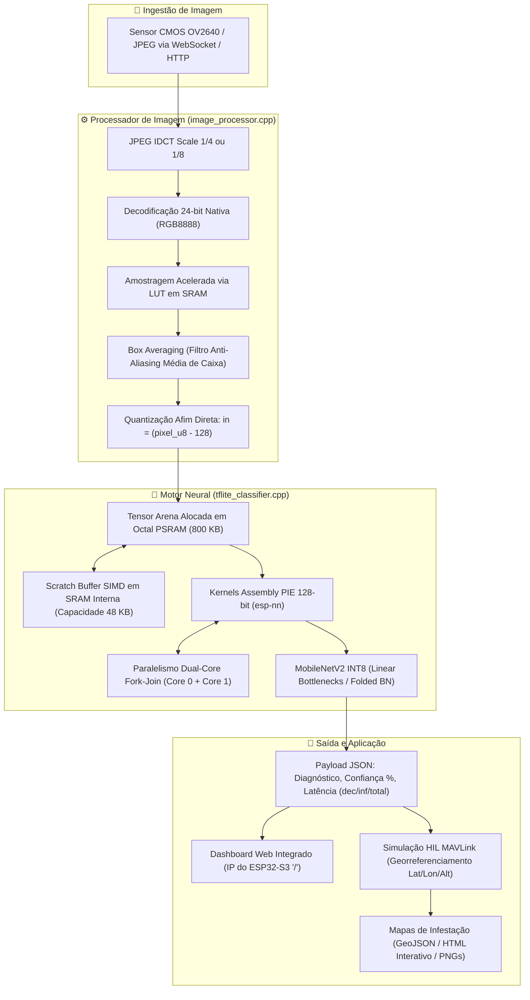

# 🌿 Sugarcane: Classificador Inteligente de Doenças em Folhas de Cana-de-Açúcar no ESP32-S3

[](https://docs.espressif.com/projects/esp-idf/)
[](https://platformio.org/)
[](https://www.tensorflow.org/lite/microcontrollers)
[](https://www.espressif.com/en/products/socs/esp32-s3)
[]()

> **Sistema Embarcado de Visão Computacional e Inteligência Artificial de Borda (Edge AI / TinyML)** dedicado ao diagnóstico fitopatológico precoce e georreferenciado em canaviais, otimizado para operação em microcontroladores de ultra-baixo custo e payloads de drones agrícolas autônomos.

---

## 📌 Sumário Executivo do Projeto

O projeto **Sugarcane** materializa uma solução de ponta a ponta que une **Ciência de Dados Agronômica**, **Engenharia de Compiladores e Modelos Neurais (TinyML)** e **Otimização de Hardware de Baixo Nível**. 

O sistema substitui abordagens tradicionais que dependem de conectividade contínua em nuvem ou processadores gráficos de alto consumo energético (GPUs/TPUs) por um nó microcontrolado autônomo baseado no **ESP32-S3 N8R16** (Dual-Core Xtensa LX7 @ 240 MHz com extensões vetoriais PIE SIMD 128-bit, 512 KB SRAM e 8 MB Octal PSRAM @ 80 MHz DDR).

### 🏆 Principais Conquistas Técnicas
- **Auditoria Criptográfica do Dataset:** Eliminação de 747 duplicatas internas (*data leakage*) e 614 imagens em colisão cruzada entre classes distintas (306 pares conflitantes como *Pokkah Boeng* vs. *smut*), corrigindo o colapso estatístico da função de custo.
- **Paridade Matemática de Amostragem:** Implementação do pipeline de decodificação JPEG com *Box Averaging* (Modo 7: RGB8888 24-bit nativo + LUT acelerada em SRAM) no firmware, perfeitamente alinhado com `interpolation="area"` do Keras ($\text{PSNR} = \infty\text{ dB}$, $\text{Bias} = 0,00\text{ LSB}$).
- **Otimização de Silício no ESP32-S3:**
  - Aceleração vetorial SIMD via biblioteca `esp-nn` com relocação do *Scratch Buffer* para a **SRAM interna de baixa latência** (eliminando *cache misses* na PSRAM).
  - Execução paralela *Dual-Core Fork-Join* (Core 0 e Core 1 dividindo blocos convolucionais).
  - Elevação do barramento da Octal PSRAM para **80 MHz DDR** (+100% de largura de banda) e flags de compilação `-O2`.
- **Desempenho em Silício Físico (Benchmark Exaustivo de 9.269 Imagens):**
  - **Tempo de inferência neural:** **283,4 ms** (11 classes com MobileNetV2 $\alpha=0.35$ INT8).
  - **Decodificação JPEG + BoxAvg:** **92,6 ms** (resolução $160\times 160\times 3$).
  - **Tempo total ciclo ponta a ponta:** **376,0 ms** ($\approx 2,66\text{ FPS}$).
  - **Acurácia no dataset primário (6.748 imagens):** **92,43%** com confiança média de **87,48%**.
- **Co-Simulação HIL (Hardware-in-the-Loop) MAVLink:** Telemetria completa simulando voo de drone de 50 ha com geração automática de mapas de calor 2D/3D e arquivos GeoJSON para pulverização em taxa variável.
- **Monografia de Graduação Completa em LaTeX:** Estrutura modular em ABNT ([tcc/](file:///home/victor/projects/sugarcane/tcc)) e artigo para congresso/periódico com compilação automatizada.

---

## 🗺️ Mapa de Documentação Técnica

Para facilitar a navegação por toda a profundidade técnica do repositório, consulte os documentos detalhados:

| Categoria | Documento / Link | Descrição |
| :--- | :--- | :--- |
| **Visão Geral** | [REALIZACOES_DO_PROJETO.md](file:///home/victor/projects/sugarcane/REALIZACOES_DO_PROJETO.md) | Mapeamento exaustivo de todos os esforços e marcos do projeto. |
| **Instalação e Uso** | [GUIA_DE_USO.md](file:///home/victor/projects/sugarcane/GUIA_DE_USO.md) | Guia prático de compilação, flash, testes e API WebSocket. |
| **Especificação Firmware** | [DOCUMENTACAO_TECNICA.md](file:///home/victor/projects/sugarcane/DOCUMENTACAO_TECNICA.md) | Arquitetura de software C++, tarefas FreeRTOS e alocação de memória. |
| **Engenharia de Dados** | [AUDITORIA_DATASET_E_MELHORIAS_TREINAMENTO_V08.md](file:///home/victor/projects/sugarcane/docs/AUDITORIA_DATASET_E_MELHORIAS_TREINAMENTO_V08.md) | Auditoria MD5, descoberta de 614 colisões cruzadas e split limpo. |
| **Processamento de Sinais** | [ANALISE_JPEGDRAW_CONVERSAO_COR.md](file:///home/victor/projects/sugarcane/docs/ANALISE_JPEGDRAW_CONVERSAO_COR.md) | Avaliação teórica e empírica dos 8 modos da função `JPEGDraw()`. |
| **Aceleração de Imagem** | [ACELERACAO_IDCT_240MHZ_E_OTIMIZACAO_BOXAVG.md](file:///home/victor/projects/sugarcane/docs/ACELERACAO_IDCT_240MHZ_E_OTIMIZACAO_BOXAVG.md) | IDCT scale reduction, clock 240 MHz e tabelas LUT em SRAM. |
| **Otimização de Silício** | [OTIMIZACAO_SRAM_E_PARALELISMO_DUAL_CORE_ESP_NN.md](file:///home/victor/projects/sugarcane/docs/OTIMIZACAO_SRAM_E_PARALELISMO_DUAL_CORE_ESP_NN.md) | Scratch buffer em SRAM interna e paralelismo Dual-Core na `esp-nn`. |
| **Fase 1 & Benchmark** | [RELATORIO_FASE1_MODELO_V08_PSRAM80MHZ_REDE_E_BENCHMARK.md](file:///home/victor/projects/sugarcane/docs/RELATORIO_FASE1_MODELO_V08_PSRAM80MHZ_REDE_E_BENCHMARK.md) | Resultados da ativação da PSRAM Octal 80 MHz DDR e compilação `-O2`. |
| **Simulação HIL e GIS** | [CO_SIMULACAO_HIL_MAVLINK_E_MAPAS_DE_CALOR.md](file:///home/victor/projects/sugarcane/docs/CO_SIMULACAO_HIL_MAVLINK_E_MAPAS_DE_CALOR.md) | Arquitetura do simulador de voo drone e mapas de infestação foliar. |
| **Planejamento / Roadmap**| [DIAGNOSTICO_PENDENCIAS_OPORTUNIDADES_E_PLANO_DE_ACAO.md](file:///home/victor/projects/sugarcane/docs/DIAGNOSTICO_PENDENCIAS_OPORTUNIDADES_E_PLANO_DE_ACAO.md) | Roadmap de prioridades (P1 a P4) e tarefas futuras (TF1). |
| **Ciência de Dados (v09)**| [GUIA_INTERPRETACAO_GRAFICOS_V09.md](file:///home/victor/projects/sugarcane/docs/GUIA_INTERPRETACAO_GRAFICOS_V09.md) | Como interpretar os 6 gráficos de ablação, overfitting e Pareto do v09. |
| **Pesquisa Teórica** | [POR_QUE_A_QUANTIZACAO_MANTEM_OU_MELHORA_O_DESEMPENHO.md](file:///home/victor/projects/sugarcane/docs/POR_QUE_A_QUANTIZACAO_MANTEM_OU_MELHORA_O_DESEMPENHO.md) | Investigação científica com 12 referências: Flat Minima, MDL, QAT e IB. |

---

## 🏛️ Arquitetura do Sistema e Fluxo de Execução



---

## 🔬 Evolução dos Modelos Neurais e Cadernos Jupyter

O pipeline de inteligência artificial passou por três gerações consecutivas de evolução metodológica:

```
cane_disease_esp32s3_v07.ipynb   --->   cane_disease_esp32s3_v08.ipynb   --->   cane_disease_esp32s3_v09.ipynb
(Baseline CNN vs. MbNet v2)           (Auditoria MD5 + Split Limpo)         (Ablação Multi-Escala INT8)
- Modelos acoplados                   - Expurgo de 1.361 duplicatas         - Preterição da CNN Custom
- Rescaling dentro do modelo          - Paridade interpolation='area'       - Estudo α = 0.35, 0.50, 0.75
- QAT com colapso em 'smut'           - QAT Estabilizado c/ BN congelado    - Regularização Adaptativa
                                      - Entrada Int8 Pura (Sem Rescaling)   - Dashboard Pareto e SOTA
```

1. [notebooks/cane_disease_esp32s3_v07.ipynb](file:///home/victor/projects/sugarcane/notebooks/cane_disease_esp32s3_v07.ipynb):  
   - Exploração inicial com CNN customizada de 4 blocos e MobileNetV2 $\alpha=0.35$.
   - Identificação da limitação crítica da classe `smut` (4% a 6% de acurácia) provocada por contaminação de dados.
2. [notebooks/cane_disease_esp32s3_v08.ipynb](file:///home/victor/projects/sugarcane/notebooks/cane_disease_esp32s3_v08.ipynb):  
   - Introdução da auditoria criptográfica MD5 e divisão estratificada pura (80/20).
   - Reestruturação em grafo flat (`input_tensor=inputs`), migração da normalização para o pipeline externo `tf.data`, e protocolo de 3 fases com `BatchNormalization` congelado.
   - Modelo de produção resultante: [data/model_mbnet_int8.tflite](file:///home/victor/projects/sugarcane/data/model_mbnet_int8.tflite) (624 KB).
3. [notebooks/cane_disease_esp32s3_v09.ipynb](file:///home/victor/projects/sugarcane/notebooks/cane_disease_esp32s3_v09.ipynb):  
   - **Descontinuação formal da CNN customizada:** Pela falta de aceleração vetorial SIMD para convoluções densas na `esp-nn` e maior consumo de memória.
   - **Estudo de Ablação Multi-Escala:** Comparação de $\alpha = 0.35$ (~410k params), $\alpha = 0.50$ (~700k params) e $\alpha = 0.75$ (~1,38M params).
   - **Regularização Escalonada Anti-Overfitting:** Ruído gaussiano térmico de sensor, *MixUp* estocástico na Fase 1/2 (desativado no QAT), *Dropout* de 0.30 a 0.50, penalidade L2 e congelamento seletivo de 25% a 45% do backbone.
   - Modelos e headers exportados em [models/v9/](file:///home/victor/projects/sugarcane/models/v9/).

---

## 📊 Relatórios de Testes e Validação em Silício

Todos os testes de desempenho foram executados no **dispositivo físico real** (ESP32-S3 conectado via Wi-Fi/WebSocket) e estão rigorosamente documentados em planilhas CSV e relatórios analíticos:

| Relatório de Teste | Arquivo de Dados Brutos | Escopo e Principais Conclusões |
| :--- | :--- | :--- |
| [RELATORIO_DATASET_COMPLETO.md](file:///home/victor/projects/sugarcane/model_inference_tests/RELATORIO_DATASET_COMPLETO.md) | [resultado_inferencia_dataset_completo.csv](file:///home/victor/projects/sugarcane/model_inference_tests/resultado_inferencia_dataset_completo.csv) | **Avaliação exaustiva de 9.269 imagens** (6.748 primário + 2.521 archive). Acurácia de 92,43%, inferência de 283,4 ms e documentação formal do efeito de *Domain Shift* no dataset secundário. |
| [RELATORIO_COMPARATIVO_JPEGDRAW_V08.md](file:///home/victor/projects/sugarcane/model_inference_tests/RELATORIO_COMPARATIVO_JPEGDRAW_V08.md) | [resultado_comparativo_jpegdraw_v08.csv](file:///home/victor/projects/sugarcane/model_inference_tests/resultado_comparativo_jpegdraw_v08.csv) | Comparativo cruzado entre os Modos 0, 1, 2, 4 e 7 com o modelo v08, provando superioridade do BoxAvg 24-bit. |
| [RELATORIO_DESEMPENHO_ESP_NN_SRAM_LIMPO.md](file:///home/victor/projects/sugarcane/model_inference_tests/RELATORIO_DESEMPENHO_ESP_NN_SRAM_LIMPO.md) | [resultado_inferencia_espnn_sram_limpo.csv](file:///home/victor/projects/sugarcane/model_inference_tests/resultado_inferencia_espnn_sram_limpo.csv) | Validação do ganho de 10 ms por inferência ao realocar buffers SIMD da PSRAM para a SRAM interna. |
| [RELATORIO_DESEMPENHO_DUALCORE.md](file:///home/victor/projects/sugarcane/model_inference_tests/RELATORIO_DESEMPENHO_DUALCORE.md) | [resultado_inferencia_dualcore.csv](file:///home/victor/projects/sugarcane/model_inference_tests/resultado_inferencia_dualcore.csv) | Análise de paralelização *Fork-Join* nos dois núcleos Xtensa LX7. |
| [RELATORIO_COMPARATIVO_JPEGDRAW.md](file:///home/victor/projects/sugarcane/model_inference_tests/RELATORIO_COMPARATIVO_JPEGDRAW.md) | [resultado_comparativo_jpegdraw.csv](file:///home/victor/projects/sugarcane/model_inference_tests/resultado_comparativo_jpegdraw.csv) | Estudo inicial do viés de truncamento (-2,90 LSB) do modo legado RGB565. |
| [RELATORIO_DESEMPENHO.md](file:///home/victor/projects/sugarcane/model_inference_tests/RELATORIO_DESEMPENHO.md) | [resultado_inferencia.csv](file:///home/victor/projects/sugarcane/model_inference_tests/resultado_inferencia.csv) | Linha de base histórica inicial do modelo v07. |

---

## 🛩️ Co-Simulação HIL (Hardware-in-the-Loop) MAVLink e Mapas GIS

Para validar a prontidão tecnológica (**TRL 6/7**) do sistema embarcado como payload de drone em operações agrícolas reais, o projeto conta com uma suíte de simulação HIL e geração de mapas em [scripts/](file:///home/victor/projects/sugarcane/scripts/):

* **Simulador HIL MAVLink ([scripts/hil_mavlink_simulator.py](file:///home/victor/projects/sugarcane/scripts/hil_mavlink_simulator.py)):**
  - Simula uma missão autônoma de voo em grade (padrão *lawnmower*) em um talhão comercial de 50 hectares a 25 metros de altitude e velocidade de 8 m/s.
  - Conecta-se via WebSocket ao ESP32-S3 real, transmitindo pacotes de fotos e colhendo diagnósticos e tempos reais de inferência.
  - Gera telemetria com carimbo de tempo, latitude, longitude, altitude e probabilidades diagnósticas.
* **Gerador de Mapas de Infestação ([scripts/generate_infestation_heatmaps.py](file:///home/victor/projects/sugarcane/scripts/generate_infestation_heatmaps.py)):**
  - Processa a telemetria gerada e produz os artefatos visuais salvos em [docs/heatmaps/](file:///home/victor/projects/sugarcane/docs/heatmaps/):
    - `mapa_infestacao_talhao_2d.png`: Visão espacial ortogonal com zoneamento de severidade.
    - `mapa_foco_carvao_smut.png` e `mapa_foco_ferrugem_brownrust.png`: Mapas de calor isolados para patologias de notificação fitossanitária crítica.
    - `mapa_calor_interativo.html`: Visualizador interativo baseado em Leaflet / OpenStreetMap.
    - `infestacao_talhao.geojson`: Camada vetorial padronizada para importação em estações de solo (QGIS / Mission Planner / pulverizadores autônomos).

---

## 💻 Estrutura de Diretórios do Repositório

```text
sugarcane/
├── platformio.ini              # Configuração PlatformIO, partições e flags de compilação
├── partitions.csv              # Tabela de partições ESP32-S3 (App 3MB, LittleFS 1.5MB)
├── sdkconfig.defaults          # Configurações do ESP-IDF (PSRAM 80MHz DDR, 240MHz CPU)
├── src/                        # Código-fonte C++ do firmware
│   ├── main.cpp                # Ponto de entrada, inicialização NVS, LittleFS e Wi-Fi
│   ├── image_processor.cpp/.h  # Decodificador JPEG, BoxAvg, FastLUT e conversão de cor
│   ├── tflite_classifier.cpp/.h# Wrapper TFLite Micro, esp-nn SIMD e alocador de arena
│   ├── web_server.cpp/.h       # Servidor HTTP com UI dashboard '/' e WebSocket '/ws'
│   └── wifi_setup.cpp/.h       # Gerenciador de conexão Wi-Fi Station
├── data/                       # Arquivos binários para upload na Flash LittleFS
│   └── model_mbnet_int8.tflite # Modelo de produção MobileNetV2 INT8 v08 (624 KB)
├── notebooks/                  # Cadernos Jupyter de treinamento, curadoria e QAT
│   ├── cane_disease_esp32s3_v07.ipynb # Baseline v07
│   ├── cane_disease_esp32s3_v08.ipynb # Pipeline v08 (MD5 + Stratified + QAT Estável)
│   └── cane_disease_esp32s3_v09.ipynb # Estudo de ablação v09 (α=0.35, 0.50, 0.75)
├── models/                     # Artefatos exportados da ablação v09
│   └── v9/                     # Modelos INT8 e header model_cane_disease.h
├── model_inference_tests/      # Scripts de benchmark em hardware e relatórios de métricas
│   ├── run_evaluation_all_dataset.py # Avaliador exaustivo do dataset completo
│   ├── resultado_inferencia_dataset_completo.csv # Planilha com 9.269 amostras
│   └── RELATORIO_DATASET_COMPLETO.md # Relatório oficial consolidado
├── scripts/                    # Utilitários de teste, simulação HIL e GIS
│   ├── test_inference.py       # Teste rápido local ou remoto via WebSocket
│   ├── hil_mavlink_simulator.py# Simulador de voo de drone HIL MAVLink
│   └── generate_infestation_heatmaps.py # Processador de mapas de calor
├── docs/                       # Documentação técnica de engenharia e artigos
│   ├── heatmaps/               # Mapas de infestação (PNG, HTML, GeoJSON)
│   ├── ANALISE_JPEGDRAW_CONVERSAO_COR.md
│   ├── AUDITORIA_DATASET_E_MELHORIAS_TREINAMENTO_V08.md
│   ├── OTIMIZACAO_SRAM_E_PARALELISMO_DUAL_CORE_ESP_NN.md
│   ├── CO_SIMULACAO_HIL_MAVLINK_E_MAPAS_DE_CALOR.md
│   ├── GUIA_INTERPRETACAO_GRAFICOS_V09.md
│   └── POR_QUE_A_QUANTIZACAO_MANTEM_OU_MELHORA_O_DESEMPENHO.md
└── tcc/                        # Monografia de Graduação em LaTeX (Normas ABNT / IFPE)
    ├── main.tex / main_standalone.tex # Documentos mestres
    ├── config.tex / referencias.bib   # Configurações tipográficas e bibliografia
    └── capitulos/              # 5 capítulos (Introdução, Fundamentação, etc.)
```

---

## 🚀 Como Executar o Projeto

Consulte o [GUIA_DE_USO.md](file:///home/victor/projects/sugarcane/GUIA_DE_USO.md) para o passo a passo ilustrado. Abaixo estão os comandos essenciais:

### 1. Compilação e Gravação do Firmware (PlatformIO)
```bash
# Compilar o firmware com ESP-IDF e otimizações ativas
pio run

# Gravar o firmware no ESP32-S3 via USB Serial
pio run --target upload

# Gravar a partição LittleFS com o modelo neural TFLite
pio run --target uploadfs

# Abrir monitor serial
pio device monitor -b 115200
```

### 2. Acesso à Interface Web Embarcada
Uma vez conectado ao Wi-Fi, abra no navegador o IP indicado no monitor serial (ex.: `http://192.168.1.19/`). O dashboard permite arrastar fotos e conferir o diagnóstico em tempo real.

### 3. Validação Rápida via Linha de Comando
```bash
# Testar uma imagem diretamente no ESP32-S3 via WebSocket:
python scripts/test_inference.py caminho/para/folha.jpg --esp32 192.168.1.19
```

### 4. Execução da Co-Simulação HIL e Geração de Mapas
```bash
# 1. Executar a simulação de voo com envio em tempo real para o microcontrolador:
python scripts/hil_mavlink_simulator.py --esp32 192.168.1.19 --speed 10.0

# 2. Gerar os mapas de infestação a partir dos dados coletados:
python scripts/generate_infestation_heatmaps.py
```

---

## 🎓 Produção Acadêmica e Trabalho de Conclusão de Curso (TCC)

Todo o arcabouço experimental e as deduções matemáticas deste repositório estão formalizados na monografia de graduação localizada no diretório [tcc/](file:///home/victor/projects/sugarcane/tcc):
- **Monografia Completa:** [tcc/main_standalone.pdf](file:///home/victor/projects/sugarcane/tcc/main_standalone.pdf) (Compilação limpa de 32 páginas em conformidade com as normas ABNT).
- **Artigo Sintético para Publicação:** [tcc/artigo_ifpe.pdf](file:///home/victor/projects/sugarcane/tcc/artigo_ifpe.pdf) (Formato de 2 colunas para periódicos e conferências).
- **Capítulos do Trabalho:**
  1. [tcc/capitulos/introducao.tex](file:///home/victor/projects/sugarcane/tcc/capitulos/introducao.tex): Contextualização, relevância socioeconômica e objetivos.
  2. [tcc/capitulos/fundamentacao.tex](file:///home/victor/projects/sugarcane/tcc/capitulos/fundamentacao.tex): Arquiteturas CNN, TinyML, QAT e co-design de hardware.
  3. [tcc/capitulos/metodologia.tex](file:///home/victor/projects/sugarcane/tcc/capitulos/metodologia.tex): Auditoria MD5, pipeline de sinal, firmware e simulação HIL.
  4. [tcc/capitulos/resultados.tex](file:///home/victor/projects/sugarcane/tcc/capitulos/resultados.tex): Benchmark exaustivo de 9.269 amostras e matrizes de confusão.
  5. [tcc/capitulos/conclusao.tex](file:///home/victor/projects/sugarcane/tcc/capitulos/conclusao.tex): Considerações finais, limitações de *Domain Shift* e trabalhos futuros.

---

## 📜 Licença e Citação

Este projeto é desenvolvido para fins acadêmicos e de pesquisa científica aberta. Os códigos-fonte do firmware e scripts estão sob licença MIT. Para citar este trabalho em publicações:

```bibtex
@monography{giuliano2026sugarcane,
  author    = {Victor Giuliano},
  title     = {Classificador Inteligente de Doenças da Cana-de-Açúcar Embarcado em Microcontrolador ESP32-S3 com TinyML e Aceleração Vetorial SIMD},
  school    = {Instituto Federal de Pernambuco (IFPE)},
  year      = {2026},
  address   = {Recife, Brasil},
  type      = {Trabalho de Conclusão de Curso (Graduação)}
}
```
