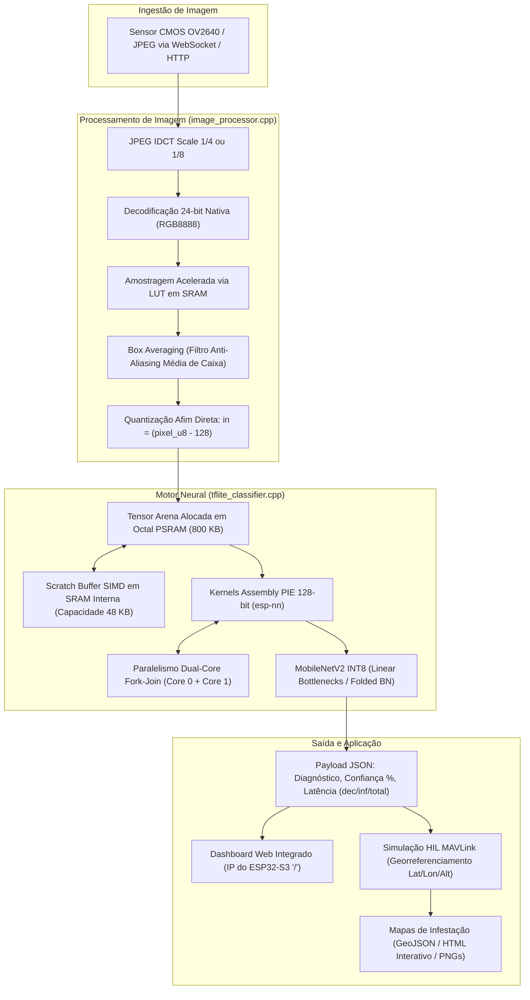

# Sugarcane: Classificador de Doenças em Folhas de Cana-de-Açúcar no ESP32-S3

[](https://docs.espressif.com/projects/esp-idf/)
[](https://platformio.org/)
[](https://www.tensorflow.org/lite/microcontrollers)
[](https://www.espressif.com/en/products/socs/esp32-s3)
[]()

> Sistema Embarcado de Visão Computacional e Inteligência Artificial de Borda (Edge AI / TinyML) dedicado ao diagnóstico fitopatológico precoce e georreferenciado em canaviais, otimizado para operação em microcontroladores de baixo custo e integração como payload em veículos aéreos não tripulados (VANTs / drones agrícolas).

---

## Autoria e Identificação Institucional

Este projeto constitui o Trabalho de Conclusão de Curso (TCC) desenvolvido por:

* **Autor:** Victor Giuliano de Freitas Silva
* **Curso:** Tecnologia em Análise e Desenvolvimento de Sistemas (TADS)
* **Instituição:** Instituto Federal de Educação, Ciência e Tecnologia de Pernambuco (IFPE) — Campus Paulista
* **Contato Institucional / Acadêmico:** [email](mailto:victor.giuliano@ufpe.br)

O trabalho engloba pesquisa teórica, curadoria e auditoria criptográfica de dados, treinamento e quantização de redes neurais profundas, engenharia de compiladores e otimização de baixo nível em arquitetura computacional microcontrolada.

---

## 1. Sumário Executivo do Projeto

O projeto **Sugarcane** materializa uma solução tecnológica integral que conecta Ciência de Dados Agronômica, Engenharia de Modelos Neurais Compactos (TinyML) e Otimização de Hardware de Baixo Nível. 

A arquitetura proposta substitui paradigmas convencionais — dependentes de conectividade de rede contínua para computação em nuvem ou processadores gráficos de elevado consumo de energia (GPUs/TPUs) — por um nó microcontrolado totalmente autônomo baseado no **ESP32-S3 N8R16** (Dual-Core Xtensa LX7 a 240 MHz, extensões vetoriais PIE SIMD de 128 bits, 512 KB de SRAM interna e 8 MB de Octal PSRAM operando a 80 MHz DDR).

### Principais Conquistas Técnicas
* **Auditoria Criptográfica do Dataset:** Identificação e expurgo de 747 duplicatas internas (*data leakage*) e 614 imagens com colisão cruzada de rótulos entre classes distintas (306 pares conflitantes, como *Pokkah Boeng* vs. *smut*), sanando o colapso estatístico da função de custo.
* **Paridade Matemática de Amostragem:** Implementação do pipeline de decodificação JPEG com filtro de Média de Caixa (*Box Averaging*) em 24 bits nativos (RGB8888) e tabela de consulta (*Look-Up Table* - LUT) em SRAM, garantindo equivalência exata à função `interpolation="area"` do Keras ($\text{PSNR} = \infty\text{ dB}$, $\text{Bias} = 0,00\text{ LSB}$).
* **Otimização de Silício no ESP32-S3:**
  * Aceleração vetorial SIMD por meio da biblioteca `esp-nn`, com alocação do *Scratch Buffer* temporário na **SRAM interna de baixa latência** (eliminando faltas de cache na PSRAM externa).
  * Execução paralela *Dual-Core Fork-Join* (divisão de blocos de filtros convolucionais entre o Core 0 e o Core 1).
  * Ajuste do barramento da Octal PSRAM para **80 MHz DDR** (+100% de largura de banda) e compilação em nível `-O2`.
* **Desempenho em Silício Físico (Benchmark de 9.269 Imagens):**
  * **Tempo de inferência neural:** **283,4 ms** (11 classes com MobileNetV2 $\alpha=0.35$ quantizada em INT8).
  * **Decodificação JPEG + BoxAvg:** **92,6 ms** (resolução de $160\times 160\times 3$).
  * **Tempo total do ciclo:** **376,0 ms** ($\approx 2,66\text{ FPS}$).
  * **Acurácia no dataset primário (6.748 imagens):** **92,43%** com índice médio de confiança de **87,48%**.
* **Co-Simulação Hardware-in-the-Loop (HIL) MAVLink:** Telemetria simulando voo autônomo em grade sobre talhão comercial de 50 hectares, com exportação automática de mapas de calor 2D/3D e camadas vetoriais GeoJSON para pulverização em taxa variável.
* **Monografia Acadêmica em LaTeX:** Estrutura modular em conformidade com as normas da ABNT ([tcc/](file:///home/victor/projects/sugarcane/tcc)) e artigo para publicação científica com compilação automatizada.

---

## 2. Mapa de Documentação Técnica

A documentação do repositório está subdividida conforme as áreas de concentração da pesquisa e do desenvolvimento:

| Categoria | Documento / Link | Descrição |
| :--- | :--- | :--- |
| **Visão Geral** | [REALIZACOES_DO_PROJETO.md](file:///home/victor/projects/sugarcane/REALIZACOES_DO_PROJETO.md) | Mapeamento exaustivo de todos os esforços e marcos de engenharia do projeto. |
| **Instalação e Uso** | [GUIA_DE_USO.md](file:///home/victor/projects/sugarcane/GUIA_DE_USO.md) | Guia prático de compilação, gravação de firmware, testes locais e comunicação WebSocket. |
| **Especificação Firmware** | [DOCUMENTACAO_TECNICA.md](file:///home/victor/projects/sugarcane/DOCUMENTACAO_TECNICA.md) | Arquitetura de software C++, tarefas FreeRTOS e alocação de memória. |
| **Engenharia de Dados** | [AUDITORIA_DATASET_E_MELHORIAS_TREINAMENTO_V08.md](file:///home/victor/projects/sugarcane/docs/AUDITORIA_DATASET_E_MELHORIAS_TREINAMENTO_V08.md) | Auditoria por hash MD5, descoberta de 614 colisões cruzadas e particionamento limpo. |
| **Processamento de Sinais** | [ANALISE_JPEGDRAW_CONVERSAO_COR.md](file:///home/victor/projects/sugarcane/docs/ANALISE_JPEGDRAW_CONVERSAO_COR.md) | Avaliação teórica e empírica das variantes da função `JPEGDraw()`. |
| **Aceleração de Imagem** | [ACELERACAO_IDCT_240MHZ_E_OTIMIZACAO_BOXAVG.md](file:///home/victor/projects/sugarcane/docs/ACELERACAO_IDCT_240MHZ_E_OTIMIZACAO_BOXAVG.md) | Redução de escala via IDCT, frequência de 240 MHz e tabelas LUT em SRAM. |
| **Otimização de Silício** | [OTIMIZACAO_SRAM_E_PARALELISMO_DUAL_CORE_ESP_NN.md](file:///home/victor/projects/sugarcane/docs/OTIMIZACAO_SRAM_E_PARALELISMO_DUAL_CORE_ESP_NN.md) | Scratch buffer na SRAM interna e paralelismo Dual-Core na biblioteca `esp-nn`. |
| **Fase 1 e Benchmark** | [RELATORIO_FASE1_MODELO_V08_PSRAM80MHZ_REDE_E_BENCHMARK.md](file:///home/victor/projects/sugarcane/docs/RELATORIO_FASE1_MODELO_V08_PSRAM80MHZ_REDE_E_BENCHMARK.md) | Avaliação da ativação da PSRAM Octal a 80 MHz DDR e compilação `-O2`. |
| **Benchmark 132 Amostras** | [RELATORIO_BENCHMARK_132_AMOSTRAS.md](file:///home/victor/projects/sugarcane/docs/RELATORIO_BENCHMARK_132_AMOSTRAS.md) | Relatório comparativo de 132 amostras no hardware físico com SRAM interna e Fork-Join esp-nn. |
| **Fase 2 e Telemetria** | [RELATORIO_FASE2_DASHBOARD_WEB_VUE_E_TELEMETRIA.md](file:///home/victor/projects/sugarcane/docs/RELATORIO_FASE2_DASHBOARD_WEB_VUE_E_TELEMETRIA.md) | Homologação em silício físico da SPA Vue.js 3, concorrência thread-safe e LittleFS. |
| **Dashboard & Web SPA** | [ESPECIFICACAO_DASHBOARD_WEB_VUE_E_TELEMETRIA_ESP32S3.md](file:///home/victor/projects/sugarcane/docs/ESPECIFICACAO_DASHBOARD_WEB_VUE_E_TELEMETRIA_ESP32S3.md) | Especificação técnica do dashboard Vue.js 3 embarcado no LittleFS, telemetria 1Hz, rede híbrida e mDNS. |
| **Simulação HIL e SIG** | [CO_SIMULACAO_HIL_MAVLINK_E_MAPAS_DE_CALOR.md](file:///home/victor/projects/sugarcane/docs/CO_SIMULACAO_HIL_MAVLINK_E_MAPAS_DE_CALOR.md) | Arquitetura da co-simulação de voo e geração de mapas de infestação foliar. |
| **Planejamento / Roadmap**| [DIAGNOSTICO_PENDENCIAS_OPORTUNIDADES_E_PLANO_DE_ACAO.md](file:///home/victor/projects/sugarcane/docs/DIAGNOSTICO_PENDENCIAS_OPORTUNIDADES_E_PLANO_DE_ACAO.md) | Roadmap de prioridades (P1 a P4) e tarefas de continuidade (TF1). |
| **Ciência de Dados (v09)**| [GUIA_INTERPRETACAO_GRAFICOS_V09.md](file:///home/victor/projects/sugarcane/docs/GUIA_INTERPRETACAO_GRAFICOS_V09.md) | Análise técnica dos 6 gráficos analíticos de ablação, overfitting e Pareto do v09. |
| **Pesquisa Teórica** | [POR_QUE_A_QUANTIZACAO_MANTEM_OU_MELHORA_O_DESEMPENHO.md](file:///home/victor/projects/sugarcane/docs/POR_QUE_A_QUANTIZACAO_MANTEM_OU_MELHORA_O_DESEMPENHO.md) | Fundamentação científica com 12 referências: Flat Minima, MDL, QAT e Gargalo de Informação. |
| **Rigor Estatístico** | [ROBUSTEZ_ESTATISTICA_E_SEMENTES_ALEATORIAS.md](file:///home/victor/projects/sugarcane/docs/ROBUSTEZ_ESTATISTICA_E_SEMENTES_ALEATORIAS.md) | Análise de variância estocástica, impacto de sementes e intervalo de confiança da acurácia. |
| **Mundo Aberto & OOD** | [ESTUDO_TECNICO_SUPOSICAO_MUNDO_FECHADO_E_OOD_CANAVIAL.md](file:///home/victor/projects/sugarcane/docs/ESTUDO_TECNICO_SUPOSICAO_MUNDO_FECHADO_E_OOD_CANAVIAL.md) | Estudo sobre mundo fechado, dados OOD (não-cana) e estratégias de triagem (ExG e 12ª classe). |

---

## 3. Arquitetura do Sistema e Fluxo de Execução



---

## 4. Evolução dos Modelos Neurais e Cadernos Jupyter

O desenvolvimento dos classificadores neurais baseou-se em três etapas metodológicas estruturadas:

1. [notebooks/cane_disease_esp32s3_v07.ipynb](file:///home/victor/projects/sugarcane/notebooks/cane_disease_esp32s3_v07.ipynb):  
   * Exploração comparativa entre uma CNN customizada sequencial de 4 blocos e a MobileNetV2 $\alpha=0.35$.
   * Diagnóstico do problema da classe `smut` (acurácia restrita a 4% a 6%) decorrente de contaminação cruzada no repositório original.
2. [notebooks/cane_disease_esp32s3_v08.ipynb](file:///home/victor/projects/sugarcane/notebooks/cane_disease_esp32s3_v08.ipynb):  
   * Introdução da auditoria por MD5 e criação de particionamento estratificado sem vazamento de dados (80% treino / 20% validação).
   * Construção em grafo plano (`input_tensor=inputs`), migração da normalização para o pipeline externo `tf.data` e protocolo de treinamento em 3 fases com `BatchNormalization` congelado.
   * Binário de produção gerado: [data/model_mbnet_int8.tflite](file:///home/victor/projects/sugarcane/data/model_mbnet_int8.tflite) (624 KB).
3. [notebooks/cane_disease_esp32s3_v09.ipynb](file:///home/victor/projects/sugarcane/notebooks/cane_disease_esp32s3_v09.ipynb):  
   * **Descontinuação da CNN Customizada:** Justificada pela ausência de suporte a instruções SIMD para convoluções densas na biblioteca `esp-nn` e pelo maior consumo de memória.
   * **Estudo de Ablação Multi-Escala:** Avaliação sistemática de $\alpha = 0.35$ (~410k parâmetros), $\alpha = 0.50$ (~700k parâmetros) e $\alpha = 0.75$ (~1,38M parâmetros).
   * **Estratégias de Regularização Adaptativa:** Injeção de ruído gaussiano (simulando ruído térmico de sensor), *MixUp* na Fase 1 e 2, *Dropout* escalonado (0.30 a 0.50), regularização L2 e congelamento seletivo de 25% a 45% das camadas do extrator.
   * Modelos e arquivos de cabeçalho exportados disponíveis em [models/v9/](file:///home/victor/projects/sugarcane/models/v9/).

---

## 5. Relatórios de Testes e Validação em Silício

Os ensaios de desempenho foram realizados no **dispositivo físico real** (ESP32-S3 interconectado via Wi-Fi/WebSocket), com os registros documentados em relatórios técnicos e planilhas de dados:

| Relatório de Teste | Arquivo de Dados Brutos | Escopo e Principais Conclusões |
| :--- | :--- | :--- |
| [RELATORIO_DATASET_COMPLETO.md](file:///home/victor/projects/sugarcane/model_inference_tests/RELATORIO_DATASET_COMPLETO.md) | [resultado_inferencia_dataset_completo.csv](file:///home/victor/projects/sugarcane/model_inference_tests/resultado_inferencia_dataset_completo.csv) | **Avaliação exaustiva de 9.269 imagens** (6.748 primárias + 2.521 do conjunto de arquivo). Acurácia de 92,43%, latência de 283,4 ms e caracterização formal do Deslocamento de Domínio (*Domain Shift*). |
| [RELATORIO_COMPARATIVO_JPEGDRAW_V08.md](file:///home/victor/projects/sugarcane/model_inference_tests/RELATORIO_COMPARATIVO_JPEGDRAW_V08.md) | [resultado_comparativo_jpegdraw_v08.csv](file:///home/victor/projects/sugarcane/model_inference_tests/resultado_comparativo_jpegdraw_v08.csv) | Comparativo experimental entre os Modos 0, 1, 2, 4 e 7 sob o modelo v08, comprovando a eficácia do BoxAvg em 24 bits. |
| [RELATORIO_DESEMPENHO_ESP_NN_SRAM_LIMPO.md](file:///home/victor/projects/sugarcane/model_inference_tests/RELATORIO_DESEMPENHO_ESP_NN_SRAM_LIMPO.md) | [resultado_inferencia_espnn_sram_limpo.csv](file:///home/victor/projects/sugarcane/model_inference_tests/resultado_inferencia_espnn_sram_limpo.csv) | Mensuração do ganho de aproximadamente 10 ms por inferência obtido ao realocar os buffers da PSRAM para a SRAM interna. |
| [RELATORIO_DESEMPENHO_DUALCORE.md](file:///home/victor/projects/sugarcane/model_inference_tests/RELATORIO_DESEMPENHO_DUALCORE.md) | [resultado_inferencia_dualcore.csv](file:///home/victor/projects/sugarcane/model_inference_tests/resultado_inferencia_dualcore.csv) | Análise da divisão paralela de trabalho (*Fork-Join*) entre os dois núcleos Xtensa LX7. |
| [RELATORIO_COMPARATIVO_JPEGDRAW.md](file:///home/victor/projects/sugarcane/model_inference_tests/RELATORIO_COMPARATIVO_JPEGDRAW.md) | [resultado_comparativo_jpegdraw.csv](file:///home/victor/projects/sugarcane/model_inference_tests/resultado_comparativo_jpegdraw.csv) | Diagnóstico do viés sistemático de truncamento (-2,90 LSB) presente no método legado RGB565. |
| [RELATORIO_DESEMPENHO.md](file:///home/victor/projects/sugarcane/model_inference_tests/RELATORIO_DESEMPENHO.md) | [resultado_inferencia.csv](file:///home/victor/projects/sugarcane/model_inference_tests/resultado_inferencia.csv) | Medições da linha de base inicial do modelo v07. |

---

## 6. Co-Simulação Hardware-in-the-Loop (HIL) MAVLink e Mapas SIG

Para atestar a viabilidade do sistema como carga útil de sensoriamento remoto agrícola (**Nível de Maturidade Tecnológica - TRL 6/7**), desenvolveu-se uma infraestrutura de co-simulação localizada no diretório [scripts/](file:///home/victor/projects/sugarcane/scripts/):

* **Simulador HIL MAVLink ([scripts/hil_mavlink_simulator.py](file:///home/victor/projects/sugarcane/scripts/hil_mavlink_simulator.py)):**
  * Reproduz o perfil de missão de um quadricóptero autônomo sobrevoando um talhão de 50 hectares (velocidade de 5,0 m/s a 15 metros de altitude AGL).
  * Envia pacotes MAVLink (`HEARTBEAT`, `GLOBAL_POSITION_INT`, `ATTITUDE`) via porta UDP 14550 para estações de controle em terra (QGroundControl / Mission Planner).
  * Executa a rotina operacional de parada momentânea para captura estável de imagem (*Pause-and-Classify*), transmitindo as amostras ao ESP32-S3 via WebSocket e registrando os diagnósticos georreferenciados.
* **Gerador Cartográfico de Infestação ([scripts/generate_infestation_heatmaps.py](file:///home/victor/projects/sugarcane/scripts/generate_infestation_heatmaps.py)):**
  * Processa a série temporal de telemetria e gera os produtos cartográficos arquivados em [docs/heatmaps/](file:///home/victor/projects/sugarcane/docs/heatmaps/):
    * `mapa_infestacao_talhao_2d.png`: Painel geral com interpolação contínua (KDE 2D) e zonas de severidade.
    * `mapa_foco_carvao_smut.png` e `mapa_foco_ferrugem_brownrust.png`: Mapas de calor temáticos para doenças de quarentena fitossanitária crítica.
    * `mapa_calor_interativo.html`: Painel interativo com base cartográfica OpenStreetMap / Leaflet.
    * `infestacao_talhao.geojson`: Camada espacial vetorial normalizada (RFC 7946 / EPSG:4326) pronta para ingestão em softwares SIG (QGIS, ArcGIS) e maquinário agrícola de aplicação variável.

---

## 7. Estrutura de Diretórios do Projeto

```text
sugarcane/
├── platformio.ini              # Configuração do PlatformIO, partições e diretivas de compilação
├── partitions.csv              # Tabela de partições do ESP32-S3 (App: 3MB, LittleFS: 1.5MB)
├── sdkconfig.defaults          # Parâmetros base do ESP-IDF (PSRAM 80MHz DDR, CPU a 240MHz)
├── src/                        # Código-fonte em C++ do firmware embarcado
│   ├── main.cpp                # Inicialização de subsistemas (NVS, LittleFS, Wi-Fi, Tarefas)
│   ├── image_processor.cpp/.h  # Decodificação JPEG, BoxAvg, tabelas FastLUT e rotinas de cor
│   ├── tflite_classifier.cpp/.h# Integração TFLite Micro, aceleração esp-nn SIMD e alocador
│   ├── web_server.cpp/.h       # Servidor HTTP/WebSocket com dashboard '/' e endpoint '/ws'
│   └── wifi_setup.cpp/.h       # Configuração e monitoramento do enlace Wi-Fi Station
├── data/                       # Arquivos gravados na partição LittleFS da memória Flash
│   └── model_mbnet_int8.tflite # Modelo neural MobileNetV2 INT8 v08 compilado (624 KB)
├── notebooks/                  # Cadernos Jupyter de experimentação, limpeza e treino QAT
│   ├── cane_disease_esp32s3_v07.ipynb # Baseline v07
│   ├── cane_disease_esp32s3_v08.ipynb # Pipeline v08 (Auditoria MD5, Split Estratificado)
│   └── cane_disease_esp32s3_v09.ipynb # Estudo de ablação v09 (α=0.35, 0.50 e 0.75)
├── models/                     # Modelos gerados e cabeçalhos C++ derivados da versão v09
│   └── v9/                     # Binários INT8 e cabeçalho model_cane_disease.h
├── model_inference_tests/      # Scripts de avaliação em hardware e documentação de ensaios
│   ├── run_evaluation_all_dataset.py # Executador do teste exaustivo de 9.269 amostras
│   ├── resultado_inferencia_dataset_completo.csv # Tabela com os dados brutos medidos
│   └── RELATORIO_DATASET_COMPLETO.md # Relatório técnico consolidado
├── scripts/                    # Scripts utilitários de inferência, teste HIL e geração SIG
│   ├── test_inference.py       # Validador de inferência (execução local ou via WebSocket)
│   ├── hil_mavlink_simulator.py# Emulador de voo e telemetria HIL via protocolo MAVLink
│   └── generate_infestation_heatmaps.py # Gerador de mapas de calor e dados GeoJSON
├── docs/                       # Artigos técnicos e documentação de suporte
│   ├── heatmaps/               # Produtos cartográficos gerados (PNG, HTML, GeoJSON)
│   ├── ANALISE_JPEGDRAW_CONVERSAO_COR.md
│   ├── AUDITORIA_DATASET_E_MELHORIAS_TREINAMENTO_V08.md
│   ├── OTIMIZACAO_SRAM_E_PARALELISMO_DUAL_CORE_ESP_NN.md
│   ├── CO_SIMULACAO_HIL_MAVLINK_E_MAPAS_DE_CALOR.md
│   ├── GUIA_INTERPRETACAO_GRAFICOS_V09.md
│   └── POR_QUE_A_QUANTIZACAO_MANTEM_OU_MELHORA_O_DESEMPENHO.md
└── tcc/                        # Monografia de Graduação em LaTeX (Normas ABNT / IFPE)
    ├── main.tex / main_standalone.tex # Arquivos-fonte mestres
    ├── config.tex / referencias.bib   # Configurações tipográficas e referências bibliográficas
    └── capitulos/              # Capítulos textuais (Introdução, Metodologia, Resultados, etc.)
```

---

## 8. Procedimentos de Execução

Orientações detalhadas de bancada podem ser consultadas em [GUIA_DE_USO.md](file:///home/victor/projects/sugarcane/GUIA_DE_USO.md). Os passos operacionais essenciais são descritos a seguir:

### Compilação e Gravação do Firmware (PlatformIO)
```bash
# Compilação do firmware sob as configurações do ESP-IDF
pio run

# Gravação do binário principal na memória Flash do microcontrolador
pio run --target upload

# Gravação da imagem LittleFS contendo o modelo neural TFLite
pio run --target uploadfs

# Abertura do terminal serial de depuração
pio device monitor -b 115200
```

### Interface de Diagnóstico Web
Ao estabelecer conexão Wi-Fi, o dispositivo expõe seu endereço IP local (por exemplo, `http://192.168.1.19/`). O painel integrado permite o envio de imagens via navegador e a inspeção das latências de decodificação e classificação.

### Teste de Inferência via Linha de Comando
```bash
# Execução de inferência direta no ESP32-S3 via WebSocket:
python scripts/test_inference.py caminho/para/amostra.jpg --esp32 192.168.1.19
```

### Execução da Simulação HIL e Geração Cartográfica
```bash
# 1. Início da missão simulada com transmissão em tempo real ao dispositivo:
python scripts/hil_mavlink_simulator.py --esp32 192.168.1.19 --speed 10.0

# 2. Processamento dos dados georreferenciados e geração dos mapas:
python scripts/generate_infestation_heatmaps.py
```

---

## 9. Produção Acadêmica e Trabalho de Conclusão de Curso (TCC)

Todo o arcabouço metodológico, modelagem matemática e resultados empíricos estão consolidados na monografia mantida no diretório [tcc/](file:///home/victor/projects/sugarcane/tcc):
* **Monografia Acadêmica Completa:** [tcc/main_standalone.pdf](file:///home/victor/projects/sugarcane/tcc/main_standalone.pdf) (Documento estruturado conforme as normas da ABNT).
* **Artigo Científico:** [tcc/artigo_ifpe.pdf](file:///home/victor/projects/sugarcane/tcc/artigo_ifpe.pdf) (Síntese no formato padrão de periódicos e conferências).
* **Capítulos Estruturantes:**
  1. [tcc/capitulos/introducao.tex](file:///home/victor/projects/sugarcane/tcc/capitulos/introducao.tex): Contextualização socioeconômica da agroindústria sucroalcooleira e objetivos.
  2. [tcc/capitulos/fundamentacao.tex](file:///home/victor/projects/sugarcane/tcc/capitulos/fundamentacao.tex): Convoluções separáveis, quantização INT8, TinyML e arquitetura ESP32-S3.
  3. [tcc/capitulos/metodologia.tex](file:///home/victor/projects/sugarcane/tcc/capitulos/metodologia.tex): Auditoria criptográfica, decodificador com BoxAvg e protocolo HIL.
  4. [tcc/capitulos/resultados.tex](file:///home/victor/projects/sugarcane/tcc/capitulos/resultados.tex): Análise de desempenho em 9.269 imagens, tempos on-chip e matrizes de confusão.
  5. [tcc/capitulos/conclusao.tex](file:///home/victor/projects/sugarcane/tcc/capitulos/conclusao.tex): Considerações finais, diagnóstico de Deslocamento de Domínio e trabalhos futuros.

---

## 10. Referência e Citação

Este trabalho é disponibilizado sob os termos da Licença MIT para os códigos-fonte e materiais associados. Para citação formal:

```bibtex
@monography{silva2026sugarcane,
  author    = {Silva, Victor Giuliano de Freitas},
  title     = {Classificador Inteligente de Doenças da Cana-de-Açúcar Embarcado em Microcontrolador ESP32-S3 com TinyML e Aceleração Vetorial SIMD},
  school    = {Instituto Federal de Educação, Ciência e Tecnologia de Pernambuco (IFPE) --- Campus Paulista},
  year      = {2026},
  address   = {Paulista, PE, Brasil},
  type      = {Trabalho de Conclusão de Curso (Tecnologia em Análise e Desenvolvimento de Sistemas)}
}
```
