# Histórico Consolidado e Timeline Completa da Aplicação — Projeto Sugarcane (ESP32-S3)

**Projeto:** Classificador Inteligente de Doenças da Cana-de-Açúcar Embarcado em ESP32-S3 (*Edge AI / TinyML*)  
**Escopo da Consolidação:** Auditoria integral de **26 documentos Markdown (`.md`)**, **52 commits no Git** (`bee0b70` $\rightarrow$ `2f11517`), **3 notebooks de treinamento** (`v07`, `v08`, `v09`), **4 binários quantizados INT8** e **10 baterias experimentais** (host, silício físico e co-simulação HIL).  
**Período Coberto pelo Histórico Git e Ensaios:** `06/11/2026 15:38` a `09/11/2026 20:39`  
**Autor do Projeto:** Victor Giuliano de Freitas Silva (TADS — IFPE Campus Paulista)

---

## Sumário

1. [Visão Panorâmica da Evolução (Mapa Visual e Tabela Cronológica Mestra)](#1-visão-panorâmica-da-evolução-mapa-visual-e-tabela-cronológica-mestra)
2. [Cronologia Detalhada por Fase de Desenvolvimento](#2-cronologia-detalhada-por-fase-de-desenvolvimento)
3. [Evolução por Eixo Técnico](#3-evolução-por-eixo-técnico)
   - [3.1. Modelos de CNN, Trocas de Arquitetura e Treinamento (`v07` → `v08` → `v09`)](#31-modelos-de-cnn-trocas-de-arquitetura-e-treinamento-v07--v08--v09)
   - [3.2. Algoritmos de Processamento de Imagem (`JPEGDraw`, Conversão de Cor, BoxAvg e IDCT)](#32-algoritmos-de-processamento-de-imagem-jpegdraw-conversão-de-cor-boxavg-e-idct)
   - [3.3. Arquitetura de Hardware, Memória, Concorrência e Subsistema Web/Rede](#33-arquitetura-de-hardware-memória-concorrência-e-subsistema-webrede)
   - [3.4. Quadro Unificado de Todos os Testes e Benchmarks](#34-quadro-unificado-de-todos-os-testes-e-benchmarks)
4. [Auditoria Crítica da Documentação (Divergências Detectadas via Git e Binários)](#4-auditoria-crítica-da-documentação-divergências-detectadas-via-git-e-binários)
5. [Estado Atual Consolidado e Roadmap Futuro](#5-estado-atual-consolidado-e-roadmap-futuro)
6. [Índice Geral dos Documentos `.md` Auditados](#6-índice-geral-dos-documentos-md-auditados)

---

## 1. Visão Panorâmica da Evolução (Mapa Visual e Tabela Cronológica Mestra)

A aplicação evoluiu ao longo de **8 grandes fases contínuas**, saindo de um protótipo sequencial em *Single-Core* (`1.440,6 ms` no chip, `0,63 img/s`, classe `smut` colapsada em `6,0%`) até um sistema embarcado autônomo completo com paralelismo híbrido em 2 níveis, PSRAM a 80 MHz DDR, paridade matemática de amostragem (`PSNR = ∞ dB`), validação HIL MAVLink, SPA em Vue.js 3 servida do LittleFS, rede híbrida STA/SoftAP com mDNS e telemetria térmica contínua (`376,0 ms` no chip, `1,77 img/s` em lote, `89,82%` no hardware em amostras limpas e `smut` recuperada para `84,0%`).

```mermaid
flowchart TD
    F1["<b>Fase 1 (06/11 15h38–18h42)</b><br/>Fundação ESP-IDF/PlatformIO + Modelo v07<br/>Single-Core (14,5 min) -> Pipeline Dual-Core (9,6 min)<br/>Descoberta do colapso de smut (6%)"]
    F2["<b>Fase 2 (06/11 19h14–20h53)</b><br/>Auditoria de 8 modos JPEGDraw (4.400 inf.)<br/>Duelo CNN Custom vs MobileNetV2 (v07)<br/>Auditoria MD5 (6.748 imgs) -> Notebook v08"]
    F3["<b>Fase 3 (07/11 06h06–12h12)</b><br/>Validação v08 (13.104 inf.): Modo 7 vence (91,09%)<br/>LUT SRAM + Scratch 48KB/25KB SRAM + Fork-Join esp-nn<br/>Patch Stem 3x3 + SKIP_NUDGE + Doc Técnica"]
    F4["<b>Fase 4 (07/11 18h19–20h19)</b><br/>Clock 160->240 MHz + IDCT Scale 1/4 e 1/2<br/>Inf: 336ms | Dec: 145ms<br/>Diagnóstico: Flash ainda com v07 + Wi-Fi Modem Sleep"]
    F5["<b>Fase 5 (08/11 06h03–10h32)</b><br/>Uploadfs v08 + PSRAM 80MHz DDR + -O2 + BoxAcc 8B<br/>WIFI_PS_NONE + lru_purge -> Inf: 283,4ms | Dec: 92–102ms<br/>Stress Test 9.269 imgs (1h34) e prova de Domain Shift"]
    F6["<b>Fase 6 (08/11 10h32–13h04)</b><br/>Ablação v09 (MobileNetV2 α=0.35 / 0.50 / 0.75)<br/>Co-Simulação HIL MAVLink (55 WPs) + Mapas SIG<br/>Estudos Teóricos (INT8, Seeds) + Monografia TCC LaTeX"]
    F7["<b>Fase 7 (08/11 14h26–21h04)</b><br/>Dashboard SPA Vue 3 (89,1 KB Gzip em LittleFS)<br/>Rede Híbrida STA/SoftAP + mDNS + Telemetria 1Hz + CSV<br/>Mutex s_ws_mutex + Benchmark 132 amostras + Estudo OOD"]
    F8["<b>Fase 8 (09/11 06h48–20h39)</b><br/>OpenStreetMap vetorial como mapa padrão<br/>Rebuild assets Gzip LittleFS<br/>Consolidação da cronologia de testes"]

    F1 --> F2 --> F3 --> F4 --> F5 --> F6 --> F7 --> F8
```

### Tabela Cronológica Mestra (Git + Experimentos + Documentação)

| Data / Hora           | Fase | Commits Git                                                                            | Eixo Principal                | Marco Realizado                                                                                                                                                                                                                                                                                                                             | Referências Documentais / Artefatos                                                                                                                                                                                                                                                                                                                                                                                                                                                                                |
| :-------------------- | :--: | :------------------------------------------------------------------------------------- | :---------------------------- | :------------------------------------------------------------------------------------------------------------------------------------------------------------------------------------------------------------------------------------------------------------------------------------------------------------------------------------------ | :----------------------------------------------------------------------------------------------------------------------------------------------------------------------------------------------------------------------------------------------------------------------------------------------------------------------------------------------------------------------------------------------------------------------------------------------------------------------------------------------------------------- |
| **06/11 15:38**       |  F1  | `bee0b70`, `998e504`, `834cb8c`, `c18ed38`                                             | Firmware / Teste              | **Teste 1 (Single-Core Sequencial, `v07`):** 550 fotos brutas; `Inf 626,6 ms`, `Dec 814,0 ms`, `82,55%` acc, `smut` em `6,0%` (`3/50`).                                                                                                                                                                                                     | [RELATORIO_DESEMPENHO.md](../05_testes_de_desempenho/01_BENCHMARK_BASELINE_SINGLE_CORE_V07_550.md), [GUIA_DE_USO.md](04_GUIA_DE_USO_E_OPERACAO.md)                                                                                                                                                                                                                                                                                                                                                                                                         |
| **06/11 18:02**       |  F1  | `834cb8c`, `c18ed38`                                                                   | Arquitetura / Teste           | **Teste 2 (Pipeline Dual-Core FreeRTOS, `v07`):** Core 0 (Wi-Fi/Decode) + Core 1 (TFLite) + Double Buffering PSRAM. Lote cai `-34,0%` (`871s` $\rightarrow$ `574s`, `0,96 img/s`).                                                                                                                                                          | [RELATORIO_DESEMPENHO_DUALCORE.md](../05_testes_de_desempenho/02_BENCHMARK_PIPELINE_DUAL_CORE_V07_550.md)                                                                                                                                                                                                                                                                                                                                                                                                                         |
| **06/11 19:14–19:23** |  F2  | `63e35e6`, `98624e5`                                                                   | Proc. Imagem / Teste          | **Teste 3 (8 Modos `JPEGDraw`, `v07`):** 4.400 inferências. Prova matemática do viés `-2,90 LSB` (`RGB565 ZeroFill`) e aliasing (*Last-Pixel-Wins*, `PSNR 27,1 dB`). Modo 5 atinge `82,73%`; Modo 7 atinge `PSNR = ∞ dB`.                                                                                                                   | [ANALISE_JPEGDRAW_CONVERSAO_COR.md](../03_processamento_de_imagem/01_ANALISE_MATEMATICA_JPEGDRAW_COR_E_AMOSTRAGEM.md), [RELATORIO_COMPARATIVO_JPEGDRAW.md](../03_processamento_de_imagem/02_BENCHMARK_8_MODOS_JPEGDRAW_MODELO_V07.md)                                                                                                                                                                                                                                                                                                                                          |
| **06/11 20:03–20:08** |  F2  | `f4a0c3c`, `95f7f06`                                                                   | CNN / Proc. Imagem            | Inclusão do notebook **`v07`** (CNN Customizada 4 blocos vs MobileNetV2 $\alpha=0,35$). Implementação em `src/image_processor.cpp` das Opções A (`BoxAvg RGB565`), B (`FastLUT RGB8888`) e C (`BoxAvg RGB8888`).                                                                                                                            | [cane_disease_esp32s3_v07.ipynb](../../notebooks/cane_disease_esp32s3_v07.ipynb), [image_processor.cpp](../../src/image_processor.cpp)                                                                                                                                                                                                                                                                                                                                                                                         |
| **06/11 20:38–20:43** |  F2  | `399450c`, `d52a0ec`                                                                   | Firmware                      | Tentativa de mover cabeçalhos `.h` de `src/` para `lib/` e reversão imediata para manter compatibilidade com o build ESP-IDF/PlatformIO.                                                                                                                                                                                                    | `src/*.h`                                                                                                                                                                                                                                                                                                                                                                                                                                                                                                          |
| **06/11 20:49–20:53** |  F2  | `2f31d9a`, `c4bb00e`                                                                   | Ciência de Dados / CNN        | **Auditoria Criptográfica MD5 (6.748 imgs):** 747 duplicatas internas + 614 colisões cruzadas (110 pares `Pokkah Boeng <-> smut`). Criação do notebook **`v08`** (5.389 imgs limpas, split 80/20, `interpolation="area"`, Focal Loss, BN congelado).                                                                                        | [AUDITORIA_DATASET_E_MELHORIAS_TREINAMENTO_V08.md](../02_engenharia_de_dados_e_modelos/01_AUDITORIA_MD5_DATASET_E_TREINAMENTO_V08.md), [cane_disease_esp32s3_v08.ipynb](../../notebooks/cane_disease_esp32s3_v08.ipynb)                                                                                                                                                                                                                                                                                                                              |
| **07/11 06:06–11:57** |  F3  | `7b1edff`                                                                              | Modelo CNN / Teste            | **Atualização do modelo `v08`** (`data/model_mbnet_int8.tflite`, MD5 `95abc002...`) e **Teste 4 (13.104 inferências):** Modo 7 (`RGB8888+BoxAvg`) vence em 1º lugar (`91,09%` limpo, `89,41%` em `val/`, `smut` em `84–88%`, **0 erros cruzados** `smut <-> Pokkah Boeng`).                                                                 | [RELATORIO_COMPARATIVO_JPEGDRAW_V08.md](../03_processamento_de_imagem/03_BENCHMARK_8_MODOS_JPEGDRAW_MODELO_V08.md)                                                                                                                                                                                                                                                                                                                                                                                                               |
| **07/11 11:57–12:12** |  F3  | `2ce3aee`, `244568c`, `6f3980c`                                                        | Arquitetura / Silício         | Ativação padrão da **Opção C (Modo 7)** com LUTs SRAM (`-99,77%` divisões). **Scratch Buffers em SRAM interna** (`48 KB` + `25 KB` worker), **Fork-Join Dual-Core `esp-nn`**, patch no Stem $3\times3$ (`esp_nn_conv_esp32s3.c`), `SKIP_NUDGE=1`.                                                                                           | [OTIMIZACAO_SRAM_E_PARALELISMO_DUAL_CORE_ESP_NN.md](../04_otimizacao_hardware_e_firmware/01_OTIMIZACAO_SRAM_E_FORK_JOIN_DUAL_CORE_ESP_NN.md), [DOCUMENTACAO_TECNICA.md](03_DOCUMENTACAO_TECNICA_E_ARQUITETURA.md)                                                                                                                                                                                                                                                                                                                                                    |
| **07/11 18:19–18:26** |  F4  | `b1ea439`                                                                              | Clock / IDCT / Teste          | **Clock 240 MHz** + **IDCT Scale Reduction** (`1/4` e `1/2`) + `iWidthUsed`. **Teste 5A (550 brutas):** `Inf 336,3 ms`, `Dec 145,2 ms`, `83,09%`. Diagnosticados *Wi-Fi Modem Sleep* (`65,8 min` lote) e Flash ainda com `v07` (`smut 4%`).                                                                                                 | [ACELERACAO_IDCT_240MHZ_E_OTIMIZACAO_BOXAVG.md](../03_processamento_de_imagem/04_ACELERACAO_IDCT_240MHZ_E_OTIMIZACAO_BOXAVG.md), [RELATORIO_DESEMPENHO_ESP_NN_SRAM.md](../05_testes_de_desempenho/03_BENCHMARK_SRAM_FORK_JOIN_240MHZ_BRUTO_550.md), [REALIZACOES_DO_PROJETO.md](02_REALIZACOES_E_MARCOS_DO_PROJETO.md)                                                                                                                                                                                                                                                      |
| **07/11 20:19**       |  F4  | `37aacbd` *(versão inicial)*                                                           | Teste Exaustivo               | **Teste 5B (1ª Bateria Exaustiva — 6.748 imgs, ainda com `v07` na Flash):** `Inf 336,1 ms`, `Dec 148,1 ms`, `80,36 min`, `1,40 img/s`, **`92,43%`** (`6.237/6.748`, mas 89 confusões `smut -> Pokkah Boeng`).                                                                                                                               | Histórico Git (`37aacbd:model_inference_tests/RELATORIO_DATASET_COMPLETO.md`)                                                                                                                                                                                                                                                                                                                                                                                                                                      |
| **08/11 06:03–07:51** |  F5  | `fde29aa`, `37aacbd`, `85b712f`, `0d724de`                                             | Hardware / Rede / Teste       | **Fase 1 do Plano de Ação:** `uploadfs` real do **`v08`**, **PSRAM 80 MHz DDR**, **`-O2`**, `BoxAccumulator` **8 B** (200 KB), `WIFI_PS_NONE`, `lru_purge_enable`. **Teste 6 (550 limpas):** **`Inf 283,4 ms`**, **`Dec 102,7 ms`**, **`5,18 min`** (`1,77 img/s`), **0 quedas**, **`89,82%`** (`smut 84%`, 4 classes 100%).                | [DIAGNOSTICO_PENDENCIAS_OPORTUNIDADES_E_PLANO_DE_ACAO.md](05_DIAGNOSTICO_PENDENCIAS_E_ROADMAP.md), [RELATORIO_FASE1_MODELO_V08_PSRAM80MHZ_REDE_E_BENCHMARK.md](../04_otimizacao_hardware_e_firmware/02_FASE1_PSRAM_80MHZ_BOXACC8B_REDE_E_V08.md), [RELATORIO_DESEMPENHO_ESP_NN_SRAM_LIMPO.md](../05_testes_de_desempenho/04_BENCHMARK_PSRAM80MHZ_V08_LIMPO_550.md)                                                                                                                                                 |
| **08/11 08:42–10:32** |  F5  | `38c076c`, `61b3421`                                                                   | Stress Test / Web v1          | Primeira UI web embarcada em `GET /`. **Teste 7 (Stress Test 9.269 imgs com `v08` na Flash):** `94,63 min` contínuos, **0 falhas**, **`Inf 283,4 ms`**, **`Dec 92,6 ms`**, `82,26%` (primário bruto, **0 erros** `smut <-> Pokkah Boeng`) e `3,13%` (Archive) — prova empírica de ***Domain Shift***.                                       | [RELATORIO_DATASET_COMPLETO.md](../05_testes_de_desempenho/05_BENCHMARK_EXAUSTIVO_DATASET_COMPLETO_9269.md)                                                                                                                                                                                                                                                                                                                                                                                                                               |
| **08/11 10:32–13:04** |  F6  | `7977f59`, `c820e70`, `f77f860`, `b186c85`, `8c8a579`, `98a382a`, `7f9d246`, `a28ce48` | CNN v09 / HIL / Teoria / TCC  | **Notebook `v09`:** ablação MobileNetV2 ($\alpha=0,35 / 0,50 / 0,75$), descontinuação da CNN Customizada, Pareto seleciona $\alpha=0,35$. **Teste HIL MAVLink** (55 WPs, ciclo `1.130,1 ms`, GeoJSON/HTML/KDE). Estudos de quantização INT8 e sementes aleatórias. Monografia TCC (35 págs) e artigo IFPE.                                  | [cane_disease_esp32s3_v09.ipynb](../../notebooks/cane_disease_esp32s3_v09.ipynb), [GUIA_INTERPRETACAO_GRAFICOS_V09.md](../02_engenharia_de_dados_e_modelos/02_ABLACAO_MULTIESCALA_E_GRAFICOS_V09.md), [CO_SIMULACAO_HIL_MAVLINK_E_MAPAS_DE_CALOR.md](../06_simulacao_hil_e_sig/01_CO_SIMULACAO_HIL_MAVLINK_E_MAPAS_DE_CALOR.md), [POR_QUE_A_QUANTIZACAO_MANTEM_OU_MELHORA_O_DESEMPENHO.md](../02_engenharia_de_dados_e_modelos/03_FUNDAMENTACAO_QUANTIZACAO_INT8_E_QAT.md), [ROBUSTEZ_ESTATISTICA_E_SEMENTES_ALEATORIAS.md](../02_engenharia_de_dados_e_modelos/04_ROBUSTEZ_ESTATISTICA_E_SEMENTES_ALEATORIAS.md), [README.md](../../README.md) |
| **08/11 14:26–16:18** |  F7  | `0ce608c` .. `5b4ad70` *(16 commits)*                                                  | SPA Vue 3 / Rede / Telemetria | **Fase 2 Completa:** SPA Vue.js 3 + Leaflet comprimida em Gzip (`271 KB` $\rightarrow$ `89,1 KB`), Wi-Fi híbrido **STA + fallback SoftAP (`Sugarcane-AI-AP`) + mDNS (`sugarcane.local`)**, sensor térmico on-chip (1 Hz), log `/storage/inspections.csv`, `GET /api/export-csv`, mutex **`s_ws_mutex`**, upload interativo e satélite Esri. | [ESPECIFICACAO_DASHBOARD_WEB_VUE_E_TELEMETRIA_ESP32S3.md](../04_otimizacao_hardware_e_firmware/03_ESPECIFICACAO_DASHBOARD_VUE3_TELEMETRIA_E_GPS.md), [RELATORIO_FASE2_DASHBOARD_WEB_VUE_E_TELEMETRIA.md](../04_otimizacao_hardware_e_firmware/04_FASE2_HOMOLOGACAO_DASHBOARD_VUE3_E_TELEMETRIA.md)                                                                                                                                                                                                                                                                               |
| **08/11 16:35–21:04** |  F7  | `af0164c`, `59b8da1`, `33a9f02`, `f191c92`                                             | Teste / Teoria OOD            | **Teste 8 (Homologação Fase 2 — 132 amostras):** `Inf 284,4 ms`, `Dec 96,3 ms`, `1,30 img/s`, `78,03%` com telemetria 1 Hz concorrente validada. Estudo técnico de **Mundo Fechado e OOD** (pré-filtro ExG + 12ª classe `Background_NonCane`).                                                                                              | [RELATORIO_BENCHMARK_132_AMOSTRAS.md](../05_testes_de_desempenho/06_BENCHMARK_HOMOLOGACAO_FASE2_TELEMETRIA_132.md), [ESTUDO_TECNICO_SUPOSICAO_MUNDO_FECHADO_E_OOD_CANAVIAL.md](../02_engenharia_de_dados_e_modelos/05_ESTUDO_MUNDO_FECHADO_E_DETECCAO_OOD.md)                                                                                                                                                                                                                                                                                                         |
| **09/11 06:48–20:39** |  F8  | `c9e77d9`, `3a32c9b`, `2f11517`                                                        | Mapa / Docs                   | OpenStreetMap vetorial como camada padrão no dashboard, rebuild Gzip no LittleFS e criação do índice cronológico dos testes de inferência.                                                                                                                                                                                                  | [HISTORICO_CONSOLIDADO_E_CRONOLOGIA_DE_TESTES.md](../05_testes_de_desempenho/00_INDICE_E_CRONOLOGIA_DE_BENCHMARKS.md)                                                                                                                                                                                                                                                                                                                                                                                           |

---

## 2. Cronologia Detalhada por Fase de Desenvolvimento

### Fase 1 — Fundação Embarcada, Modelo Inicial (`v07`) e Pipeline Assíncrono Dual-Core *(06/11, 15h38–18h42)*
* **Commits:** `bee0b70`, `998e504`, `834cb8c`, `c18ed38`.
* **Infraestrutura Inicial:** Configuração do ambiente PlatformIO/ESP-IDF para o **ESP32-S3 DevKitM-1** (16 MB Flash, 8 MB Octal PSRAM inicialmente a 40 MHz, partição `factory` de 4 MB e partição LittleFS `storage` de 10 MB em `partitions.csv`). Adoção de `LittleFS` para desacoplar o modelo `.tflite` do binário C++ (`pio run -t uploadfs`).
* **Primeiro Modelo Embarcado (`v07`):** `data/model_mbnet_int8.tflite` (`639.272 bytes`, MD5 `bfe792823603ff822be86c426aecb1e5`), MobileNetV2 $\alpha=0,35$ INT8 para 11 classes foliares com entrada `160×160×3`.
* **Comunicação e Decodificação Base:** Servidor WebSocket binário assíncrono na rota `/ws` (`src/web_server.cpp`), evitando overhead de Base64 (+33%) e handshakes HTTP repetidos; decodificação JPEG em streaming por blocos MCU via biblioteca `JPEGDEC` no modo legado (`Modo 0: RGB565 ZeroFill + Overwrite`).
* **Evolução Arquitetural — Teste 1 $\rightarrow$ Teste 2:**
  * **Teste 1 (`06/11 15:38`, `run_evaluation.py`):** Execução sequencial Single-Core sobre 550 imagens brutas (`50 × 11`). Inferência média de `626,6 ms` ($\pm 1,0\text{ ms}$), decodificação de `814,0 ms`, RTT `1.581,3 ms`, lote total em **`871,51 s` (14,53 min)** (`0,63 img/s`) e acurácia global de **`82,55%`** (`454/550`). **Anomalia crítica revelada:** `smut` acertou apenas **`6,0%` (3/50)**, com 34 amostras classificadas como `Pokkah Boeng` e confiança travada em ~53%.
  * **Teste 2 (`06/11 18:02`, `run_evaluation_dualcore.py`):** Implementação do **Macro-Pipeline Produtor-Consumidor Dual-Core** (`decode_task` no Core 0, `inference_task` no Core 1, 3 filas FreeRTOS e *Double Buffering* de `2 × 76,8 KB` na PSRAM com devolução antecipada do buffer). Com janela deslizante de 2 fotos *in-flight*, o tempo do lote caiu para **`574,89 s` (9,58 min)** (**-34,0%**, vazão `0,96 img/s`, $1,52\times$ mais rápido) com acurácia bit-a-bit idêntica (`82,55%`). Contudo, os tempos individuais subiram (`Inf 777,4 ms`, `Dec 1.032,4 ms`) devido à disputa simultânea dos dois núcleos pelo barramento SPI da PSRAM a 40 MHz.

---

### Fase 2 — Auditoria Matemática de `JPEGDraw()`, Comparativo de CNNs (`v07`), Auditoria MD5 e Treinamento `v08` *(06/11, 19h14–20h53)*
* **Commits:** `63e35e6`, `98624e5`, `f4a0c3c`, `95f7f06`, `399450c`, `d52a0ec`, `2f31d9a`, `c4bb00e`.
* **Auditoria de Processamento de Imagem — Teste 3 (`06/11 19:14`, 4.400 inferências):**
  * A análise matemática de [`docs/03_processamento_de_imagem/01_ANALISE_MATEMATICA_JPEGDRAW_COR_E_AMOSTRAGEM.md`](../03_processamento_de_imagem/01_ANALISE_MATEMATICA_JPEGDRAW_COR_E_AMOSTRAGEM.md) demonstrou três defeitos no `Modo 0 (RGB565 ZeroFill + Overwrite)`:
    1. **Viés DC de escurecimento:** truncamento de 3 bits em R/B e 2 em G gera teto de `248/252/248` e viés teórico de `-2,833 LSB` (medido empiricamente em **`-2,90 LSB`**).
    2. **Violação de Nyquist-Shannon (*Last-Pixel-Wins*):** cada pixel `160×160` cobre ~30,72 pixels de uma foto `768×1024`; 96,74% das escritas eram sobrescritas, apagando lesões finas (`PSNR = 27,1 dB`, `RMSE = 11,25 LSB`).
    3. **Desperdício de CPU/PSRAM:** 786.432 divisões e escritas por foto.
  * Foram avaliadas **8 variantes** (Modos 0 a 7). No modelo `v07`, o **Modo 5 (`RGB565 ZeroFill + BoxAvg`)** alcançou a maior acurácia (`82,73%`), quadruplicando `smut` (`4%` $\rightarrow$ `18%–20%`), enquanto o **Modo 4 (`RGB8888 + FastLUT`)** cortou 18% do tempo com erro de cor `0,00` e o **Modo 7 (`RGB8888 + BoxAvg`)** atingiu fidelidade física perfeita (`PSNR = ∞ dB`, `Bias = 0,00`, `RMSE = 0,00`).
  * As Opções A (`BoxAvg RGB565`), B (`FastLUT RGB8888`) e C (`BoxAvg RGB8888`) foram implementadas em `src/image_processor.cpp` (`95f7f06`).
* **Duelo de Arquiteturas CNN no Notebook `v07` (`f4a0c3c`):**
  * Comparação formal entre **Modelo A (CNN Customizada de 4 blocos convolucionais densos, 1,20 M parâmetros)** e **Modelo B (MobileNetV2 $\alpha=0,35$ com grafo *flat*, 424 mil parâmetros)**. A CNN Customizada atingiu `85,32%` em Float32 mas **colapsou para `44,11%`** em INT8 (`1.205,95 KB`), enquanto a MobileNetV2 atingiu `91,03%` em Float32 e **`91,18%` em INT8 QAT** (`624,29 KB`).
* **Auditoria Criptográfica MD5 do Dataset (`2f31d9a`) e Notebook `v08` (`c4bb00e`):**
  * Varredura MD5 nas **6.748 imagens** originais revelou a causa-raiz do colapso de `smut`: **747 duplicatas internas** (*data leakage* entre treino/val) e **614 arquivos em colisão cruzada** (306 pares binariamente idênticos em pastas de doenças diferentes — sendo **110 pares entre `Pokkah Boeng` e `smut`** e 67 entre `Banded Chlorosis` e `BrownRust`).
  * Demonstração matemática de que, sob pesos $w_{\text{Pokkah}}=1,44$ e $w_{\text{smut}}=1,39$, o ótimo da *Cross-Entropy* converge obrigatoriamente para $50,88\% / 49,12\%$, explicando exatamente a confiança travada em ~53% observada no ESP32-S3.
  * Construção do notebook **`v08`**: expurgo automatizado retendo **5.389 amostras puras**, split físico estratificado 80/20 (`4.313 treino / 1.076 val`), **`interpolation="area"`** (paridade matemática com `BoxAvg`), `CategoricalFocalCrossentropy` ($\gamma=2,0$, `label_smoothing=0,02`), pesos suavizados $p^{0,75}$, data augmentation preservador de bordas, `BatchNormalization` congelado na Fase 2 e *warmup* mínimo no QAT.

---

### Fase 3 — Validação do Modelo `v08`, LUTs em SRAM, Scratch Buffers e Paralelismo Fork-Join `esp-nn` *(07/11, 06h06–12h12)*
* **Commits:** `7b1edff`, `2ce3aee`, `244568c`, `6f3980c`.
* **Validação do Novo Modelo `v08` — Teste 4 (`07/11 06:06`, 13.104 inferências):**
  * Exportação do novo `data/model_mbnet_int8.tflite` (MD5 `95abc002c2e9c49175c9f5cc69a1a909`, mesmos `639.272 bytes`, 65 operadores e 177 tensores — custo temporal idêntico).
  * Com o retreinamento em `interpolation="area"`, houve **inversão definitiva a favor do Modo 7 (`RGB8888 Nativo + BoxAvg`)**:
    * **550 amostras limpas:** **`91,09%` (`501/550`)** em 1º lugar absoluto, confiança média de **`86,20%`**, `Pokkah Boeng` em **`100,0%`**, `smut` saltando de `4%` para **`84,0%–88,0%`** e **0 confusões cruzadas** entre ambas.
    * **1.076 amostras inéditas de validação (`val/`):** **`89,41%` (`962/1.076`)**, superando o Modo 0 (`83,46%`) em **`+5,95 p.p.` (+64 acertos)** — com ganhos de `+21,5%` em `Yellow Leaf` e `+14,7%` em `BrownRust`.
    * **550 amostras brutas (`[:50]`):** `67,45%`, explicado porque 179 delas (32,55%) eram colisões MD5 propositalmente removidas do treino `v08`.
* **Otimização de Decodificação (`2ce3aee`):** Ativação da **Opção C (Modo 7)** como padrão em `process_jpeg()` com tabelas `s_src_to_dst_x` e `s_src_to_dst_y` na SRAM interna, derrubando de 786.432 para 1.792 divisões inteiras por foto (overhead reduzido de `+21,4%` para `+5,6%`).
* **Otimização de Silício e Paralelismo em 2 Níveis (`244568c`):**
  * Alocação de `s_sram_scratch_buf` (**48 KB** alinhados em 16 B na SRAM interna DMA) registrado em `esp_nn_set_conv_preferred_scratch_buf_esp32s3()` e `esp_nn_set_depthwise_conv_preferred_scratch_buf_esp32s3()`, cobrindo **100% das 52 camadas convolucionais** (pico real de 24,5 KB em Conv $1\times1$ e 43,9 KB em Depthwise $3\times3$).
  * **Patch direto na biblioteca oficial** `managed_components/espressif__esp-nn/src/convolution/esp_nn_conv_esp32s3.c` para que a primeira camada (*Stem* $3\times3$, `160×160×3 -> 80×80×16`, lida 102.400 vezes/foto) também use o buffer na SRAM.
  * Habilitação de **`CONFIG_NN_SKIP_NUDGE=y` / `-D SKIP_NUDGE=1`**, removendo 13 instruções escalares de carry de 64 bits a cada 4 canais no Assembly SIMD (~20% mais rápido na requantização).
  * **Fork-Join Dual-Core `esp-nn`:** Alocação de `worker_sram` (**25 KB** em SRAM) e correção crítica da afinidade de núcleo: chamar `classifier_enable_dual_core()` no início da `inference_task` (Core 1) para fixar `esp_nn_worker` no Core 0, permitindo divisão paralela de canais (`Conv2D`), linhas/faixas (`DepthwiseConv2D`) e vetores (`Add`/`Mul`).
* Consolidação arquitetural em [`docs/01_visao_geral/03_DOCUMENTACAO_TECNICA_E_ARQUITETURA.md`](03_DOCUMENTACAO_TECNICA_E_ARQUITETURA.md) (`6f3980c`).

---

### Fase 4 — Clock Máximo a 240 MHz, IDCT Adaptativo e Diagnóstico de Dois Gargalos Ocultos *(07/11, 18h19–20h19)*
* **Commits:** `b1ea439` (e dados iniciais registrados em `37aacbd`).
* **Aceleração Tripartite (`ACELERACAO_IDCT_240MHZ_E_OTIMIZACAO_BOXAVG.md`):**
  1. **Elevação de Clock (160 MHz $\rightarrow$ 240 MHz):** `CONFIG_ESP_DEFAULT_CPU_FREQ_MHZ_240=y` e `board_build.f_cpu = 240000000L` (+50% de clock nos dois núcleos Xtensa LX7).
  2. ***Scale Reduction* Adaptativo no Domínio DCT (`JPEGDEC`):** Seleção dinâmica de `JPEG_SCALE_QUARTER` ($1/4$, reduzindo `768×1024` para `192×256` — **-93,75% dos pixels**, de 786.432 para 49.152) ou `JPEG_SCALE_HALF` ($1/2$, para `768×576 -> 384×288`), garantindo sempre resolução $\ge 160\times160$ (zero upscaling).
  3. **Limpeza do Callback:** Uso de `iWidthUsed` (eliminando padding MCU) e normalização direta para `int8`.
* **Medição Intermediária (160 MHz + SRAM/Fork-Join):** Antes dos 240 MHz, a inferência já havia caído de `777,4 ms` para **`550,0 ms`** (-29,2%), enquanto a decodificação Modo 7 ainda levava `1.123,1 ms`.
* **Teste 5A (`07/11 18:19`, 550 brutas — `RELATORIO_DESEMPENHO_ESP_NN_SRAM.md`):**
  * **Salto massivo no chip:** Inferência despencou para **`336,3 ms`** (-56,7% vs Fase 2) e decodificação despencou para **`145,2 ms`** (-85,9%), totalizando `481,5 ms` no chip com acurácia de `83,09%`.
  * **Dois problemas críticos revelados pelo teste:**
    1. **Quedas TCP (`Errno 104`) por *Wi-Fi Modem Sleep*:** O lote total demorou `3.945,82 s` (`65,76 min`) devido a travamentos do rádio Wi-Fi (`WIFI_PS_MIN_MODEM`) e esgotamento de sockets no `esp_http_server`.
    2. **Modelo `v07` ainda gravado na Flash:** Embora o arquivo `v08` estivesse atualizado no PC, apenas `pio run -t upload` (firmware) havia sido executado — faltou `pio run -t uploadfs` (partição LittleFS). Por isso `smut` manteve a assinatura do `v07` (`4,0%` = 2/50, 36 confundidas com `Pokkah Boeng`).
* **Teste 5B (`07/11 20:19`, 1ª Execução do Dataset Completo — 6.748 imgs, registrada no commit `37aacbd`):**
  * Antes da gravação do `v08` via `uploadfs` e antes da PSRAM a 80 MHz, o sistema processou as 6.748 imagens primárias em `4.821,73 s` (`80,36 min`, `1,40 img/s`, `Inf 336,1 ms`, `Dec 148,1 ms`), obtendo **`92,43%` (6.237/6.748)** e confiança `87,48%` — ainda sob o modelo `v07` na Flash (confirmado pelas 89 confusões `smut -> Pokkah Boeng` na matriz de confusão dessa revisão Git).

---

### Fase 5 — Fase 1 do Plano de Ação: Upload do `v08`, PSRAM 80 MHz DDR, Estabilização de Rede e Stress Test de 9.269 Imagens *(08/11, 06h03–10h32)*
* **Commits:** `fde29aa`, `37aacbd`, `85b712f`, `0d724de`, `38c076c`, `61b3421`.
* **Auditoria Geral e Plano de Ação (`DIAGNOSTICO_PENDENCIAS_OPORTUNIDADES_E_PLANO_DE_ACAO.md`):** Mapeamento das 6 pendências estruturais (`P1` a `P6`) e 5 oportunidades de engenharia (`O1` a `O5`, incluindo sensor térmico on-chip `O5`).
* **Implementações de Silício e Rede (`fde29aa`):**
  1. **Gravação efetiva do modelo `v08`** na partição LittleFS (`pio run -t uploadfs`).
  2. **Octal PSRAM 40 MHz $\rightarrow$ 80 MHz DDR** (`CONFIG_SPIRAM_SPEED_80M=y`), dobrando a largura de banda de memória externa.
  3. **Compilação em Performance (`-O2`):** `CONFIG_COMPILER_OPTIMIZATION_PERF=y` no lugar do perfil de depuração/tamanho.
  4. **Compactação de `BoxAccumulator` (16 B $\rightarrow$ 8 B):** Migração de `uint32_t` para `uint16_t` (`alignas(8)`), cortando o buffer de **400 KB para 200 KB** e dobrando a densidade na D-Cache L1.
  5. **Blindagem de Rede:** `esp_wifi_set_ps(WIFI_PS_NONE)` em `src/wifi_setup.cpp` + `config.lru_purge_enable = true` e `max_open_sockets = 7` em `src/web_server.cpp`.
* **Teste 6 (`08/11 06:03`, 550 amostras limpas — `RELATORIO_DESEMPENHO_ESP_NN_SRAM_LIMPO.md` e `RELATORIO_FASE1...`):**
  * **Inferência:** **`283,4 ms`** (mediana `283,0 ms` — **-63,5%** vs Fase 2).
  * **Decodificação JPEG:** **`102,7 ms`** (**-90,1%** vs Fase 2).
  * **Lote completo (550 fotos):** **`310,83 s` (5,18 min)**, cadência `564,7 ms/frame`, throughput **`1,77 img/s`** ($2,81\times$ superior ao Teste 1) e **0 quedas TCP**.
  * **Acurácia no Hardware com `v08`:** **`89,82%` (`494/550`)**, confiança `84,83%`, `smut` saltando de `4%` $\rightarrow$ **`84,0%`** (`42/50`, zero confusões com `Pokkah Boeng`) e 4 classes em **100%** (`Brown Spot`, `Grassy shoot`, `Pokkah Boeng`, `Sett Rot`).
* **Primeira UI Web Embarcada (`38c076c`):** Adição de dashboard HTML inicial na rota `GET /` em `src/web_server.cpp` e suporte `--esp32` em `scripts/test_inference.py`.
* **Teste 7 (`08/11 08:42`, Stress Test Exaustivo de 9.269 imagens — `61b3421`):**
  * Execução ininterrupta por **1h34m38s** (`5.678,06 s`) no hardware físico com **100% de confiabilidade** (zero *panics*, zero *watchdog resets*, estabilidade térmica absoluta mantendo `283,4 ms` do início ao fim).
  * **Ciclo médio on-chip:** **`376,0 ms`** (`283,4 ms` inferência + `92,6 ms` decode $\approx 2,66\text{ FPS}$); throughput end-to-end de `1,63 img/s`.
  * **Dataset Primário completo (6.748 imgs brutas):** **`82,26%` (`5.551/6.748`)** com **0 confusões cruzadas** entre `smut` e `Pokkah Boeng` (a diferença frente aos `89,82%` do lote limpo decorre das 614 imagens colidentes presentes no diretório bruto que foram expurgadas do treino `v08`).
  * **Validação Externa (*Dataset Archive*, 2.521 imgs em 5 classes):** Apenas **`3,13%` (`79/2.521`)**, com 81,3% das predições colapsando em `Brown Spot` e 0% em `RedRot` (classe inexistente nas 11 categorias treinadas). Caracterização formal do fenômeno de **Deslocamento de Domínio (*Domain Shift*)**, originando a tarefa futura `TF1`.

---

### Fase 6 — Ablação Multi-Escala (`v09`), Co-Simulação HIL MAVLink, Teoria Científica e Monografia TCC *(08/11, 10h32–13h04)*
* **Commits:** `7977f59`, `c820e70`, `f77f860`, `b186c85`, `8c8a579`, `98a382a`, `7f9d246`, `a28ce48`.
* **Estudo de Ablação Multi-Escala — Notebook `v09` (`c820e70`):**
  * **Descontinuação formal da CNN Customizada:** convoluções densas sem aceleração otimizada para *depthwise separable* no `esp-nn` e consumo superior de Flash/RAM.
  * Avaliação sistemática da **MobileNetV2** em três escalas de largura: $\alpha = 0,35$ (`624 KB`, ~410k params), $\alpha = 0,50$ (`966 KB`, ~700k params) e $\alpha = 0,75$ (`1,72 MB`, ~1,38M params), com perfis adaptativos anti-overfitting (ruído gaussiano de sensor, *MixUp* `0.0 / 0.15 / 0.25`, *Dropout* escalonado `0.30–0.50`, L2, congelamento seletivo de 25%–45% do backbone).
  * Análise em 6 painéis científicos (convergência/gap, matrizes F32 vs INT8, barras por patologia, Co-Design Pareto/Memória/NetScore/ECE, SOTA vs TinyML, Radar 6 eixos), documentada em [`docs/02_engenharia_de_dados_e_modelos/02_ABLACAO_MULTIESCALA_E_GRAFICOS_V09.md`](../02_engenharia_de_dados_e_modelos/02_ABLACAO_MULTIESCALA_E_GRAFICOS_V09.md).
  * **Decisão Pareto:** `MobileNetV2 α=0.35` ratificada como modelo padrão de produção (`models/v9/model_cane_disease.h`), reservando `α=0.50` para bancada e sinalizando `α=0.75` próximo ao teto de Flash e latência.
* **Co-Simulação Hardware-in-the-Loop (HIL) MAVLink e Mapas SIG (`7977f59`, `b186c85`):**
  * Implementação de `scripts/hil_mavlink_simulator.py` e `scripts/generate_infestation_heatmaps.py`.
  * **Missão HIL em Malha Fechada (55 waypoints, 1.000 m, Talhão 04 Ribeirão Preto/SP, 15 m AGL, 5 m/s):** Envio de telemetria MAVLink v2 (`HEARTBEAT`, `GLOBAL_POSITION_INT`, `ATTITUDE`) na porta UDP `14550` com máquina de estados ***Pause-and-Classify*** conectada ao ESP32-S3 físico via WebSocket.
  * **Resultados:** **100% de entrega (55/55)**, duração `78,2 s`, estabilização `504,2 ms`, Decode `94,2 ms`, Inferência `283,3 ms`, **Cycle Time médio de `1.130,1 ms`** (38,9% abaixo do teto de `1.850 ms`), projeção de até **1.320 inspeções por bateria LiPo (25 min)**.
  * Geração automática em `docs/heatmaps/` de camada vetorial **GeoJSON (RFC 7946 / EPSG:4326)** para QGIS/ArcGIS, **Dashboard Web GIS interativo (Leaflet/Folium)** e **3 mapas KDE 2D em PNG** (geral, foco Carvão e foco Ferrugem Marrom).
* **Fundamentação Teórica e Produção Acadêmica:**
  * [`POR_QUE_A_QUANTIZACAO_MANTEM_OU_MELHORA_O_DESEMPENHO.md`](../02_engenharia_de_dados_e_modelos/03_FUNDAMENTACAO_QUANTIZACAO_INT8_E_QAT.md): 4 pilares (Regularização implícita, *Flat Minima*, MDL/Occam, *Information Bottleneck*), STE/QAT vs PTQ e 12 referências bibliográficas.
  * [`ROBUSTEZ_ESTATISTICA_E_SEMENTES_ALEATORIAS.md`](../02_engenharia_de_dados_e_modelos/04_ROBUSTEZ_ESTATISTICA_E_SEMENTES_ALEATORIAS.md): análise de variância estocástica, fatores mitigadores (Transfer Learning ImageNet, split MD5 físico, *Flat Minima* QAT), intervalo de confiança ($\text{IC}_{95\%}$) e protocolo *Multi-Seed* ($K=5$) para periódicos.
  * Formalização do [`README.md`](../../README.md) (`8c8a579`, `98a382a`) e inclusão da **monografia completa do TCC em LaTeX/ABNT** (35 páginas, `tcc/main_standalone.pdf`) e artigo científico (`tcc/artigo_ifpe.pdf`) no commit `a28ce48`.

---

### Fase 7 — Fase 2: Dashboard Web SPA em Vue.js 3, Rede Híbrida, Telemetria 1 Hz, Homologação e Estudo OOD *(08/11, 14h26–21h04)*
* **Commits:** `0ce608c`, `f81becc`, `ec29672`, `35875eb`, `56adc49`, `0c867a8`, `5258e44`, `d43ffe2`, `61ee40f`, `ed3d0e6`, `703751a`, `c667050`, `bcc50b1`, `1afc7d1`, `fe5430b`, `5b4ad70`, `af0164c`, `59b8da1`, `33a9f02`, `f191c92`.
* **Especificação e Construção da SPA Embarcada (`frontend/`):**
  * Substituição da página HTML simples por uma **Single Page Application em Vue.js 3 + Vite + Leaflet + Leaflet.heat** (`Navbar.vue`, `TelemetryCards.vue`, `LiveInferenceCard.vue`, `MapViewer.vue`, `InspectionsTable.vue`), operando **100% offline** (fallback automático para *Dark Grid Canvas* quando sem internet).
  * Pipeline `scripts/build_and_compress_frontend.py` com compressão **Gzip nível 9**, reduzindo os assets de `271,4 KB` para **`89,1 KB` (-67,2%)** gravados em `/storage/www/` e servidos com `Cache-Control: immutable`.
* **Evolução do Firmware de Rede, Telemetria e Persistência:**
  * **Rede Híbrida (`src/wifi_setup.cpp`):** Tentativa STA por 5 s com fallback automático para **SoftAP autônomo (`Sugarcane-AI-AP`, `192.168.4.1`)** + integração do componente **`espressif/mdns`** anunciando **`http://sugarcane.local`**.
  * **Isolamento de Prioridades e Memória (`src/web_server.cpp`):** `httpd` em **Prioridade 2 no Core 0** (vs Prioridade 5 de `decode_task`/`inference_task`), com buffers HTTP/CSV na PSRAM. Rotas REST `GET /api/status` e `GET /api/export-csv`.
  * **Telemetria Contínua 1 Hz e Sensor Térmico (`src/main.cpp`):** Ativação do sensor térmico interno do ESP32-S3 (`driver/temperature_sensor.h`, estável em `56,3–57,3 °C`), broadcast WebSocket 1 Hz (PSRAM livre `5,81 MB`, SRAM livre `120,2 KB`, RSSI, uptime), gravação persistente em `/storage/inspections.csv`, recuperação do contador de inspeções no boot (`1afc7d1`) e upload interativo + satélite Esri no frontend (`fe5430b`).
  * **Correção Crítica de Concorrência (`703751a`):** Inserção do **Mutex FreeRTOS `s_ws_mutex`** para serializar escritas simultâneas no WebSocket entre `telemetry_task` (1 Hz) e `inference_task`, eliminando corrupção de frames.
* **Teste 8 (`08/11 16:35`, Homologação Fase 2 — 132 amostras balanceadas, `af0164c`, `59b8da1`):**
  * Adaptação de `run_evaluation_espnn_sram.py` para filtrar frames assíncronos de telemetria 1 Hz.
  * **Resultado:** Inferência **`284,4 ms`**, Decode **`96,3 ms`**, lote `101,60 s` (`1,30 img/s`), acurácia `78,03%` (`103/132`) — comprovando que o servidor Vue 3 + telemetria 1 Hz + mutex causam impacto praticamente nulo (`~1 ms`) sobre a inferência neural.
* **Estudo Técnico de Mundo Fechado e OOD (`f191c92`):**
  * Análise formal do risco de superconfiança da Softmax em alvos não-cana (solo, palhada, ervas daninhas) e comparativo de 4 soluções: (1) Cascata de 2 redes (**rejeitada** por elevar latência para ~510 ms / <1 FPS); (2) **12ª classe `Background_NonCane`** (padrão-ouro para retreinamento: `+1,3 KB` Flash, `<0,1 ms`); (3) **Pré-filtro cromático ExG (`2G - R - B`)** imediato em C++ (`~1,8 ms`, poupa 284 ms em solo); (4) **Thresholding de incerteza / margem $\Delta_{\text{top}} < 0,15$**.

---

### Fase 8 — Refinamento Cartográfico e Consolidação dos Benchmarks *(09/11, 06h48–20h39)*
* **Commits:** `c9e77d9`, `3a32c9b`, `2f11517`.
* Definição de **OpenStreetMap (estilo vetorial)** como camada cartográfica padrão no `MapViewer.vue` (`c9e77d9`) e regeneração dos assets gzip para o LittleFS (`3a32c9b`).
* Criação do mapa cronológico dedicado aos testes em [`docs/05_testes_de_desempenho/00_INDICE_E_CRONOLOGIA_DE_BENCHMARKS.md`](../05_testes_de_desempenho/00_INDICE_E_CRONOLOGIA_DE_BENCHMARKS.md) (`2f11517`).

---

## 3. Evolução por Eixo Técnico

### 3.1. Modelos de CNN, Trocas de Arquitetura e Treinamento (`v07` → `v08` → `v09`)

A escolha do modelo neural passou por **três gerações de experimentação**, saindo de um comparativo entre uma CNN construída do zero e uma MobileNetV2 compacta até um estudo formal de ablação multi-escala sob restrições físicas do ESP32-S3:

| Geração / Notebook | Arquitetura Avaliada | Parâmetros | Tamanho `.tflite` (INT8) | Dataset e Pré-Processamento | Perda e Protocolo de Treino | Desempenho Float32 vs. INT8 QAT | Decisão de Engenharia |
| :--- | :--- | :---: | :---: | :--- | :--- | :--- | :--- |
| **`v07`** *(Modelo A)* | **CNN Customizada** (4 blocos: `32→64`, `64→128`, `128→256`, `256` + `Dense(128)`, `Conv→BN→ReLU` p/ BN Folding) | `1.200.491` (`4,58 MB` F32) | `1.205,95 KB` (`1,18 MB`) | Bruto (6.748 imgs c/ duplicatas e colisões), `bilinear`, `validation_split=0.20` | `CategoricalCrossentropy`, 75 ép. F32 + 20 ép. QAT | F32: `85,32%` (F1 `81,45%`) **INT8: `44,11%` (Colapso)** | **Rejeitada:** colapso no QAT (early stopping na ép. 1), 2× maior em Flash e sem aceleração depthwise SIMD no `esp-nn`. |
| **`v07`** *(Modelo B — Baseline Embarcado)* | **MobileNetV2 ($\alpha=0,35$)** com grafo *flat* (`input_tensor=inputs`) + `GAP` + `Dropout(0.30)` + `Dense(11)` | `424.299` (`1,62 MB` F32) | `624,29 KB` (`639.272 B`, MD5 `bfe79282...`) | Bruto (6.748 imgs), `bilinear`, normalização `[-1,1]` externa (`tf.data`) | 3 Fases (Head + Fine-Tune + QAT 15 ép.) | F32: `91,03%` (F1 `87,07%`) INT8: `91,18%` (val c/ leakage) ESP32 bruto: `82,55%` (**`smut 6%`**) | **Embarcada na Fase 1:** comprovou viabilidade INT8 pura (6 ops), mas herdou contaminação do dataset (`smut <-> Pokkah Boeng`). |
| **`v08`** *(Produção Atual)* | **MobileNetV2 ($\alpha=0,35$)** grafo *flat* (mesma topologia: 65 ops, 177 tensores) *(nota: CNN Customizada mantida no notebook c/ warmup QAT p/ comparação)* | `424.299` | **`624,29 KB`** (`639.272 B`, MD5 `95abc002...`) | **Limpo MD5 (5.389 imgs)**, split físico 80/20 (`4.313/1.076`), **`interpolation="area"`**, Aug preservando pontas | **Focal Loss** ($\gamma=2,0$, smooth `0,02`), pesos $p^{0,75}$, **BN congelado na Fase 2**, QAT `start_from_epoch=4` | Limpo Modo 7: **`91,09%`** Val inédito: **`89,41%`** ESP32 limpo: **`89,82%`** **`smut: 84–88%`** (`0` erros cruzados) | **Modelo Ativo em Produção (`data/model_mbnet_int8.tflite`):** eliminou 100% da confusão `smut <-> Pokkah Boeng` e garantiu paridade matemática com `BoxAvg`. |
| **`v09`** *(Ablação Multi-Escala)* | **MobileNetV2 $\alpha \in \{0.35, 0.50, 0.75\}$** *(CNN Customizada oficialmente descontinuada)* | `0.35`: ~410k `0.50`: ~700k `0.75`: ~1,38M | `0.35`: **`624 KB`** (`638.864 B`) `0.50`: `965 KB` (`988.448 B`) `0.75`: `1,68 MB` (`1.761.440 B`) | Limpo MD5 + `interpolation="area"` + perfis adaptativos por $\alpha$ (ruído gaussiano, MixUp `0/0.15/0.25`, Dropout `0.30–0.50`, L2, freeze seletivo 25–45%) | 3 Fases + QAT + Auditoria automática de hardware (Pareto, NetScore $\Omega$, ECE) | $\Delta$ (INT8 vs F32) $\le 0,3\%$; `0.35` na zona verde (<350 ms); `0.50` zona amarela (~500 ms); `0.75` próximo ao teto de Flash e latência | **Seleção Pareto Formal:** ratifica **$\alpha=0,35$** (`models/v9/model_cane_disease.h`) como ótimo para voo em tempo real; `α=0,50` como alternativa de bancada. |

> **Nota arquitetural importante:** A remoção da camada `layers.Rescaling` de dentro do grafo Keras para o pipeline externo `tf.data` foi mantida de `v07` a `v09`, garantindo entrada nativa `int8` (`scale = 1/127.5`, `zero_point = 0`), eliminando nós `DEQUANTIZE`/`QUANTIZE` e poupando **307,2 KB** na `tensor_arena` do ESP32-S3.

---

### 3.2. Algoritmos de Processamento de Imagem (`JPEGDraw`, Conversão de Cor, BoxAvg e IDCT)

A engenharia de processamento digital de sinais em [`src/image_processor.cpp`](../../src/image_processor.cpp) foi determinante tanto para a **acurácia** quanto para a **velocidade** do sistema:

| Variante / Etapa Evolutiva | Conversão de Cor | Amostragem / Escala | Bias DC (LSB) | RMSE (LSB) | PSNR Global | Acurácia `v07` (550 brutas) | Acurácia `v08` (550 limpas) | Acurácia `v08` (`val/` 1.076) | Tempo Decode (Host Ref / ESP32-S3) |
| :--- | :--- | :--- | :---: | :---: | :---: | :---: | :---: | :---: | :---: |
| **Modo 0 (Legado)** | `RGB565 ZeroFill` | *Overwrite* (`Last-Pixel-Wins`) | `-2,90` | `11,25` | `27,1 dB` | `82,36%` | `89,27%` | `83,46%` | `5.689 µs` / `814–1.032 ms` |
| **Modo 1** | `RGB565 BitRep` | *Overwrite* | `+0,60` | `11,00` | `27,3 dB` | `81,64%` | `89,64%` | — | `6.397 µs` (+12,4%) |
| **Modo 2** | `RGB8888 Nativo` (24-bit) | *Overwrite* | `-0,06` | `10,35` | `27,8 dB` | `81,82%` | `90,18%` | — | `6.116 µs` (+7,5%) |
| **Modo 3** | `RGB565 BitRep` | **FastLUT** (pula 96,7% pixels) | `+0,60` | `11,00` | `27,3 dB` | `81,64%` | `89,64%` | — | **`3.904 µs` (-31,4%)** |
| **Modo 4 (Opção B)** | `RGB8888 Nativo` (24-bit) | **FastLUT** (0 B PSRAM extra) | `-0,06` | `10,35` | `27,8 dB` | `81,82%` | `90,18%` | `83,36%` | **`4.663 µs` (-18,0%)** |
| **Modo 5 (Opção A)** | `RGB565 ZeroFill` | **BoxAvg** (média ~30,7 px) | `-2,84` | `3,15` | `38,2 dB` | **`82,73%` (1º `v07`)** | `90,55%` (2º) | `88,57%` | `6.445 µs` (+13,3%) |
| **Modo 6** | `RGB565 BitRep` | **BoxAvg** | `+0,66` | `1,69` | `43,6 dB` | `80,73%` | `90,36%` | — | `7.191 µs` (+26,4%) |
| **Modo 7 (Opção C — Base)** | **`RGB8888 Nativo`** | **BoxAvg** (arred. simétrico) | **`0,00`** | **`0,00`** | **`∞ dB`** | `80,91%` (`smut 20%`) | **`91,09%` (1º `v08`)** | **`89,41%` (1º)** | `6.879–7.267 µs` (+21–27%) / `1.123 ms` (160 MHz) |
| **Modo 7 + LUT SRAM** | `RGB8888 Nativo` | **BoxAvg + LUTs `src->dst`** (1.792 vs 786.432 divs) | `0,00` | `0,00` | `∞ dB` | — | `91,09%` | `89,41%` | `5.308 µs` (+5,6% apenas) |
| **Modo 7 + LUT + IDCT 1/4–1/2 + 240 MHz** | `RGB8888 Nativo` | **IDCT Adaptativo** (-93,75% px) + `iWidthUsed` + BoxAvg | ~`0,00` | Mínimo | Alta | `83,09%` (chip) | — | — | **`145,2 ms`** no ESP32-S3 (-85,9%) |
| **Modo 7 + IDCT + BoxAcc 8B + PSRAM 80 MHz + `-O2` *(ATIVO)*** | **`RGB8888 Nativo`** | **IDCT + BoxAvg + `uint16_t` 8B** (200 KB vs 400 KB) | ~`0,00` | Mínimo | Alta | — | **`89,82%` (no chip)** | — | **`92,6–102,7 ms`** no ESP32-S3 (**-90,1%**) |

---

### 3.3. Arquitetura de Hardware, Memória, Concorrência e Subsistema Web/Rede

A evolução do firmware embarcado percorreu **6 gerações arquiteturais bem definidas**:

1. **Geração 1 — Baseline Sequencial (`06/11 15:38`):** Fluxo síncrono em série (`WS -> Decode -> TFLM -> WS`), CPU @ 160/240 MHz, PSRAM @ 40 MHz, `Modo 0`.
2. **Geração 2 — Macro-Pipeline Assíncrono Dual-Core (`06/11 18:02`):** Separação em tasks FreeRTOS fixadas (`decode_task` Core 0 / `inference_task` Core 1), 3 filas (`inference_queue`, `decoded_queue`, `free_tensor_queue`) e *Double Buffering* (`2 × 76,8 KB` PSRAM) com devolução antecipada após `memcpy`.
3. **Geração 3 — Hierarquia de SRAM + Fork-Join Dual-Core `esp-nn` (`07/11 11:57`):**
   * `s_sram_scratch_buf` (**48 KB** SRAM interna DMA) + `worker_sram` (**25 KB** SRAM interna) + stack `esp_nn_worker` (**8 KB**) + LUTs `JPEGDraw` (**8,6–16 KB**) $\approx$ **97 KB** estratégicos na SRAM interna (mantendo ~110–120 KB livres para Wi-Fi/LwIP).
   * Patch no `esp_nn_conv_esp32s3.c` (Stem $3\times3$ na SRAM), `CONFIG_NN_SKIP_NUDGE=y` e correção da afinidade do `esp_nn_worker` (Core 0 assistindo Core 1).
4. **Geração 4 — Aceleração de Clock e Domínio DCT (`07/11 18:19`):** CPU em **240 MHz**, IDCT adaptativo (`JPEG_SCALE_QUARTER` / `JPEG_SCALE_HALF`) e `iWidthUsed`.
5. **Geração 5 — Salto de Barramento e Blindagem de Rede (`08/11 06:03`):** **Octal PSRAM 80 MHz DDR**, GCC **`-O2`**, `BoxAccumulator` compactado para **8 bytes** (200 KB), **`WIFI_PS_NONE`** e **`lru_purge_enable = true`**, além do `uploadfs` efetivo do modelo `v08`.
6. **Geração 6 — Produto Completo Embarcado (`08/11 14:26` – `09/11`):**
   * **SPA Vue.js 3 + Leaflet** comprimida em Gzip nível 9 (**89,1 KB** em `/storage/www/`), servida pelo `httpd` em **Prioridade 2 no Core 0** com buffers na PSRAM.
   * **Rede Híbrida Resiliente:** STA (timeout 5 s) $\rightarrow$ fallback **SoftAP (`Sugarcane-AI-AP`, `192.168.4.1`)** + **mDNS (`http://sugarcane.local`)**.
   * **Telemetria 1 Hz e Auditoria:** Sensor térmico interno do silício (`56,3–57,3 °C`), persistência em `/storage/inspections.csv` (`GET /api/export-csv`), recuperação de contador no boot e serialização *thread-safe* com **Mutex `s_ws_mutex`**.

---

### 3.4. Quadro Unificado de Todos os Testes e Benchmarks

Consolidando **todas as 10 baterias experimentais** registradas nos relatórios e no histórico Git (incluindo a 1ª execução exaustiva de 07/11 recuperada do Git e a missão HIL MAVLink):

| # | Data / Hora | Experimento | Ambiente | Modelo Real Executado | Volume | Inf. Média | Dec. Média | Cadência / Ciclo | Duração / Vazão | Acurácia / Resultado-Chave |
| :-: | :---: | :--- | :---: | :---: | :---: | :---: | :---: | :---: | :---: | :--- |
| **1** | 06/11 15:38 | Single-Core Sequencial (Baseline) | ESP32-S3 | `v07` | 550 brutas | `626,6 ms` | `814,0 ms` | `1.581,3 ms` | `871,5 s` (`0,63 img/s`) | `82,55%` (`smut 6,0%`) |
| **2** | 06/11 18:02 | Pipeline Dual-Core FreeRTOS | ESP32-S3 | `v07` | 550 brutas | `777,4 ms` | `1.032,4 ms` | `1.044,8 ms` | `574,9 s` (`0,96 img/s`) | `82,55%` (`-34,0%` no tempo total) |
| **3** | 06/11 19:14 | 8 Variantes `JPEGDraw()` (`v07`) | Host C/Py | `v07` | 4.400 inf. | — | `3,9–7,3 µs` | — | — | Modo 5: `82,73%`; Modo 7: `PSNR = ∞` |
| **4** | 07/11 06:06 | 8 Variantes `JPEGDraw()` (`v08`) | Host C/Py | `v08` | 13.104 inf. | `10,8 ms` (host) | `4,0–6,9 µs` | — | — | Modo 7: **`91,09%`** limpo / **`89,41%`** `val/` |
| **5A** | 07/11 18:19 | SRAM + Fork-Join + 240 MHz + IDCT | ESP32-S3 | `v07` *(em Flash)* | 550 brutas | `336,3 ms` | `145,2 ms` | `7.173,7 ms`* | `3.945,8 s`* | `83,09%` (`smut 4%`); revelou Modem Sleep + falta de `uploadfs` |
| **5B** | 07/11 20:19 | 1ª Bateria Dataset Primário *(Git `37aacbd`)* | ESP32-S3 | `v07` *(em Flash)* | 6.748 brutas | `336,1 ms` | `148,1 ms` | ~`714 ms` | `4.821,7 s` (`1,40 img/s`) | `92,43%` (`6.237/6.748`; `89` erros `smut→PB`) |
| **6** | 08/11 06:03 | **Fase 1:** `v08` + PSRAM 80MHz + `-O2` + 8B | ESP32-S3 | **`v08`** | 550 limpas | **`283,4 ms`** | **`102,7 ms`** | **`564,7 ms`** | **`310,8 s` (`1,77 img/s`)** | **`89,82%`** (`smut 84%`, 4 classes 100%, **0 quedas**) |
| **7** | 08/11 08:42 | **Stress Test Exaustivo + Archive** | ESP32-S3 | **`v08`** | **9.269 imgs** | **`283,4 ms`** | **`92,6 ms`** | ~`612 ms` | **`5.678,1 s` (`1,63 img/s`)** | `82,26%` primário bruto (`0` erros `smut↔PB`); `3,13%` Archive (*Domain Shift*) |
| **8** | 08/11 ~10h | **Co-Simulação HIL MAVLink** | ESP32-S3 + SITL | **`v08`** | 55 waypoints | **`283,3 ms`** | **`94,2 ms`** | **`1.130,1 ms`** (c/ pausa 504 ms) | `78,2 s` (`1.000 m`) | **100% enlace (55/55)**; 38,9% abaixo do teto `1.850 ms`; SIG GeoJSON/KDE |
| **9** | 08/11 16:35 | **Homologação Fase 2** (SPA + Telemetria 1Hz) | ESP32-S3 | **`v08`** | 132 imgs | **`284,4 ms`** | **`96,3 ms`** | `769,2 ms` | `101,6 s` (`1,30 img/s`) | `78,03%` (`103/132`); validou `s_ws_mutex` e impacto ~`1 ms` |

*\* Nota do Teste 5A: o tempo total de `65,8 min` foi causado por resets TCP (`Errno 104`) do Wi-Fi Modem Sleep antes da ativação de `WIFI_PS_NONE`.*

---

## 4. Auditoria Crítica da Documentação (Divergências Detectadas via Git e Binários)

A leitura cruzada dos 26 documentos `.md` contra o histórico Git, os cadernos Jupyter e o conteúdo binário dos arquivos `.tflite` identificou **5 inconsistências documentais pontuais** que merecem registro transparente para preservar o rigor acadêmico e técnico do projeto:

1. **Nomenclatura do Modelo (`MobileNetV2` vs. `MobileNetV3Small`):**
   * *Ocorrência:* O commit `7b1edff` e relatórios posteriores ([`OTIMIZACAO_SRAM...`](../04_otimizacao_hardware_e_firmware/01_OTIMIZACAO_SRAM_E_FORK_JOIN_DUAL_CORE_ESP_NN.md), [`ACELERACAO_IDCT...`](../03_processamento_de_imagem/04_ACELERACAO_IDCT_240MHZ_E_OTIMIZACAO_BOXAVG.md), [`RELATORIO_DESEMPENHO_ESP_NN_SRAM*.md`](../05_testes_de_desempenho/03_BENCHMARK_SRAM_FORK_JOIN_240MHZ_BRUTO_550.md), [`RELATORIO_DATASET_COMPLETO.md`](../05_testes_de_desempenho/05_BENCHMARK_EXAUSTIVO_DATASET_COMPLETO_9269.md) e [`RELATORIO_BENCHMARK_132_AMOSTRAS.md`](../05_testes_de_desempenho/06_BENCHMARK_HOMOLOGACAO_FASE2_TELEMETRIA_132.md)) rotularam o binário no cabeçalho como `MobileNetV3Small Int8 v08`.
   * *Verificação Técnica:* A inspeção do código-fonte dos notebooks `v07`, `v08` e `v09` e das *strings* internas do FlatBuffer `data/model_mbnet_int8.tflite` (`mobilenetv2_a0.35/quant_.../Relu6`) comprova que **todos os modelos treinados e embarcados são `MobileNetV2`** ($\alpha=0,35$ em produção; $\alpha \in \{0,35, 0,50, 0,75\}$ no `v09`).
2. **Mistura de Métricas entre as Duas Execuções do Dataset Completo (`92,43%` vs. `82,26%`):**
   * *Ocorrência:* [`README.md`](../../README.md), [`ROBUSTEZ_ESTATISTICA_E_SEMENTES_ALEATORIAS.md`](../02_engenharia_de_dados_e_modelos/04_ROBUSTEZ_ESTATISTICA_E_SEMENTES_ALEATORIAS.md) e [`POR_QUE_A_QUANTIZACAO_MANTEM_OU_MELHORA_O_DESEMPENHO.md`](../02_engenharia_de_dados_e_modelos/03_FUNDAMENTACAO_QUANTIZACAO_INT8_E_QAT.md) citam simultaneamente **`92,43%` (6.237/6.748)** e **`283,4 ms`**.
   * *Verificação via Git:* Conforme provado pela comparação entre os commits `37aacbd` e `61b3421`, **`92,43%`** refere-se à **1ª bateria de 6.748 imagens (`07/11 20:19`, `336,1 ms`, PSRAM 40 MHz)** executada quando o modelo **`v07`** ainda estava na Flash (com 89 confusões `smut -> Pokkah Boeng` e *data leakage* das duplicatas). Já a **2ª bateria (`08/11 08:42`, `283,4 ms`, PSRAM 80 MHz)** com o modelo **`v08`** efetivamente gravado atingiu **`82,26%` (5.551/6.748)** no diretório bruto (que inclui 614 arquivos colidentes excluídos do treino `v08`, com **0 confusões** `smut <-> Pokkah Boeng`), correspondendo exatamente à tabela oficial da monografia (`tcc/capitulos/04_resultados_e_discussoes.tex`), enquanto nas **550 amostras limpas** o `v08` atingiu **`89,82%`** no ESP32-S3 e **`91,09%`** em Full IDCT.
3. **Versão Efetiva do Modelo no Teste 5A (`07/11 18:19`):**
   * *Ocorrência:* [`RELATORIO_DESEMPENHO_ESP_NN_SRAM.md`](../05_testes_de_desempenho/03_BENCHMARK_SRAM_FORK_JOIN_240MHZ_BRUTO_550.md) e [`HISTORICO_CONSOLIDADO_E_CRONOLOGIA_DE_TESTES.md`](../05_testes_de_desempenho/00_INDICE_E_CRONOLOGIA_DE_BENCHMARKS.md) listam `v08` na tabela do Teste 5.
   * *Verificação:* O documento [`DIAGNOSTICO_PENDENCIAS_OPORTUNIDADES_E_PLANO_DE_ACAO.md`](05_DIAGNOSTICO_PENDENCIAS_E_ROADMAP.md) (Item P1) registrou formalmente que `pio run -t uploadfs` só foi executado na manhã de `08/11` (antes do Teste 6), explicando a queda de `smut` para `4,0%` no Teste 5A e sua recuperação imediata para `84,0%` no Teste 6.
4. **Topologia Efetiva da Cabeça (`v08`) e dos Blocos da CNN Customizada (`v07`):**
   * *Ocorrência:* [`AUDITORIA_DATASET_E_MELHORIAS_TREINAMENTO_V08.md`](../02_engenharia_de_dados_e_modelos/01_AUDITORIA_MD5_DATASET_E_TREINAMENTO_V08.md) e [`docs/01_visao_geral/02_REALIZACOES_E_MARCOS_DO_PROJETO.md`](02_REALIZACOES_E_MARCOS_DO_PROJETO.md) descrevem *Dual-Pooling* (`GAP + MaxPool2D`) no `v08` e blocos `16→32→64→128` na CNN Customizada.
   * *Verificação:* No notebook `v07`, a CNN Customizada possui blocos `32→64 / 64→128 / 128→256 / 256` (`1.200.491` params). No notebook `v08` (Célula 14) e no binário `data/model_mbnet_int8.tflite` (65 ops), manteve-se o *head* com `GlobalAveragePooling2D + Dropout(0.30) + Dense(11)` (sem `MAX_POOL_2D`), garantindo exatamente os 6 operadores registrados em `MicroMutableOpResolver<6>`.
5. **Pequenas Divergências de Citação Pontual:**
   * Na validação inédita (`val/`, 1.076 imgs), a fonte primária ([`RELATORIO_COMPARATIVO_JPEGDRAW_V08.md`](../03_processamento_de_imagem/03_BENCHMARK_8_MODOS_JPEGDRAW_MODELO_V08.md)) registra **`89,41%` (`962/1.076`)**, enquanto [`HISTORICO_CONSOLIDADO_E_CRONOLOGIA_DE_TESTES.md`](../05_testes_de_desempenho/00_INDICE_E_CRONOLOGIA_DE_BENCHMARKS.md) mencionou `90,52%` no resumo textual.
   * Em `tcc/capitulos/01_introducao.tex` (linha 46), um objetivo cita `MobileNetV2 (α=0,75)`, enquanto a metodologia (`03_metodologia.tex`) e o binário de produção utilizam **`α=0,35`**.

---

## 5. Estado Atual Consolidado e Roadmap Futuro

### O que está 100% Validado em Silício Físico
* **Motor Neural:** MobileNetV2 $\alpha=0,35$ INT8 (`v08`, `624 KB`) em TFLite Micro + `esp-nn` SIMD PIE 128-bit + Scratch SRAM (48 KB + 25 KB) + Fork-Join Dual-Core + `SKIP_NUDGE` $\rightarrow$ **`283,4 ms`** estáveis.
* **Pipeline de Imagem:** Decodificador `JPEGDEC` em `RGB8888` 24-bit + IDCT adaptativo (`1/4` e `1/2`) + LUTs SRAM + `BoxAccumulator` 8 B $\rightarrow$ **`92,6–102,7 ms`**.
* **Ciclo Total On-Chip:** **`376,0 ms`** ($\approx 2,66\text{ FPS}$ teóricos; `1,77 img/s` em lote WebSocket contínuo).
* **Produto Embarcado & Observabilidade:** SPA Vue.js 3 + Leaflet/OSM (`89,1 KB` Gzip no LittleFS), Wi-Fi híbrido STA/SoftAP (`Sugarcane-AI-AP`), mDNS (`http://sugarcane.local`), telemetria 1 Hz (temperatura ~56,8 °C, 5,81 MB PSRAM livre), log CSV persistente e thread-safety via `s_ws_mutex`.
* **Validação Agronômica/Aérea & Acadêmica:** Co-simulação HIL MAVLink (55 WPs, ciclo `1.130 ms`), geração GeoJSON/Heatmap KDE e monografia ABNT compilada (`tcc/main_standalone.pdf`).

### Próximos Passos Mapeados na Documentação
1. **Hardware de Campo (Fase 3):** Conexão física do módulo **GPS NEO-6M** na UART1 (`GPIO 17/18`) com parser NMEA (`$GPGGA`/`$GPRMC`) e ensaios em voo real sobre canaviais em Pernambuco.
2. **Proteção contra Dados Fora de Distribuição (OOD):** Implementação imediata do pré-filtro cromático **ExG (`2G - R - B`, ~1,8 ms)** e *Margin Thresholding* ($\Delta_{\text{top}} \ge 0,15$) no firmware, seguidos pela expansão do classificador para **12 classes** (`Background_NonCane`, `+1,3 KB`, `<0,1 ms`).
3. **Mitigação de *Domain Shift* e Expansão Taxonômica (`TF1`):** *Transfer Learning* / *Domain Adversarial Training* (DANN) multidataset e inclusão da doença **Podridão Vermelha (*RedRot* — *Colletotrichum falcatum*)**.
4. **Rigor para Publicação em Periódico:** Execução do protocolo *Multi-Seed Study* ($K=5$ sementes: `{42, 101, 555, 1337, 2026}`) ou *5-Fold Cross-Validation* reportando $\mu \pm \sigma$, além da harmonização das 5 pequenas inconsistências textuais apontadas na Seção 4.

---

## 6. Índice Geral dos Documentos `.md` Auditados

| Categoria | Arquivo | Commit de Origem / Última Atualização | Papel na Documentação |
| :--- | :--- | :---: | :--- |
| **Raiz (4)** | [README.md](../../README.md) | `8c8a579` → `2f11517` | Portal executivo, arquitetura e índice geral do repositório. |
| | [DOCUMENTACAO_TECNICA.md](03_DOCUMENTACAO_TECNICA_E_ARQUITETURA.md) | `6f3980c` → `ed3d0e6` | Dossiê arquitetural completo (memória, FreeRTOS, C++, rede). |
| | [REALIZACOES_DO_PROJETO.md](02_REALIZACOES_E_MARCOS_DO_PROJETO.md) | `b1ea439` → `bcc50b1` | Inventário detalhado das entregas e evolução de métricas. |
| | [GUIA_DE_USO.md](04_GUIA_DE_USO_E_OPERACAO.md) | `998e504` → `61ee40f` | Manual operacional (flashing, SPA Vue 3, STA/SoftAP, WebSocket). |
| **Engenharia & Teoria (`docs/`, 14)** | [ANALISE_JPEGDRAW_CONVERSAO_COR.md](../03_processamento_de_imagem/01_ANALISE_MATEMATICA_JPEGDRAW_COR_E_AMOSTRAGEM.md) | `63e35e6` → `7b1edff` | Prova matemática de viés DC, Nyquist e 8 modos `JPEGDraw`. |
| | [AUDITORIA_DATASET_E_MELHORIAS_TREINAMENTO_V08.md](../02_engenharia_de_dados_e_modelos/01_AUDITORIA_MD5_DATASET_E_TREINAMENTO_V08.md) | `2f31d9a` | Auditoria MD5 (6.748 imgs), colisões e melhorias `v08`. |
| | [OTIMIZACAO_SRAM_E_PARALELISMO_DUAL_CORE_ESP_NN.md](../04_otimizacao_hardware_e_firmware/01_OTIMIZACAO_SRAM_E_FORK_JOIN_DUAL_CORE_ESP_NN.md) | `244568c` | Scratch buffers SRAM (48+25 KB), Fork-Join `esp-nn` e `SKIP_NUDGE`. |
| | [ACELERACAO_IDCT_240MHZ_E_OTIMIZACAO_BOXAVG.md](../03_processamento_de_imagem/04_ACELERACAO_IDCT_240MHZ_E_OTIMIZACAO_BOXAVG.md) | `b1ea439` | Clock 240 MHz, IDCT `1/4`–`1/2` e otimização do callback. |
| | [DIAGNOSTICO_PENDENCIAS_OPORTUNIDADES_E_PLANO_DE_ACAO.md](05_DIAGNOSTICO_PENDENCIAS_E_ROADMAP.md) | `85b712f` → `61b3421` | Auditoria P1–P6, oportunidades O1–O5 e tarefa futura TF1. |
| | [RELATORIO_FASE1_MODELO_V08_PSRAM80MHZ_REDE_E_BENCHMARK.md](../04_otimizacao_hardware_e_firmware/02_FASE1_PSRAM_80MHZ_BOXACC8B_REDE_E_V08.md) | `85b712f` | Homologação `v08`, PSRAM 80 MHz, `-O2`, BoxAcc 8B e Wi-Fi. |
| | [CO_SIMULACAO_HIL_MAVLINK_E_MAPAS_DE_CALOR.md](../06_simulacao_hil_e_sig/01_CO_SIMULACAO_HIL_MAVLINK_E_MAPAS_DE_CALOR.md) | `b186c85` | Bancada HIL MAVLink (55 WPs) e produtos SIG/KDE. |
| | [GUIA_INTERPRETACAO_GRAFICOS_V09.md](../02_engenharia_de_dados_e_modelos/02_ABLACAO_MULTIESCALA_E_GRAFICOS_V09.md) | `f77f860` | Análise dos 6 gráficos de ablação multi-escala `v09`. |
| | [POR_QUE_A_QUANTIZACAO_MANTEM_OU_MELHORA_O_DESEMPENHO.md](../02_engenharia_de_dados_e_modelos/03_FUNDAMENTACAO_QUANTIZACAO_INT8_E_QAT.md) | `f77f860` | Fundamentação científica da quantização INT8/QAT (12 refs). |
| | [ROBUSTEZ_ESTATISTICA_E_SEMENTES_ALEATORIAS.md](../02_engenharia_de_dados_e_modelos/04_ROBUSTEZ_ESTATISTICA_E_SEMENTES_ALEATORIAS.md) | `7f9d246` | Estocasticidade, sementes aleatórias, $\text{IC}_{95\%}$ e *Multi-Seed*. |
| | [ESPECIFICACAO_DASHBOARD_WEB_VUE_E_TELEMETRIA_ESP32S3.md](../04_otimizacao_hardware_e_firmware/03_ESPECIFICACAO_DASHBOARD_VUE3_TELEMETRIA_E_GPS.md) | `0ce608c` | Arquitetura completa da SPA Vue 3, GPS NEO-6M e prioridades FreeRTOS. |
| | [RELATORIO_FASE2_DASHBOARD_WEB_VUE_E_TELEMETRIA.md](../04_otimizacao_hardware_e_firmware/04_FASE2_HOMOLOGACAO_DASHBOARD_VUE3_E_TELEMETRIA.md) | `703751a` | Homologação em silício da Fase 2 (Vue 3, Gzip, mDNS, CSV, Mutex). |
| | [RELATORIO_BENCHMARK_132_AMOSTRAS.md](../05_testes_de_desempenho/06_BENCHMARK_HOMOLOGACAO_FASE2_TELEMETRIA_132.md) | `59b8da1` | Benchmark de 132 amostras sob telemetria 1 Hz concorrente. |
| | [ESTUDO_TECNICO_SUPOSICAO_MUNDO_FECHADO_E_OOD_CANAVIAL.md](../02_engenharia_de_dados_e_modelos/05_ESTUDO_MUNDO_FECHADO_E_DETECCAO_OOD.md) | `f191c92` | Estudo OOD / Mundo Aberto (ExG, 12ª classe e Thresholding). |
| **Testes (`model_inference_tests/`, 8)** | [RELATORIO_DESEMPENHO.md](../05_testes_de_desempenho/01_BENCHMARK_BASELINE_SINGLE_CORE_V07_550.md) | `c18ed38` | Teste 1: Baseline Single-Core (550 brutas, `v07`). |
| | [RELATORIO_DESEMPENHO_DUALCORE.md](../05_testes_de_desempenho/02_BENCHMARK_PIPELINE_DUAL_CORE_V07_550.md) | `c18ed38` | Teste 2: Pipeline Dual-Core (550 brutas, `v07`). |
| | [RELATORIO_COMPARATIVO_JPEGDRAW.md](../03_processamento_de_imagem/02_BENCHMARK_8_MODOS_JPEGDRAW_MODELO_V07.md) | `98624e5` | Teste 3: 8 variantes `JPEGDraw` no `v07` (4.400 inferências). |
| | [RELATORIO_COMPARATIVO_JPEGDRAW_V08.md](../03_processamento_de_imagem/03_BENCHMARK_8_MODOS_JPEGDRAW_MODELO_V08.md) | `7b1edff` | Teste 4: 8 variantes `JPEGDraw` no `v08` (13.104 inferências). |
| | [RELATORIO_DESEMPENHO_ESP_NN_SRAM.md](../05_testes_de_desempenho/03_BENCHMARK_SRAM_FORK_JOIN_240MHZ_BRUTO_550.md) | `b1ea439` | Teste 5A: SRAM + Fork-Join + 240 MHz + IDCT (550 brutas). |
| | [RELATORIO_DESEMPENHO_ESP_NN_SRAM_LIMPO.md](../05_testes_de_desempenho/04_BENCHMARK_PSRAM80MHZ_V08_LIMPO_550.md) | `37aacbd` | Teste 6: `v08` + PSRAM 80 MHz + `-O2` + 8B (550 limpas). |
| | [RELATORIO_DATASET_COMPLETO.md](../05_testes_de_desempenho/05_BENCHMARK_EXAUSTIVO_DATASET_COMPLETO_9269.md) | `37aacbd` → `61b3421` | Testes 5B (6.748 imgs, `v07`) e 7 (9.269 imgs, `v08` + *Domain Shift*). |
| | [HISTORICO_CONSOLIDADO_E_CRONOLOGIA_DE_TESTES.md](../05_testes_de_desempenho/00_INDICE_E_CRONOLOGIA_DE_BENCHMARKS.md) | `2f11517` | Mapa cronológico dos benchmarks de inferência em hardware. |
