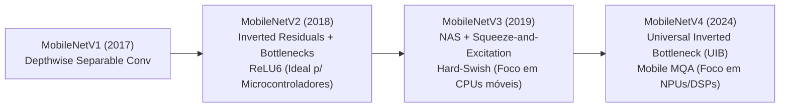

# Estudo Comparativo das Versões da MobileNet e Análise de Viabilidade no ESP32-S3

**Projeto:** Diagnóstico Fitopatológico em Cana-de-Açúcar no ESP32-S3 (TinyML & Edge AI)  
**Notebook de Referência:** [notebooks/cane_disease_esp32s3_v09.ipynb](file:///home/victor/projects/sugarcane/notebooks/cane_disease_esp32s3_v09.ipynb)  
**Hardware Alvo:** ESP32-S3 N8R16 (Xtensa LX7 Dual-Core @ 240 MHz, 8 MB Octal PSRAM, 512 KB SRAM interna, coprocessador vetorial PIE SIMD 128-bit)  
**Framework de Borda:** TensorFlow Lite Micro + Espressif `esp-nn` + LittleFS SPI Flash

---

## 1. Visão Geral e Objetivo do Projeto (Contexto da Versão v09)

O projeto tem como objetivo central o **diagnóstico fitopatológico em tempo real de folhas de cana-de-açúcar** (classificação supervisionada em 9 patologias foliares e amostras sadias) operando de forma 100% autônoma na borda (*Edge AI / TinyML*), acoplado a uma câmera CMOS OV2640 em um drone ou dispositivo portátil de inspeção agronômica.

### 1.1 Restrições Rígidas de Co-Design de Hardware
Diferente de aplicações convencionais em servidores ou smartphones, o modelo convolucional deve obedecer a limites físicos severos impostos pela arquitetura de silício do **ESP32-S3**:

1. **Partição Flash SPI LittleFS (`/models`):** Orçamento máximo de **$1.536\text{ KB}$ ($1{,}5\text{ MB}$)** para o binário `.tflite` quantizado.
2. **Orçamento de SRAM Interna para Scratch Buffer SIMD (`esp-nn`):** Limite estrito de **$48\text{ KB}$** de memória rápida interna (`MALLOC_CAP_INTERNAL | MALLOC_CAP_8BIT`), onde residem os buffers de alinhamento das instruções vetoriais PIE de 128 bits.
3. **Orçamento de *Tensor Arena* em PSRAM Octal:** Faixa de **$800\text{ KB}$ a $2\text{ MB}$** para alocação dinâmica dos tensores de ativação intermediários.
4. **Janela de Latência em Tempo Real:** Inferência pura estritamente **$< 500\text{ ms}$** por quadro (a MobileNetV2 $\alpha=0{,}35$ atinge $\sim 283{,}4\text{ ms}$ de inferência pura e $\sim 336{,}1\text{ ms}$ com telemetria ativa).
5. **Paridade com Pipeline Óptico:** Resolução de entrada fixa em **$160 \times 160 \times 3$**, pré-processada com interpolação `area` (*Box Averaging*) para espelhar bit a bit o decodificador JPEG em C++ (`JPEGDraw`) do firmware.
6. **Quantização Full-Integer (Int8 Puro):** Exigência de quantização simétrica de 8 bits para pesos e assimétrica para ativações com *Quantization-Aware Training* (QAT via `tensorflow-model-optimization`), garantindo fusão matemática (*BatchNorm Folding*) e exportação C/C++ alinhada em memória (`alignas(16)`).

---

## 2. Histórico e Evolução da Família MobileNet

A linha MobileNet, desenvolvida pelo Google Research, é a espinha dorsal da visão computacional para dispositivos móveis e embarcados. A evolução das suas gerações reflete a mudança nos gargalos de computação ao longo dos anos:

### 2.1 MobileNetV1 (2017)
* **Conceito Chave:** Introduziu a fatoração espacial da convolução padrão em duas etapas: **Depthwise Convolution** ($3 \times 3$ espacial independente por canal) seguida de **Pointwise Convolution** ($1 \times 1$ projeção linear entre canais).
* **Impacto:** Reduziu o custo computacional em aproximadamente $\frac{1}{N} + \frac{1}{D_k^2} \approx 8\times$ a $9\times$ em comparação a convoluções $3 \times 3$ densas convencionais.

### 2.2 MobileNetV2 (2018 — Utilizada na v09)
* **Conceito Chave:** Introduziu os blocos **Inverted Residuals with Linear Bottlenecks**. O fluxo expande a dimensionalidade para um espaço de maior capacidade representacional (fator de expansão $t=6$), aplica Depthwise $3 \times 3$ e projeta de volta para um gargalo linear estreito, com conexões residuais (*shortcuts*) ligando apenas os gargalos estreitos.
* **Ativação:** Utiliza **ReLU6** ($\min(\max(0, x), 6)$). Essa saturação superior fixa é ideal para ponto fixo e quantização Int8 uniforme.

### 2.3 MobileNetV3 (2019 — Small e Large)
* **Conceito Chave:** Arquitetura otimizada por busca automática (*Neural Architecture Search* — NAS) combinada com o algoritmo NetAdapt. Introduziu blocos de atenção de canal **Squeeze-and-Excitation (SE)** e a função de ativação **Hard-Swish** ($h\text{-swish}(x) = x \cdot \frac{\text{ReLU6}(x+3)}{6}$).
* **Variantes:**
  * *MobileNetV3-Large:* Alta precisão para CPUs móveis topo de linha.
  * *MobileNetV3-Small:* Compacta para dispositivos de menor porte.
  * *Variantes Minimalistic:* Removem o SE e substituem o Hard-Swish por ReLU padrão.

### 2.4 MobileNetV4 (Google Research, Maio de 2024)
* **Conceito Chave:** "Universal Models for the Mobile Ecosystem". Introduziu o **Universal Inverted Bottleneck (UIB)**, um bloco flexível que unifica Inverted Residuals, ConvNet padrão e Feed-Forward Networks (FFN).
* **Atenção Híbrida:** Variantes híbridas incorporam o **Mobile MQA** (*Multi-Query Attention* de alta eficiência para visão).
* **Alvo de Hardware:** Projetada especificamente para aceleradores modernos de alta taxa de transferência (Apple Neural Engine, Edge TPUs, Qualcomm Hexagon DSP e GPUs móveis).

### 2.5 Esclarecimento Técnico: Existe "MobileNetV5"?
> [!NOTE]
> **Não existe formalmente uma MobileNetV5 oficial desenvolvida pelo Google.**  
> A versão oficial de ponta mais recente da família MobileNet é a **MobileNetV4** (lançada em maio de 2024).  
> A menção comum a "MobileNetV5" no meio técnico decorre de confusão de nomenclatura com a família **YOLO** (YOLOv5, v8, v9, v10, v11) ou com projetos comunitários que combinam backbones eficientes como **MobileOne (Apple)**, **EfficientNetV2** ou **EdgeNeXt**.

---

## 3. Análise de Viabilidade Técnica no Microcontrolador ESP32-S3

A questão central é: **valeria a pena treinar uma nova versão do classificador fitopatológico migrando da MobileNetV2 para a MobileNetV3 ou MobileNetV4?**

A análise detalhada de engenharia de software embarcado demonstra que **não é vantajoso atualizar o backbone no ESP32-S3**. Os motivos fundamentam-se nas restrições físicas do silício:

### 3.1 Falta de Aceleração SIMD Vetorial (`esp-nn`) para Operações Não-Convencionais
* O ESP32-S3 possui o coprocessador vetorial PIE com instruções SIMD de 128 bits. A Espressif desenvolveu a biblioteca `esp-nn` com kernels otimizados em Assembly especificamente para as operações centrais da MobileNetV1 e V2:
  * `esp_nn_depthwise_conv_s8_esp32s3`
  * `esp_nn_conv_s8_esp32s3` (Pointwise $1 \times 1$)
* Operações presentes na V3 e V4 que fogem desse padrão não possuem rotinas em Assembly dedicadas. Quando um operador não é suportado pelo `esp-nn`, o TensorFlow Lite Micro recorre ao kernel de referência em C++ (ANSI C genérico), executando de forma puramente escalar (sem SIMD), o que pode elevar a latência de uma única camada em até **$5\times$ a $10\times$**.

### 3.2 O Custo Proibitivo do Bloco Squeeze-and-Excitation (SE) no ESP32-S3
A MobileNetV3 depende fortemente de blocos SE para compensar a redução de canais. No entanto, em um microcontrolador:
1. **Quebra de Localidade Espacial:** O SE requer um *Global Average Pooling* intermediário, duas projeções densas (Fully-Connected), função Sigmoid e multiplicação elemento a elemento por canal.
2. **Sobrecarga de Acesso à PSRAM Octal:** Cada bloco SE cria tensores intermediários adicionais que exigem alocação na *Tensor Arena*. Como o ESP32-S3 utiliza PSRAM externa conectada via barramento SPI Octal a 80 MHz, o tráfego extra de leitura/escrita para tensores temporários se torna um gargalo severo de barramento (*memory bound*).

### 3.3 Degradação de Ponto Fixo: Hard-Swish vs. ReLU6 sob Quantização Int8
* **Na MobileNetV2:** A função **ReLU6** restringe dinamicamente as ativações no intervalo $[0, 6]$. Na quantização Int8 simétrica/assimétrica, isso mapeia perfeitamente em limites discretos de saturação de inteiros (`MIN/MAX`), executados em um único ciclo de clock nas instruções vetoriais do ESP32-S3.
* **Na MobileNetV3:** A função **Hard-Swish** requer operações de multiplicação e divisão aritmética em ponto fixo (`gemmlowp`) ou interpolação por tabelas Look-Up (LUT) de 256 elementos para cada ativação. Isso consome ciclos de CPU, reduz a taxa de transferência e aumenta o erro de calibração esperado (ECE) após a quantização Int8.

### 3.4 Descasamento Arquitetural da MobileNetV4 com Microcontroladores
A MobileNetV4 foi projetada para dispositivos que possuem:
* Caches L2/L3 de múltiplos megabytes;
* Memória LPDDR4X/LPDDR5 com largura de banda de dezenas de GB/s;
* Motores de multiplicação de matrizes densas (NPUs e DSPs com arrays sistólicos).

No ESP32-S3, temos apenas **$512\text{ KB}$ de SRAM interna** e um barramento SPI para a PSRAM externa. O padrão de acesso e os blocos heterogêneos do Universal Inverted Bottleneck (UIB) gerariam subaproveitamento do pipeline do microcontrolador e estouro do orçamento de SRAM interna de 48 KB para *scratch buffers*.

### 3.5 Instabilidade do Pipeline QAT no TensorFlow / Keras
No notebook `v09`, o QAT foi implementado com sucesso via `tensorflow-model-optimization` (`tfmot.quantization.keras.quantize_model`) graças à topologia linear e regular da MobileNetV2.  
* O ecossistema `tfmot` possui suporte testado e validado em nível de produção para a fusão matemática de `Conv2D + DepthwiseConv2D + BatchNormalization + ReLU6`.
* Na MobileNetV3 e em blocos customizados da V4, o `tfmot` frequentemente apresenta incompatibilidades com a inserção automática de nós *FakeQuant* ao redor dos blocos de atenção e ativações não-lineares, exigindo quantização pós-treinamento (PTQ) que acarreta perdas expressivas de acurácia em datasets compactos (como nossas 4.313 amostras limpas).

---

## 4. Matriz Comparativa Multidimensional

| Dimensão de Engenharia | MobileNetV2 ($\alpha=0.35$ / $0.50$) | MobileNetV3-Small | MobileNetV4-Conv-Small |
| :--- | :---: | :---: | :---: |
| **Status no Projeto** | **Adotada e Otimizada (v09)** | Incompatível com foco TinyML | Incompatível com arquitetura |
| **Aceleração `esp-nn` (SIMD PIE)** | **100% dos blocos cobertos** | Parcial (SE e H-Swish escalares) | Baixa / Inexistente |
| **Ativação Não-Linear** | **ReLU6** (saturação 1-ciclo) | Hard-Swish (requer LUT/divisão) | ReLU / GELU |
| **Mecanismo de Atenção** | Nenhum (convolucional puro) | Squeeze-and-Excitation (SE) | Mobile MQA (Atenção linear) |
| **Consumo de Flash SPI (Int8)** | **$550\text{ a }790\text{ KB}$** (cabe com folga) | $\sim 700\text{ a }1.100\text{ KB}$ | $> 1.400\text{ KB}$ (risco de estouro) |
| **Scratch SRAM Interna** | **$< 32\text{ KB}$** (dentro do teto de 48 KB) | $\sim 40\text{ a }56\text{ KB}$ (risco crítico) | $> 64\text{ KB}$ (inviável na SRAM) |
| **Latência Real Estimada (ESP32-S3)** | **$283\text{ a }430\text{ ms}$** | $> 650\text{ ms}$ (pelo overhead do SE) | $> 900\text{ ms}$ |
| **Maturidade QAT (`tfmot`)** | **Totalmente estável** | Instável em nós SE / H-Swish | Requer PyTorch / sem export ESP-NN |

---

## 5. Conclusões e Recomendações Técnicas

1. **Manutenção da MobileNetV2:** A MobileNetV2 é a arquitetura ideal para o ESP32-S3 N8R16 neste projeto. Seu equilíbrio entre representação convolucional, eficiência de MACs, saturação estável em ReLU6 e compatibilidade estrita com os kernels em Assembly da Espressif garante a melhor fronteira de Pareto (Acurácia vs. Latência vs. Memória).
2. **Exploração Ótima dentro da V2:** Se o objetivo for obter maior poder discriminativo para classes com sintomas sutis (*Yellow Leaf* e *smut*), o caminho técnico mais eficiente e seguro já foi validado na `v09`: a variante **MobileNetV2 $\alpha=0{,}50$**, que adiciona capacidade sem quebrar o pipeline do `esp-nn` e mantendo a latência dentro da janela de tempo real ($\approx 430\text{ ms}$).
3. **Cenário para Migração de Arquitetura:** Uma eventual transição para arquiteturas mais modernas (MobileNetV4, MobileOne ou Tiny Vision Transformers) só se justificará tecnicamente se houver **mudança de plataforma de hardware** para processadores dotados de aceleradores neurais dedicados (NPUs), tais como:
   * **ESP32-P4** (com extensões avançadas de DSP e 2D-DMA);
   * **Kendryte K210 / K510** (KPU dedicada de ponto fixo);
   * **NXP i.MX RT com acelerador eIQ / microNPU**.
