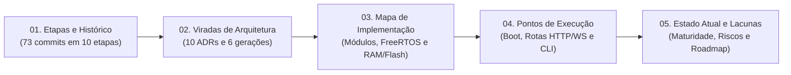

# Índice do Mapeamento de Desenvolvimento, Execução e Arquitetura — Projeto Sugarcane

**Repositório:** `sugarcane` (Classificador Embarcado de Doenças da Cana-de-Açúcar no ESP32-S3)  
**Escopo da Auditoria:** Análise integral do código-fonte (`src/`, `frontend/`, `scripts/`, `model_inference_tests/`, `notebooks/`, `test/`, `.github/`), configurações (`platformio.ini`, `partitions.csv`, `sdkconfig.defaults`), monografia (`tcc/`) e histórico Git completo.  
**Histórico Auditado:** **73 commits** na branch `master`, de `bee0b70` (`2026-11-06 18:42:08 -0300`) a `49d53a8` (`2026-11-23 15:02:46 -0300`).

---

## 1. Mapa da Série Documental

| # | Documento | Foco Principal | Principais Entregas |
| :-: | :--- | :--- | :--- |
| 01 | [01_ETAPAS_DE_DESENVOLVIMENTO_E_HISTORICO_DE_COMMITS.md](01_ETAPAS_DE_DESENVOLVIMENTO_E_HISTORICO_DE_COMMITS.md) | **Linha do tempo integral (73 commits)** | 10 etapas evolutivas (`06/11` a `23/11`), estatísticas por tipo de commit, reversões e lições operacionais. |
| 02 | [02_VIRADAS_DE_ARQUITETURA_E_DECISOES_TECNICAS.md](02_VIRADAS_DE_ARQUITETURA_E_DECISOES_TECNICAS.md) | **Viradas de arquitetura (ADRs)** | 10 decisões estruturais (problema, causa raiz, solução, impacto antes/depois, trade-offs) e tabela das 6 gerações. |
| 03 | [03_MAPA_DE_IMPLEMENTACAO_E_MODULOS.md](03_MAPA_DE_IMPLEMENTACAO_E_MODULOS.md) | **Inventário técnico de módulos** | Mapeamento de `src/`, `managed_components/`, `frontend/`, `scripts/`, `notebooks/`, tasks FreeRTOS e mapa de memória. |
| 04 | [04_PONTOS_DE_EXECUCAO_E_FLUXOS_OPERACIONAIS.md](04_PONTOS_DE_EXECUCAO_E_FLUXOS_OPERACIONAIS.md) | **Entrypoints e fluxos de runtime** | Sequência de boot (`app_main`), diagrama de sequência WS/FreeRTOS, contrato HTTP/WS JSON e comandos de execução. |
| 05 | [05_ESTADO_ATUAL_LACUNAS_E_MATURIDADE.md](05_ESTADO_ATUAL_LACUNAS_E_MATURIDADE.md) | **Diagnóstico crítico no commit `49d53a8`** | Matriz de maturidade por subsistema, pendências operacionais, inconsistências de código/docs e roadmap. |

---

## 2. Fluxo de Leitura e Conexão entre os Documentos

---

## 3. Guia Rápido por Perfil

* **Engenheiro de Firmware / Sistemas Embarcados:** Inicie por [02_VIRADAS_DE_ARQUITETURA_E_DECISOES_TECNICAS.md](02_VIRADAS_DE_ARQUITETURA_E_DECISOES_TECNICAS.md) (viradas 1, 2, 3, 5, 6 e 9) e siga para [03_MAPA_DE_IMPLEMENTACAO_E_MODULOS.md](03_MAPA_DE_IMPLEMENTACAO_E_MODULOS.md) e [04_PONTOS_DE_EXECUCAO_E_FLUXOS_OPERACIONAIS.md](04_PONTOS_DE_EXECUCAO_E_FLUXOS_OPERACIONAIS.md).
* **Cientista de Dados / TinyML:** Consulte [01_ETAPAS_DE_DESENVOLVIMENTO_E_HISTORICO_DE_COMMITS.md](01_ETAPAS_DE_DESENVOLVIMENTO_E_HISTORICO_DE_COMMITS.md) (etapas 2, 3, 6 e 9), a virada 4 em [02_VIRADAS_DE_ARQUITETURA_E_DECISOES_TECNICAS.md](02_VIRADAS_DE_ARQUITETURA_E_DECISOES_TECNICAS.md) e os apontamentos sobre `v08`/`v09`/`v10` e *Domain Shift* em [05_ESTADO_ATUAL_LACUNAS_E_MATURIDADE.md](05_ESTADO_ATUAL_LACUNAS_E_MATURIDADE.md).
* **Engenheiro Frontend / Operador de Campo:** Veja o mapa do SPA Vue 3 em [03_MAPA_DE_IMPLEMENTACAO_E_MODULOS.md](03_MAPA_DE_IMPLEMENTACAO_E_MODULOS.md), os endpoints e contratos JSON em [04_PONTOS_DE_EXECUCAO_E_FLUXOS_OPERACIONAIS.md](04_PONTOS_DE_EXECUCAO_E_FLUXOS_OPERACIONAIS.md) e as pendências de campo em [05_ESTADO_ATUAL_LACUNAS_E_MATURIDADE.md](05_ESTADO_ATUAL_LACUNAS_E_MATURIDADE.md).
* **Avaliador Acadêmico / TCC:** Utilize este índice junto com [01_TIMELINE_E_HISTORICO_DA_APLICACAO.md](../01_visao_geral/01_TIMELINE_E_HISTORICO_DA_APLICACAO.md) e [02_REALIZACOES_E_MARCOS_DO_PROJETO.md](../01_visao_geral/02_REALIZACOES_E_MARCOS_DO_PROJETO.md) para rastrear a evolução completa até a entrega final.

---

## 4. Resumo Quantitativo de Ponta a Ponta

| Dimensão | Linha de Base Inicial (`bee0b70`–`c18ed38`) | Estado Atual (`49d53a8`) | Ganho / Evolução |
| :--- | :---: | :---: | :--- |
| **Tempo Total no Chip (Dec + Inf)** | `1.440,6 ms` (`814,0 + 626,6 ms`) | **`376,0 ms`** (`92,6 + 283,4 ms` no lote 9.269) | **3,83x mais rápido** (`-73,9%`) |
| **Vazão em Lote (550 fotos)** | `0,63 img/s` (`14,53 min`) | **`1,77 img/s`** (`5,18 min` limpo) | **2,81x maior throughput** |
| **Acurácia (550 amostras limpas)** | `82,36%` (`v07` Modo 0) | **`91,09%`** host / **`89,82%`** ESP32 (`v08` Modo 7) | **`+7,46 p.p.`** no hardware |
| **Acurácia na Classe `smut`** | `6,0%` (`3/50` bruto) / `4,0%` | **`84,0%`** (`42/50` limpo, 0 erros cruzados) | **14x–21x mais acertos** |
| **Fidelidade de Sinal (`JPEGDraw`)** | `PSNR 27,1 dB`, Bias `-2,90 LSB` | **`PSNR = ∞ dB`**, Bias `0,00 LSB` (Modo 7) | Paridade exata com `area` |
| **Interface & Telemetria** | Sem UI web; sem GPS/térmico | **SPA Vue 3 (`89,1 KB` gzip)**, GPS NEO-6M UART2, 1 Hz | Operação autônoma offline |
| **Qualidade & Segurança** | Credenciais hardcoded; sem CI/testes | NVS/Kconfig, `auth_token`, mutexes, **Unity + CI** | Endurecimento completo |
