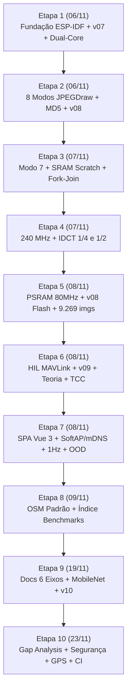

# Etapas de Desenvolvimento e Histórico Integral de Commits — Projeto Sugarcane

Este documento mapeia **todos os 73 commits** da branch `master` do repositório `sugarcane`, desde a configuração inicial (`bee0b70` em `2026-11-06 18:42:08 -0300`) até o estado atual (`49d53a8` em `2026-11-23 15:02:46 -0300`), organizados em **10 Etapas Evolutivas**.

> **Nota de Escopo:** O documento histórico anterior ([01_TIMELINE_E_HISTORICO_DA_APLICACAO.md](../01_visao_geral/01_TIMELINE_E_HISTORICO_DA_APLICACAO.md)) cobria os 61 primeiros commits até `09/11/2026` (`2f11517`). Este mapeamento estende a auditoria para incluir integralmente as **Etapas 9 e 10** (`19/11/2026` e `23/11/2026`, mais 12 commits).

---

## 1. Visão Macro das 10 Etapas Evolutivas

---

## 2. Estatísticas do Histórico Git

* **Total de Commits:** 73 (`master`).
* **Janela Temporal:** `06/11/2026` a `23/11/2026` (6 dias com atividade: `06/11`, `07/11`, `08/11`, `09/11`, `19/11`, `23/11`).
* **Convenção de Commits:** Majoritariamente *Conventional Commits* (`feat`, `perf`, `fix`, `docs`, `test`, `refactor`, `build`, `chore`, `ci`, `style`).

---

## 3. Detalhamento Cronológico das 10 Etapas

### Etapa 1 — Fundação ESP-IDF/PlatformIO, Modelo `v07` e Pipeline Dual-Core Inicial (`06/11 18:42`)
* **Commits (4):**
  * `bee0b70` — `chore(config): configura projeto PlatformIO/ESP-IDF para ESP32-S3 com PSRAM e LittleFS`
  * `998e504` — `feat(model): adiciona modelo MobileNetV2 INT8, guia de uso e script de validacao local`
  * `834cb8c` — `feat(firmware): implementa servidor WebSocket, decodificador JPEG e pipeline Dual-Core TFLite Micro`
  * `c18ed38` — `test(eval): adiciona scripts e relatorios de desempenho Single-Core e Dual-Core no ESP32-S3`
* **Objetivo e Entregas:** Estruturação do projeto em ESP-IDF via PlatformIO para `esp32-s3-devkitm-1` (16 MB Flash, `partitions.csv` com `factory` 4 MB e `storage` LittleFS 10 MB), embarque do modelo `v07` (`639.272 bytes`), servidor WebSocket `/ws`, decodificação `JPEGDEC` e transição do baseline Single-Core para pipeline produtor-consumidor Dual-Core.
* **Impacto:** O lote de 550 imagens caiu de `871,51 s` (`0,63 img/s`) para `574,89 s` (`0,96 img/s`, `-34,0%`), mas revelou o colapso da classe `smut` (`6,0%`, 3/50) confundida com `Pokkah Boeng`.

### Etapa 2 — Auditoria Matemática `JPEGDraw`, Duelo CNN `v07` e Auditoria MD5 → `v08` (`06/11 19:18–20:53`)
* **Commits (8):**
  * `63e35e6` — `docs(analysis): adiciona analise tecnica/matematica da funcao JPEGDraw e benchmark comparativo das 8 abordagens`
  * `98624e5` — `docs(eval): adiciona relatorio estatistico e matrizes de confusao dos metodos JPEGDraw`
  * `f4a0c3c` — `feat(notebooks): adiciona notebook de treinamento, QAT e quantizacao Int8 (CNN Customizada vs MobileNetV2 0.35)`
  * `95f7f06` — `feat(firmware): implementa opcoes de JPEGDraw (BoxAvg RGB565/RGB8888 e FastLUT) e alinha TENSOR_SIZE para 160x160x3`
  * `399450c` — `refactor(firmware): move arquivos de cabecalho (.h) de src/ para lib/`
  * `d52a0ec` — `refactor(firmware): restaura arquivos de cabecalho (.h) de lib/ para src/`
  * `2f31d9a` — `docs(dataset): adiciona auditoria MD5 de integridade do dataset e arquitetura de melhorias do treinamento v08`
  * `c4bb00e` — `feat(notebooks): adiciona notebook v08 com deduplicacao MD5, interpolacao area, head Dual-Pooling e Focal Loss`
* **Objetivo e Entregas:** Prova matemática do viés DC (`-2,90 LSB`) e *aliasing* do `Modo 0`; implementação das Opções A (`BoxAvg RGB565`), B (`FastLUT RGB8888`) e C (`BoxAvg RGB8888`) em [src/image_processor.cpp](../../src/image_processor.cpp); auditoria MD5 em 6.748 imagens identificando 747 duplicatas internas e 614 colisões cruzadas; criação do notebook [cane_disease_esp32s3_v08.ipynb](../../notebooks/cane_disease_esp32s3_v08.ipynb) com 5.389 imagens limpas, `interpolation="area"`, grafo *flat* e *Focal Loss*.

### Etapa 3 — Modelo `v08`, Modo 7 + LUTs SRAM, Scratch SRAM e Fork-Join `esp-nn` (`07/11 11:57–12:12`)
* **Commits (4):**
  * `7b1edff` — `feat(model): atualiza modelo MobileNetV3 Int8 v08 e adiciona relatorios comparativos dos 8 modos JPEGDraw` *(nota: o arquivo é MobileNetV2 $\alpha=0,35$)*
  * `2ce3aee` — `perf(image_processor): ativa Opcao C (Modo 7 RGB8888 + BoxAvg) e adiciona LUTs src->dst na SRAM`
  * `244568c` — `perf(classifier): implementa scratch buffers em SRAM interna, paralelismo Fork-Join Dual-Core esp-nn e documentacao tecnica`
  * `6f3980c` — `docs: adiciona DOCUMENTACAO_TECNICA.md completa e consolidada do projeto`
* **Objetivo e Entregas:** Consagração do Modo 7 em 13.104 inferências (`91,09%` limpo, `89,41%` em `val/`, `smut` em `84–88%`, 0 confusões `smut <-> Pokkah Boeng`); LUTs `s_src_to_dst_x/y` na SRAM (`-99,77%` divisões); alocação de `48 KB` + `25 KB` na SRAM interna para `esp-nn`; patch no Stem $3\times 3$ em [esp_nn_conv_esp32s3.c](../../managed_components/espressif__esp-nn/src/convolution/esp_nn_conv_esp32s3.c); `SKIP_NUDGE=1`; correção da afinidade Fork-Join (chamada de `classifier_enable_dual_core()` no Core 1 fixando o worker no Core 0).

### Etapa 4 — Clock 240 MHz, IDCT Scale Reduction e Diagnóstico de Gargalos Ocultos (`07/11 18:26`)
* **Commits (1):**
  * `b1ea439` — `feat(perf): eleva clock para 240MHz, otimiza IDCT BoxAvg, adiciona relatorios e mapa de realizacoes`
* **Objetivo e Entregas:** CPU elevada para `240 MHz`, `JPEG_SCALE_QUARTER` ($1/4$) e `JPEG_SCALE_HALF` ($1/2$) no IDCT, uso de `iWidthUsed`.
* **Impacto e Diagnóstico:** No chip, a inferência caiu para `336,3 ms` e a decodificação para `145,2 ms`. Porém, o lote demorou `65,76 min` por *Wi-Fi Modem Sleep* (`Errno 104`) e `smut` seguiu em `4%` porque faltava executar `pio run -t uploadfs` (a Flash ainda continha `v07`).

### Etapa 5 — Fase 1 de Otimização de Silício/Rede, Web UI v1 e Stress Test 9.269 Imagens (`08/11 07:08–10:32`)
* **Commits (6):**
  * `fde29aa` — `perf(firmware): otimiza PSRAM 80MHz, BoxAccumulator 8B, desativa WiFi power save e purga sockets`
  * `37aacbd` — `test(benchmarks): adiciona avaliacao exaustiva de 100% do dataset e benchmark limpo`
  * `85b712f` — `docs: atualiza mapa de realizacoes e adiciona diagnostico de pendencias e relatorio fase 1`
  * `0d724de` — `docs: adiciona oportunidade O5 de monitoramento termico on-chip ao plano de acao`
  * `38c076c` — `feat(firmware): adiciona interface web dashboard em '/' e suporte a teste esp32 em test_inference.py`
  * `61b3421` — `docs(benchmark): expande avaliacao exaustiva para 9269 imagens no esp32-s3 e documenta domain shift`
* **Impacto:** Com `uploadfs` do `v08`, PSRAM `80 MHz DDR`, `-O2`, `BoxAccumulator` 8 B (`200 KB`), `WIFI_PS_NONE` e `lru_purge_enable`, o benchmark limpo (550 fotos) atingiu **`283,4 ms` inf**, **`102,7 ms` dec**, **`5,18 min`**, **`89,82%`** (`smut 84%`). O stress test de **9.269 imagens** rodou por `94,63 min` com **0 falhas**, mas revelou **3,13%** no dataset externo *Archive* (*Domain Shift*).

### Etapa 6 — Co-Simulação HIL MAVLink/SIG, Ablação Multi-Escala `v09`, Teoria e TCC (`08/11 10:32–13:04`)
* **Commits (8):**
  * `7977f59` — `feat(simulation): adiciona simulador HIL MAVLink de voo e gerador de mapas de calor georreferenciados`
  * `c820e70` — `feat(ml): adiciona notebook v09 com estudo de ablacao multi-escala MobileNetV2 (0.35, 0.50, 0.75) e artefatos INT8`
  * `f77f860` — `docs(theory): documenta interpretacao dos graficos v09 e analise teorico-cientifica da quantizacao INT8`
  * `b186c85` — `docs(simulation): adiciona guia de co-simulacao HIL MAVLink e visualizacao de mapas de calor`
  * `8c8a579` — `docs: cria README.md consolidado de ponta a ponta com mapa de documentacao e hiperlinks`
  * `98a382a` — `docs: formaliza README.md removendo emojis e adicionando identificacao institucional do autor`
  * `7f9d246` — `docs: formaliza analise de robustez estatistica, sementes aleatorias e intervalo de confianca`
  * `a28ce48` — `docs(tcc): inclui monografia completa em LaTeX, fontes, imagens e PDFs compilados`
* **Objetivo e Entregas:** Missão HIL MAVLink v2 de 55 waypoints (`1.130,1 ms` ciclo médio, 100% entrega) + geração de GeoJSON, HTML Leaflet e PNGs KDE; notebook `v09` descontinuando a CNN Customizada e avaliando $\alpha \in \{0.35, 0.50, 0.75\}$; estudos teóricos de quantização INT8 e sementes aleatórias; monografia TCC completa em LaTeX ([tcc/](../../tcc)).

### Etapa 7 — Fase 2: Dashboard SPA Vue.js 3, Rede Híbrida STA/SoftAP/mDNS, Telemetria 1 Hz e OOD (`08/11 14:26–21:04`)
* **Commits (20):**
  * `0ce608c` — `docs: adiciona especificacao tecnica de arquitetura do dashboard web e telemetria no ESP32-S3`
  * `f81becc` — `build(esp-idf): integra componente mDNS para resolucao de nomes na rede local`
  * `ec29672` — `feat(frontend): implementa aplicacao SPA em Vue 3 com Leaflet e telemetria em tempo real`
  * `35875eb` — `feat(web): adiciona script de build/compressao gzip e assets para LittleFS`
  * `56adc49` — `feat(wifi): adiciona modo hibrido STA com fallback para SoftAP e servico mDNS`
  * `0c867a8` — `feat(webserver): implementa rotas HTTP para LittleFS gzip, exportacao CSV e broadcast WebSocket`
  * `5258e44` — `feat(telemetry): integra telemetria periodica 1Hz, sensor termico e logging CSV em LittleFS`
  * `d43ffe2` — `docs: atualiza mapa de documentacao no README com a especificacao do dashboard web`
  * `61ee40f` — `docs: atualiza guia de uso com instrucoes da SPA Vue 3, modos Wi-Fi e uploadfs`
  * `ed3d0e6` — `docs: documenta arquitetura de rede hibrida, servidor HTTP LittleFS e telemetria continua`
  * `703751a` — `fix(web): adiciona mutex para sincronizacao do websocket e adiciona relatorio fase 2`
  * `c667050` — `docs: indexa relatorio da fase 2 no mapa de documentacao do README`
  * `bcc50b1` — `docs: documenta marcos da Fase 2 de dashboard web e telemetria em REALIZACOES_DO_PROJETO`
  * `1afc7d1` — `feat(firmware): recupera contador de inspecoes no boot e sincroniza reset do historico`
  * `fe5430b` — `feat(frontend): adiciona upload interativo, satelite Esri e carregamento de historico real`
  * `5b4ad70` — `feat(web): atualiza bundle e assets gzip para particao LittleFS`
  * `af0164c` — `test(benchmark): filtra telemetria no script de teste e salva resultados de 132 amostras no ESP32-S3`
  * `59b8da1` — `docs: adiciona relatorio consolidado de benchmark de 132 amostras com SRAM e Fork-Join`
  * `33a9f02` — `Change contact information to email address`
  * `f191c92` — `docs(theory): adiciona estudo tecnico sobre suposicao de mundo fechado e dados OOD no canavial`
* **Objetivo e Entregas:** SPA Vue 3 + Leaflet comprimida em Gzip nível 9 (`271,4 KB -> 89,1 KB`), Wi-Fi híbrido STA + SoftAP (`Sugarcane-AI-AP`) + mDNS (`sugarcane.local`), sensor térmico on-chip (1 Hz), log `/storage/inspections.csv`, `s_ws_mutex`, benchmark de homologação de 132 amostras (`284,4 ms` inf) e estudo formal de detecção OOD (pré-filtro ExG + 12ª classe).

### Etapa 8 — Refinamento Cartográfico OSM e Consolidação dos Benchmarks (`09/11 06:48–20:39`)
* **Commits (3):**
  * `c9e77d9` — `feat(map): define OpenStreetMap estilo vetorial como camada cartografica padrao`
  * `3a32c9b` — `feat(web): atualiza assets gzip no LittleFS com camada OpenStreetMap padrao`
  * `2f11517` — `docs(tests): cria mapa cronologico e consolida historico dos testes de inferencia`

### Etapa 9 — Reestruturação Documental em 6 Eixos, Viabilidade MobileNet e Notebook `v10` (`19/11 14:07–21:36`)
* **Commits (7):**
  * `9f0cea1` — `chore(git): ignora diretorio de configuracao do obsidian (.obsidian)`
  * `cfb9375` — `refactor(scripts): atualiza caminhos padrao de saida e datasets para nova estrutura docs/`
  * `8990e07` — `docs: reestrutura e categoriza documentacao tecnica em 6 eixos tematicos`
  * `44eae29` — `style(docs): padroniza titulo H1 removendo emojis decorativos`
  * `4692632` — `docs(models): adiciona estudo comparativo de versoes mobilenet e viabilidade esp32-s3`
  * `8abe34b` — `feat(notebooks): adiciona gerador de relatorios consolidados markdown nos notebooks v07, v08 e v09`
  * `93903d3` — `feat(notebooks): introduz notebook v10 com especializacao multi-resolucao e treino progressivo`
* **Objetivo e Entregas:** Reorganização de `docs/` em 6 eixos (`01_visao_geral` a `06_simulacao_hil_e_sig`), atualização de caminhos nos scripts Python, estudo comparativo MobileNet V1–V4 (e esclarecimento sobre "V5"), geradores automáticos de relatório Markdown nos notebooks e criação do [cane_disease_esp32s3_v10.ipynb](../../notebooks/cane_disease_esp32s3_v10.ipynb) com escalonamento composto de resolução (`192×192` e `224×224`), `SpatialDropout2D` e treino em 4 estágios com *Clean Cooldown*.

### Etapa 10 — Gap Analysis, Endurecimento de Segurança/Concorrência, GPS NEO-6M Real, Testes e CI (`23/11 14:31–15:02`)
* **Commits (12):**
  * `b40a825` — `chore: atualiza .gitignore para ignorar .agents e sdkconfig locais`
  * `362e9ad` — `docs: adiciona analise de lacunas e plano de implementacao`
  * `4ee611d` — `feat(firmware): integra GPS NEO-6M, credenciais Wi-Fi via NVS/Kconfig e mutex no CSV`
  * `9c07e39` — `fix(frontend): remove valores mockados iniciais de telemetria e exibe throughput real`
  * `bb066b8` — `fix(scripts): ignora pacotes de telemetria e diagnostico ao aguardar inferencia via WebSocket`
  * `de65052` — `fix(frontend): corrige anomaly_alert, ordenacao por total_ms e atualiza build em data/www`
  * `bcdfd00` — `feat(firmware): adiciona auth_token no WS, fallback SoftAP, SNTP e protecao de fila`
  * `535a84f` — `fix(firmware): evita broadcast sem clientes WS, adiciona thermal_alert e remove duplicata`
  * `8020f30` — `build(frontend): atualiza bundle estatico em data/www`
  * `12fa06b` — `test: adiciona testes unitarios nativos de matematica de imagem`
  * `0ddea1f` — `ci: adiciona workflow de CI para testes e build`
  * `49d53a8` — `docs: atualiza documentacao, guia de operacao e plano de implementacao`
* **Objetivo e Entregas:** Resolução dos 15 achados de [gap-analysis.md](../gap-analysis.md): envio WS thread-safe via `WsWorkItem` + `httpd_queue_work`, sanitização de *path traversal* em `/assets/*`, mutex `s_csv_mutex`, credenciais Wi-Fi em NVS/`Kconfig.projbuild`, filtro WS nos scripts Python, driver UART2 GPS NEO-6M ([gps_neo6m.cpp](../../src/gps_neo6m.cpp)), cálculo real de `s_last_fps`, SNTP, `auth_token` no `clear_history`, timeout de `100 ms` na `inference_queue`, fallback SoftAP após 5 falhas STA, `thermal_alert` >75 °C + *throttling* 250 ms, skip de broadcast sem clientes, testes Unity em [test_main.cpp](../../test/test_image_math/test_main.cpp) e CI em [ci.yml](../../.github/workflows/ci.yml).

---

## 4. Reversões e Lições Operacionais Registradas no Git

1. **Movimentação de `.h` para `lib/` (`399450c` $\rightarrow$ `d52a0ec`):** Em `06/11`, tentou-se mover os cabeçalhos de `src/` para `lib/`, mas a reversão ocorreu em 5 minutos para preservar a compatibilidade com o build ESP-IDF/PlatformIO (`src/CMakeLists.txt`).
2. **Descompasso entre `data/` local e Flash do ESP32-S3 (`b1ea439` $\rightarrow$ `fde29aa`):** O modelo `v08` foi commitado em `7b1edff`, mas como `pio run -t upload` grava apenas a partição `factory`, o chip continuou executando `v07` até a execução explícita de `pio run -t uploadfs`.
3. **Evolução da segurança de concorrência no WebSocket (`703751a` $\rightarrow$ `4ee611d`/`bcdfd00`):** O mutex `s_ws_mutex` (`703751a`) serializou as chamadas, mas `httpd_ws_send_frame_async` ainda recebia ponteiros de stack/estáticos; a correção definitiva veio em `23/11` com cópia em heap (`WsWorkItem`) despachada via `httpd_queue_work`.
