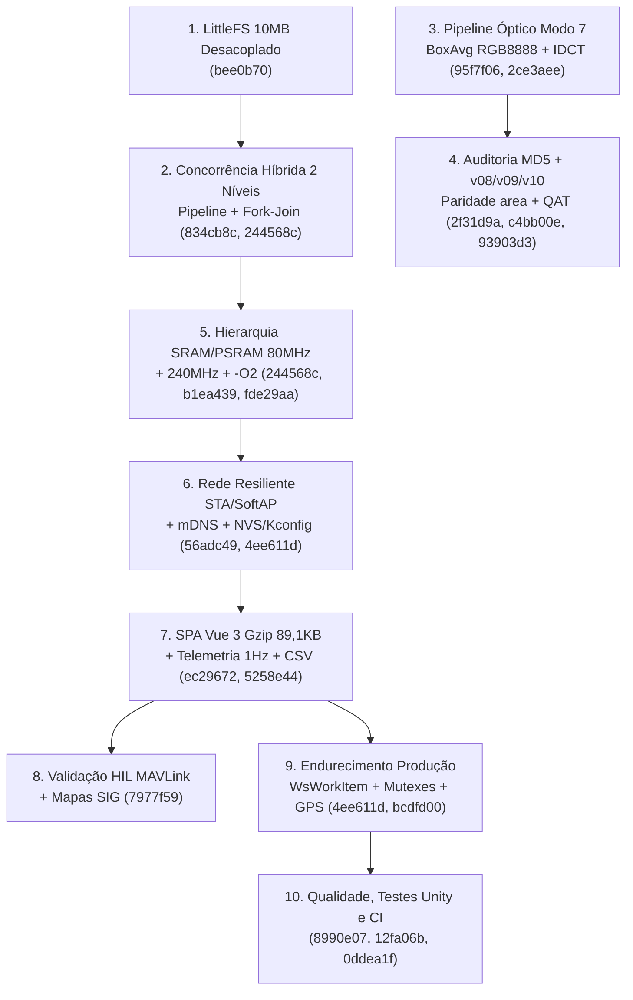

# Viradas de Arquitetura e Decisões Técnicas — Projeto Sugarcane

Este documento registra as **10 grandes viradas de arquitetura** que moldaram o sistema `sugarcane` ao longo de seu desenvolvimento (`06/11/2026` a `23/11/2026`), estruturadas no formato de *Architecture Decision Records* (ADR) técnicos.

---

## 1. Cadeia Causal das Viradas Arquiteturais

---

## 2. Registro das 10 Viradas de Arquitetura

### Virada 1 — Desacoplamento do Modelo via LittleFS (`4M` App / `10M` Storage)
* **Problema / Sintoma:** Embutir modelos `.tflite` (~640 KB a 1,7 MB) como arrays C (`const unsigned char[]`) exige recompilar e regravar todo o firmware a cada experimento neural.
* **Decisão:** Particionar a Flash de 16 MB em [partitions.csv](../../partitions.csv) com `factory` (`4M`) e `storage` (`10M`, LittleFS), carregando `/storage/model_mbnet_int8.tflite` para a PSRAM no boot.
* **Commits / Arquivos:** `bee0b70` ([partitions.csv](../../partitions.csv), [src/main.cpp](../../src/main.cpp)).
* **Impacto:** Atualização de modelos via `pio run -t uploadfs` sem recompilar C++; espaço para múltiplos modelos e assets web.
* **Trade-off:** Exige lembrar de executar `uploadfs` após atualizar `data/` (lição aprendida na Etapa 4 quando o chip rodou `v07` por engano).

### Virada 2 — Concorrência Híbrida em 2 Níveis (Macro-Pipeline + Fork-Join)
* **Problema / Sintoma:** Execução Single-Core sequencial (`1.440,6 ms` no chip) deixava um núcleo ocioso; no primeiro Dual-Core (`834cb8c`), o lote caiu `-34,0%`, mas cada foto individual subiu para `1.809,8 ms` por disputa na PSRAM e o Core 0 ficava ocioso em fotos isoladas.
* **Decisão:** Combinar **Macro-Pipeline** (`decode_task` Core 0 + `inference_task` Core 1 + *Double Buffering* com devolução antecipada antes de `classifier_run()`) com **Micro-Paralelismo Fork-Join `esp-nn`**, chamando `classifier_enable_dual_core()` dentro da `inference_task` (Core 1) para fixar `esp_nn_worker` no Core 0.
* **Commits / Arquivos:** `834cb8c`, `244568c` ([src/main.cpp](../../src/main.cpp), [src/tflite_classifier.cpp](../../src/tflite_classifier.cpp)).
* **Impacto:** Eliminação de *stalls* entre frames e divisão paralela de `Conv2D`, `DepthwiseConv2D`, `Add` e `Mul` entre os dois núcleos.

### Virada 3 — Pipeline Óptico: De `RGB565 Overwrite` para `RGB8888 BoxAvg + LUTs SRAM + IDCT`
* **Problema / Sintoma:** O `Modo 0` (`RGB565 ZeroFill + Overwrite`) gerava viés DC de `-2,90 LSB`, perdia 96,74% das escritas por *Last-Pixel-Wins* (`PSNR 27,1 dB`) e executava 786.432 divisões inteiras por foto.
* **Decisão:** Adotar a **Opção C (Modo 7)** em [src/image_processor.cpp](../../src/image_processor.cpp): decodificação nativa 24-bit (`RGB8888`), *Box Averaging* com arredondamento simétrico, LUTs `s_src_to_dst_x/y` na SRAM, *Scale Reduction* adaptativo no IDCT (`JPEG_SCALE_QUARTER` / `HALF`), `iWidthUsed` e compactação de `BoxAccumulator` de 16 B para 8 B (`200 KB` na PSRAM).
* **Commits / Arquivos:** `95f7f06`, `2ce3aee`, `b1ea439`, `fde29aa` ([src/image_processor.cpp](../../src/image_processor.cpp)).
* **Impacto:** `PSNR = ∞ dB`, `Bias = 0,00 LSB`, divisões reduzidas em `-99,77%` (786.432 → 1.792), decodificação reduzida de `1.032,4 ms` para `92,6–102,7 ms` (`-90,1%`).

### Virada 4 — Engenharia de Dados (MD5) e Evolução Neural (`v07` → `v08` → `v09` → `v10`)
* **Problema / Sintoma:** Classe `smut` travada em `4%–6%` no `v07` e colapso da CNN Customizada no QAT INT8 (`85,32%` F32 → `44,11%` INT8).
* **Decisão:**
  1. Auditoria MD5 (`v08`): expurgo de 747 duplicatas e 614 colisões cruzadas, restando 5.389 imagens puras; `interpolation="area"` alinhada ao Modo 7; grafo *flat* + *Focal Loss* + BN congelado.
  2. Ablação `v09`: descontinuação formal da CNN Customizada (sem suporte SIMD otimizado no `esp-nn`) e seleção Pareto de `MobileNetV2 α=0.35`.
  3. Viabilidade (`4692632`): recusa técnica de MobileNetV3/V4 no ESP32-S3 (blocos SE, Hard-Swish e UIB sem kernels `esp-nn` dedicados).
  4. Especialização `v10`: proposta multi-resolução (`192×192` / `224×224`), `SpatialDropout2D` e 4 estágios com *Clean Cooldown*.
* **Commits / Arquivos:** `2f31d9a`, `c4bb00e`, `c820e70`, `4692632`, `93903d3` ([notebooks/](../../notebooks)).
* **Impacto:** `smut` saltou de `4%–6%` para `84,0%` no hardware (`0` erros cruzados com `Pokkah Boeng`) e acurácia limpa atingiu `91,09%` (host) / `89,82%` (ESP32-S3).

### Virada 5 — Hierarquia de Memória e Aceleração de Silício
* **Problema / Sintoma:** *Scratch buffers* na PSRAM a 40 MHz causavam contenção severa nas instruções SIMD PIE de 128 bits.
* **Decisão:** Alocar `48 KB` (`s_sram_scratch_buf`) + `25 KB` (`worker_sram`) na SRAM interna; aplicar patch no Stem $3\times 3$ em [esp_nn_conv_esp32s3.c](../../managed_components/espressif__esp-nn/src/convolution/esp_nn_conv_esp32s3.c); ativar `CONFIG_NN_SKIP_NUDGE=y`, CPU `240 MHz`, Octal PSRAM `80 MHz DDR`, `-O2` (`CONFIG_COMPILER_OPTIMIZATION_PERF=y`) e FreeRTOS `1000 Hz`.
* **Commits / Arquivos:** `244568c`, `b1ea439`, `fde29aa` ([sdkconfig.defaults](../../sdkconfig.defaults), [platformio.ini](../../platformio.ini), [src/tflite_classifier.cpp](../../src/tflite_classifier.cpp)).
* **Impacto:** Inferência neural caiu de `777,4 ms` para **`283,4 ms`** (`-63,5%`).

### Virada 6 — Rede Resiliente, Autônoma e Segura
* **Problema / Sintoma:** *Wi-Fi Modem Sleep* causava quedas TCP (`Errno 104`, lote de `65,76 min`); credenciais Wi-Fi estavam hardcoded; não havia fallback se o roteador caísse após o boot.
* **Decisão:** `WIFI_PS_NONE`, `lru_purge_enable = true`, modo híbrido STA (5 s timeout) + SoftAP (`Sugarcane-AI-AP`, `192.168.4.1`) com fallback também após 5 desconexões em operação, mDNS (`sugarcane.local`), credenciais via NVS (`wifi_cfg`) + [Kconfig.projbuild](../../src/Kconfig.projbuild), e SNTP (`pool.ntp.org` / `a.st1.ntp.br`).
* **Commits / Arquivos:** `fde29aa`, `f81becc`, `56adc49`, `4ee611d`, `bcdfd00` ([src/wifi_setup.cpp](../../src/wifi_setup.cpp), [src/Kconfig.projbuild](../../src/Kconfig.projbuild)).

### Virada 7 — Interface Web Embarcada: De HTML Inline para SPA Vue.js 3 Offline
* **Problema / Sintoma:** Ausência de UI embarcada (depois substituída por HTML simples inline em C++) e falta de persistência/telemetria em campo.
* **Decisão:** SPA completa em Vue.js 3 + Vite + Leaflet ([frontend/](../../frontend)) comprimida em Gzip nível 9 (`271,4 KB` → **`89,1 KB`**) via [build_and_compress_frontend.py](../../scripts/build_and_compress_frontend.py), servida de `/storage/www/` pelo `httpd` em prioridade 2 no Core 0, com telemetria 1 Hz (sensor térmico) e log `/storage/inspections.csv`.
* **Commits / Arquivos:** `ec29672`, `35875eb`, `0c867a8`, `5258e44`, `c9e77d9`.

### Virada 8 — Validação em Malha Fechada (HIL MAVLink + SIG)
* **Problema / Sintoma:** Necessidade de validar o payload embarcado em perfil de missão aérea agrícola (TRL 6/7).
* **Decisão:** Criar [hil_mavlink_simulator.py](../../scripts/hil_mavlink_simulator.py) (MAVLink v2 UDP `14550`, máquina de estados *Pause-and-Classify*) e [generate_infestation_heatmaps.py](../../scripts/generate_infestation_heatmaps.py) (GeoJSON, HTML Leaflet, mapas KDE PNG).
* **Commits:** `7977f59`, `b186c85`.
* **Impacto:** 55/55 waypoints entregues (`1.130,1 ms` ciclo médio, projeção de 1.320 pontos por bateria de 25 min).

### Virada 9 — Endurecimento de Produção (`gap-analysis.md` → `implementation-plan.md`)
* **Problema / Sintoma:** Auditoria de `23/11` identificou 15 lacunas: *use-after-return* no `httpd_ws_send_frame_async`, falta de mutex no CSV, *path traversal* em `/assets/*`, ausência de `auth_token`, GPS/FPS simulados e fila WS bloqueante.
* **Decisão:** Cópia em heap (`WsWorkItem`) via `httpd_queue_work`, `s_csv_mutex`, sanitização `..`/`\` em `assets_handler`, `CONFIG_SUGARCANE_WS_AUTH_TOKEN`, timeout `100 ms` na `inference_queue`, driver UART2 GPS NEO-6M ([gps_neo6m.cpp](../../src/gps_neo6m.cpp)), `s_last_fps` real, `thermal_alert` >75 °C + *throttling* `250 ms`, e skip de broadcast sem clientes.
* **Commits:** `362e9ad` até `535a84f`.

### Virada 10 — Engenharia de Qualidade, Testes Unitários e CI
* **Problema / Sintoma:** Documentação dispersa na raiz e ausência de testes automatizados ou CI.
* **Decisão:** Reestruturação de `docs/` em 6 eixos temáticos (`8990e07`), testes unitários Unity em [test_main.cpp](../../test/test_image_math/test_main.cpp) (`12fa06b`) e workflow GitHub Actions em [ci.yml](../../.github/workflows/ci.yml) (`0ddea1f`) validando `npm run build` e `pio run`.

---

## 3. Tabela Evolutiva das 6 Gerações do Sistema

| Geração | Etapas / Commits | Arquitetura Chave | Inf (ms) | Dec (ms) | Total Chip (ms) | Vazão (img/s) | Acurácia Limpa |
| :--- | :--- | :--- | :---: | :---: | :---: | :---: | :---: |
| **G1: Baseline** | E1 (`bee0b70`–`c18ed38`) | Single-Core, `v07`, Modo 0 (`RGB565`) | `626,6` | `814,0` | `1.440,6` | `0,63` | `82,36%` (`smut 6%`) |
| **G2: Dual-Core** | E1 (`c18ed38`) | Pipeline Core 0/1 + Double Buffer PSRAM | `777,4` | `1.032,4` | `1.809,8` | `0,96` | `82,55%` |
| **G3: SRAM + 240MHz** | E3–E4 (`244568c`, `b1ea439`) | Modo 7 + LUTs + `48KB/25KB` SRAM + Fork-Join + 240MHz + IDCT | `336,3` | `145,2` | `481,5` | `0,14`* | `83,09%` (bruto, `v07` Flash) |
| **G4: PSRAM 80MHz + v08** | E5 (`fde29aa`, `61b3421`) | `uploadfs` v08 + PSRAM 80MHz DDR + `-O2` + BoxAcc 8B + `WIFI_PS_NONE` | **`283,4`** | **`92,6–102,7`** | **`376,0–386,1`** | **`1,77`** | **`89,82%`** (`smut 84%`) |
| **G5: SPA + Telemetria** | E7 (`0ce608c`–`59b8da1`) | SPA Vue 3 (`89,1KB` gz) + SoftAP/mDNS + 1Hz + CSV + `s_ws_mutex` | `284,4` | `96,3` | `380,7` | `1,30` | `78,03%` (132 am.) |
| **G6: Produção + CI** | E10 (`4ee611d`–`49d53a8`) | `WsWorkItem` + `s_csv_mutex` + NVS/Kconfig + GPS NEO-6M + Unity + CI | — | — | — | — | Compila em CI |

*\*Na G3, a vazão de lote foi degradada por quedas TCP (`Errno 104`) do Wi-Fi Modem Sleep, sanadas na G4.*
