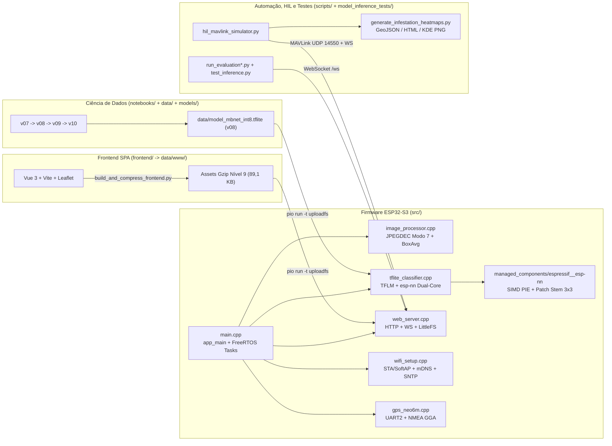

# Mapa de Implementação e Módulos — Projeto Sugarcane

Este documento apresenta o inventário técnico completo dos módulos implementados no repositório `sugarcane` no commit `49d53a8` (`23/11/2026`), cobrindo firmware C++, tarefas FreeRTOS, hierarquia de memória, frontend Vue 3, pipelines de ML, scripts Python, testes, CI e monografia.

---

## 1. Arquitetura de Componentes do Repositório

---

## 2. Módulos do Firmware C++ (`src/` e `managed_components/`)

| Módulo | Responsabilidade Principal | Símbolos / Primitivas-Chave |
| :--- | :--- | :--- |
| [src/main.cpp](../../src/main.cpp) | Ponto de entrada, montagem LittleFS, sensor térmico, log CSV, filas e tasks FreeRTOS | `app_main`, `decode_task`, `inference_task`, `telemetry_task`, `csv_lock`, `csv_unlock`, `csv_clear_history`, `s_csv_mutex`, `s_last_fps`, `DecodedJob` |
| [src/image_processor.cpp](../../src/image_processor.cpp) / [.h](../../src/image_processor.h) | Decodificação JPEG MCU, Box Averaging 24-bit, LUTs SRAM e quantização `int8` | `process_jpeg`, `process_jpeg_option_c_boxavg_rgb8888`, `BoxAccumulator` (`alignas(8)`), `s_src_to_dst_x/y`, `finalize_box_average_to_tensor` |
| [src/tflite_classifier.cpp](../../src/tflite_classifier.cpp) / [.h](../../src/tflite_classifier.h) | Motor TFLite Micro, buffers SRAM para `esp-nn`, Fork-Join e formatação JSON | `classifier_init`, `classifier_enable_dual_core`, `classifier_run`, `MicroMutableOpResolver<6>`, `s_sram_scratch_buf`, `LABELS[11]` |
| [src/web_server.cpp](../../src/web_server.cpp) / [.h](../../src/web_server.h) | Servidor HTTP/WS assíncrono, streaming LittleFS Gzip, CSV e fila de envio segura | `web_server_start`, `ws_handler`, `WsWorkItem`, `ws_send_work_cb`, `stream_file_chunks`, `assets_handler`, `export_csv_handler`, `s_ws_mutex` |
| [src/wifi_setup.cpp](../../src/wifi_setup.cpp) / [.h](../../src/wifi_setup.h) | Wi-Fi híbrido STA/SoftAP com NVS/Kconfig, mDNS (`sugarcane.local`) e SNTP | `wifi_init_auto`, `load_wifi_credentials_from_nvs`, `start_softap`, `start_mdns`, `init_sntp_once`, `event_handler` |
| [src/gps_neo6m.cpp](../../src/gps_neo6m.cpp) / [.h](../../src/gps_neo6m.h) | Receptor GPS NEO-6M via UART2 (`9600 bps`) e parser NMEA `$GxGGA` | `gps_neo6m_init`, `gps_task`, `parse_gga`, `validate_nmea_checksum`, `nmea_to_decimal`, `gps_get_state`, `s_gps_mutex` |
| [src/Kconfig.projbuild](../../src/Kconfig.projbuild) | Menu de configuração ESP-IDF para Wi-Fi, pinos UART do GPS e `auth_token` | `CONFIG_SUGARCANE_WIFI_*`, `CONFIG_SUGARCANE_GPS_UART_*`, `CONFIG_SUGARCANE_WS_AUTH_TOKEN` |
| [esp_nn_conv_esp32s3.c](../../managed_components/espressif__esp-nn/src/convolution/esp_nn_conv_esp32s3.c) | Patch na camada Stem $3\times 3$ (`esp_nn_conv_s8_im2col_s3`) para usar SRAM scratch | `esp_nn_conv_s8_im2col_s3`, `esp_nn_multicore.c` |

* **Dependências ESP-IDF ([src/idf_component.yml](../../src/idf_component.yml)):** `espressif/esp-tflite-micro` (`^1.3.1`), `joltwallet/littlefs` (`^1.14.4`) e `espressif/mdns` (`^1.3.0`).
* **Dependência PlatformIO ([platformio.ini](../../platformio.ini)):** `bitbank2/JPEGDEC` (`^1.2.8`), `board_build.f_cpu = 240000000L`, `-D CONFIG_NN_SKIP_NUDGE=1`, `-D SKIP_NUDGE=1`.

---

## 3. Mapa de Tasks FreeRTOS e Sincronização

| Task | Núcleo | Prioridade | Stack | Função / Origem | Filas e Primitivas |
| :--- | :---: | :---: | :---: | :--- | :--- |
| `decode_task` | Core 0 | 5 | 8.192 B | [src/main.cpp](../../src/main.cpp) | Consome `inference_queue` (5) e `free_tensor_queue` (2); produz `decoded_queue` (2) |
| `inference_task` | Core 1 | 5 | 8.192 B | [src/main.cpp](../../src/main.cpp) | Consome `decoded_queue`; devolve `free_tensor_queue`; usa `s_csv_mutex` e `s_ws_mutex` |
| `esp_nn_worker` | Core 0 | `configMAX_PRIORITIES - 2` | 8.192 B | `esp_nn_multicore.c` | Semáforo interno `esp-nn` (Fork-Join com `inference_task`) |
| `httpd` | Core 0 | 2 | 10.240 B | [src/web_server.cpp](../../src/web_server.cpp) | `max_open_sockets = 7`, `lru_purge_enable = true`, `httpd_queue_work` |
| `telemetry_task` | Core 0 | 2 | 4.096 B | [src/main.cpp](../../src/main.cpp) | Loop 1 Hz; lê `gps_get_state()`, temperatura e heap; envia via `s_ws_mutex` |
| `gps_task` | Core 0 | 2 | 3.072 B | [src/gps_neo6m.cpp](../../src/gps_neo6m.cpp) | Lê `UART_NUM_2` (`RX=18`, `TX=17`, `9600 bps`); atualiza `s_gps_state` sob `s_gps_mutex` |

---

## 4. Mapa de Memória Consolidado (ESP32-S3 N8R16)

### 4.1. Flash Quad SPI (16 MB — [partitions.csv](../../partitions.csv))
* `nvs` (`0x4000`), `otadata` (`0x2000`), `phy_init` (`0x1000`), `factory` (**4 MB**, firmware C++), `storage` (**10 MB**, LittleFS contendo `/storage/model_mbnet_int8.tflite`, `/storage/www/*` e `/storage/inspections.csv`).

### 4.2. SRAM Interna (512 KB) vs. Octal PSRAM (8 MB @ 80 MHz DDR)

| Estrutura / Buffer | Tamanho | Localização | Módulo |
| :--- | :---: | :---: | :--- |
| `s_sram_scratch_buf` | `48 KB` (`49.152 B`) | **SRAM Interna** (`DMA`, `alignas(16)`) | [src/tflite_classifier.cpp](../../src/tflite_classifier.cpp) |
| `worker_sram` (`esp_nn_dual_core_scratch`) | `25 KB` (`25.600 B`) | **SRAM Interna** (`SIMD`, `alignas(16)`) | [src/tflite_classifier.cpp](../../src/tflite_classifier.cpp) |
| LUTs `s_src_to_dst_x/y` + `s_target_src_x/y` | `~8,6 KB` (`8.832 B`) | **SRAM Interna** (`.bss`) | [src/image_processor.cpp](../../src/image_processor.cpp) |
| `result_json` | `1 KB` (`1.024 B`) | **SRAM Interna** (`.bss`) | [src/tflite_classifier.cpp](../../src/tflite_classifier.cpp) |
| `tensor_arena` | `800 KB` (`819.200 B`) | **Octal PSRAM** | [src/tflite_classifier.cpp](../../src/tflite_classifier.cpp) |
| `model_buffer` | `~624 KB` (`639.272 B`) | **Octal PSRAM** | [src/tflite_classifier.cpp](../../src/tflite_classifier.cpp) |
| `s_box_acc` (`BoxAccumulator[25600]`) | **`200 KB`** (`204.800 B`, `alignas(8)`) | **Octal PSRAM** | [src/image_processor.cpp](../../src/image_processor.cpp) |
| Pool *Double Buffer* (`2 × 76,8 KB`) | `150 KB` (`153.600 B`) | **Octal PSRAM** | [src/main.cpp](../../src/main.cpp) |
| Payloads WS / Chunks HTTP (`2 KB`) | Dinâmico | **Octal PSRAM** (fallback `malloc`) | [src/web_server.cpp](../../src/web_server.cpp) |

---

## 5. Frontend SPA (`frontend/` → `data/www/`)

* **Stack ([frontend/package.json](../../frontend/package.json)):** Vue `^3.5.13`, Vite `^6.0.7`, Leaflet `^1.9.4`, `leaflet.heat ^0.2.0`.
* **Build ([frontend/vite.config.js](../../frontend/vite.config.js)):** `cssCodeSplit: false`, minificação `esbuild`, nomes determinísticos (`assets/index.js`, `assets/style.css`).
* **Componentes ([frontend/src/](../../frontend/src)):** `App.vue` (estado global, WS, `/api/export-csv`), `Navbar.vue`, `TelemetryCards.vue`, `LiveInferenceCard.vue`, `MapViewer.vue` (OSM padrão + Esri + fallback offline), `InspectionsTable.vue`.
* **Empacotamento:** [scripts/build_and_compress_frontend.py](../../scripts/build_and_compress_frontend.py) executa `npm run build` e comprime em Gzip nível 9 para `data/www/` (`89,1 KB` comprimido).

---

## 6. Pipelines de ML, Scripts, Testes, CI e TCC

* **Notebooks ([notebooks/](../../notebooks)):** `v07` (CNN Custom vs MobileNetV2), `v08` (Auditoria MD5 + `area` + Focal Loss → `data/model_mbnet_int8.tflite`), `v09` (ablação $\alpha \in \{0.35, 0.50, 0.75\}$ → `models/v9/`), `v10` (proposta multi-resolução `192×192`/`224×224` + `SpatialDropout2D`).
* **Scripts ([scripts/](../../scripts)):** [test_inference.py](../../scripts/test_inference.py), [hil_mavlink_simulator.py](../../scripts/hil_mavlink_simulator.py), [generate_infestation_heatmaps.py](../../scripts/generate_infestation_heatmaps.py), [build_and_compress_frontend.py](../../scripts/build_and_compress_frontend.py).
* **Benchmarks ([model_inference_tests/](../../model_inference_tests)):** `run_evaluation.py`, `run_evaluation_dualcore.py`, `run_evaluation_espnn_sram.py`, `run_evaluation_all_dataset.py`.
* **Testes & CI:** [test/test_image_math/test_main.cpp](../../test/test_image_math/test_main.cpp) (Unity) e [.github/workflows/ci.yml](../../.github/workflows/ci.yml) (`npm run build` + `pio run`).
* **Acadêmico ([tcc/](../../tcc)):** Monografia ABNT (`main.tex`, `main_standalone.pdf`) e artigo (`artigo_ifpe.tex`, `artigo_ifpe.pdf`).
