# 🧭 Diagnóstico Geral do Projeto, Análise de Pendências, Oportunidades Técnicas e Plano de Ação

**Data da Auditoria:** 07 de Novembro de 2026  
**Escopo Analisado:** Firmware C++ ([`src/`](file:///home/victor/projects/sugarcane/src)), Configurações ESP-IDF/PlatformIO ([`platformio.ini`](file:///home/victor/projects/sugarcane/platformio.ini), [`sdkconfig.defaults`](file:///home/victor/projects/sugarcane/sdkconfig.defaults), [`partitions.csv`](file:///home/victor/projects/sugarcane/partitions.csv)), Pipeline de Ciência de Dados ([`notebooks/`](file:///home/victor/projects/sugarcane/notebooks)), Suíte de Testes ([`model_inference_tests/`](file:///home/victor/projects/sugarcane/model_inference_tests), [`scripts/`](file:///home/victor/projects/sugarcane/scripts)), Documentação Técnica ([`docs/`](file:///home/victor/projects/sugarcane/docs)) e Monografia do TCC ([`tcc/`](file:///home/victor/projects/sugarcane/tcc)).

---

## 1. Sumário Executivo: Estado Atual vs. Proposta Completa

O projeto alcançou marcos expressivos tanto em **Ciência de Dados** (auditoria criptográfica MD5, expurgo de 1.361 imagens contaminadas/duplicadas e treinamento QAT do modelo `v08` com **91,09% de acurácia limpa** e **89,41% em validação inédita**) quanto em **Engenharia de Sistemas Embarcados no ESP32-S3** (redução do tempo de inferência de **777,4 ms para 336,3 ms** e do tempo de decodificação JPEG de **1.123,1 ms para 145,2 ms**).

Contudo, a auditoria cruzada entre o código-fonte, a memória Flash atual do microcontrolador, os logs dos benchmarks e os capítulos da monografia ([`tcc/`](file:///home/victor/projects/sugarcane/tcc)) revelou **6 pendências estruturais** (de implantação, rede, validação e aderência ao escopo do TCC) e **4 oportunidades de otimização de alto impacto** ainda inexploradas.

```mermaid
flowchart TB
    subgraph CONQUISTADO["✅ O Que Já Está Consolidado"]
        A1["Dataset Auditado via MD5\n(5.389 imgs puras | Split 80/20)"]
        A2["Modelo MobileNetV2 INT8 v08\n(91,09% Limpo | 89,41% Val)"]
        A3["Motor ESP-NN Dual-Core + 73 KB SRAM\n(Inferência: 336,3 ms @ 240 MHz)"]
        A4["JPEGDraw Modo 7 + LUTs + IDCT\n(Decodificação: 145,2 ms)"]
    end

    subgraph PENDENCIAS["⚠️ Pendências Identificadas (Gaps)"]
        P1["P1. Implantação LittleFS:\nESP32 ainda roda o modelo v07 na Flash"]
        P2["P2. Estabilidade WebSocket/Wi-Fi:\nModem Sleep ativo + Resets TCP (Errno 104)"]
        P3["P3. Validação no Hardware:\nFalta testar v08 embarcado no lote limpo/val"]
        P4["P4. Escopo TCC (MAVLink & HIL):\nFalta código C++/Python da bancada SITL e mapas"]
        P5["P5. Monografia LaTeX (tcc/):\nTabelas com números antigos e figuras comentadas"]
        P6["P6. Produto & Segurança:\nCredenciais Wi-Fi fixas e falta UI na rota GET /"]
    end

    subgraph OPORTUNIDADES["🚀 Novas Oportunidades de Engenharia"]
        O1["O1. Octal PSRAM a 80 MHz\n(Atualmente em 40 MHz -> -25% tempo inferência)"]
        O2["O2. Compactação 16-bit do BoxAccumulator\n(Reduz buffer de 400 KB para 200 KB)"]
        O3["O3. Compilação -O3 (Performance)\n(Substituir -Os padrão do ESP-IDF)"]
        O4["O4. Calibração de Escala IDCT (1/2 vs 1/4)\n(Equilíbrio ótimo Velocidade vs. Acurácia v08)"]
    end

    CONQUISTADO --> PENDENCIAS
    PENDENCIAS --> OPORTUNIDADES
```

---

## 2. Diagnóstico Detalhado das Pendências (Desenvolvimento, Testes e Implantação)

### 🔴 P1. [Implantação Crítica] O Modelo `v08` Ainda Não Foi Gravado na Partição LittleFS do ESP32-S3
* **Evidência Técnica:**
  * O arquivo [`data/model_mbnet_int8.tflite`](file:///home/victor/projects/sugarcane/data/model_mbnet_int8.tflite) no computador contém o novo modelo `v08` (`MD5: 95abc002c2e9c49175c9f5cc69a1a909`), atualizado no commit `7b1edff`.
  * Porém, nos procedimentos de gravação no hardware, executamos apenas `pio run -t upload` (que grava o aplicativo na partição `factory` em `0x10000`), **sem executar `pio run -t uploadfs`** (que grava a partição `storage` LittleFS em `0x410000`).
  * Como consequência, o ESP32-S3 carregou da Flash o binário antigo (`v07`, `MD5: bfe792823603ff822be86c426aecb1e5`). Isso explica por que, na bateria recém-concluída ([`RELATORIO_DESEMPENHO_ESP_NN_SRAM.md`](file:///home/victor/projects/sugarcane/model_inference_tests/RELATORIO_DESEMPENHO_ESP_NN_SRAM.md)), a classe `smut` teve apenas **2/50 acertos (4,0%)** com 36 amostras confundidas com `Pokkah Boeng` — assinatura exata do modelo `v07` contaminado!
* **Ação Necessária:**
  * Executar `pio run -t uploadfs --upload-port /dev/ttyUSB0` para embarcar efetivamente o modelo `v08` no microcontrolador.

---

### 🔴 P2. [Desenvolvimento / Rede] Instabilidade de Conexão WebSocket, *Wi-Fi Modem Sleep* e Condição de Corrida
* **Evidência Técnica:**
  * Embora o tempo total de processamento interno no ESP32-S3 tenha caído para apenas **`481,5 ms`** (`145,2 ms` de decodificação + `336,3 ms` de inferência), o tempo total de parede do lote de 550 imagens subiu para **3.945,8 s (~65,7 minutos)** devido a quedas periódicas de conexão (`ConnectionResetError: [Errno 104]`) e *timeouts* de 10 a 30 segundos na reconexão.
  * Inspecionando [`src/wifi_setup.cpp`](file:///home/victor/projects/sugarcane/src/wifi_setup.cpp), [`src/web_server.cpp`](file:///home/victor/projects/sugarcane/src/web_server.cpp) e [`src/main.cpp`](file:///home/victor/projects/sugarcane/src/main.cpp), identificamos 4 causas raiz no código:
    1. **Modo de Economia de Energia Wi-Fi Ativo (`wifi:pm start, type: 1`):** O ESP-IDF ativa por padrão `WIFI_PS_MIN_MODEM`, desligando a antena Wi-Fi entre *beacons* do roteador. Sob envio intenso de JPEGs de ~100 KB, isso causa perda de janelas TCP e resets de conexão.
    2. **Esgotamento de Sockets no `esp_http_server`:** Em [`web_server_start()`](file:///home/victor/projects/sugarcane/src/web_server.cpp#L35-L47), utiliza-se `HTTPD_DEFAULT_CONFIG()`, que limita `max_open_sockets = 7` e não ativa `lru_purge_enable = true`. Quando o cliente Python sofre um *timeout* e abre uma nova conexão WebSocket, os descritores antigos permanecem presos em espera no servidor HTTP até o *timeout* do sistema operacional, bloqueando novas conexões.
    3. **Condição de Corrida no Buffer `result_json`:** Em [`src/main.cpp`](file:///home/victor/projects/sugarcane/src/main.cpp#L108) e [`src/web_server.cpp`](file:///home/victor/projects/sugarcane/src/web_server.cpp#L49-L57), `httpd_ws_send_frame_async()` enfileira o envio assíncrono apontando para o buffer estático global `result_json[1024]`. Em modo *pipelined*, a `inference_task` pode iniciar a próxima inferência e sobrescrever `result_json` antes de a thread do `httpd` concluir a transmissão TCP do quadro anterior.
    4. **Alocação sem Resposta de Erro:** Em [`ws_handler()`](file:///home/victor/projects/sugarcane/src/web_server.cpp#L20-L31), se `heap_caps_malloc(ws_pkt.len, MALLOC_CAP_SPIRAM)` falhar ou `httpd_ws_recv_frame` retornar erro, o servidor não envia mensagem JSON de erro ao cliente, deixando o cliente bloqueado esperando `ws.recv()` até estourar o *timeout* de 20 segundos.

---

### 🟠 P3. [Testes e Validação] Ausência de Benchmark no Hardware com o Modelo `v08` sobre o Dataset Limpo e de Validação (`val/`)
* **Evidência Técnica:**
  * Os relatórios do modelo `v08` ([`RELATORIO_COMPARATIVO_JPEGDRAW_V08.md`](file:///home/victor/projects/sugarcane/model_inference_tests/RELATORIO_COMPARATIVO_JPEGDRAW_V08.md)) foram gerados em simulação Python no host.
  * Todos os três testes executados no hardware físico ESP32-S3 via WebSocket utilizaram a lista alfabética bruta (`[:50]` de cada pasta, que inclui pares de arquivos com colisão cruzada MD5) e com o modelo `v07` na Flash.
  * Além disso, na análise por classe da última bateria, verificou-se que:
    * As pastas `Grassy shoot` (29 de 50 fotos) e `Healthy Leaves` (15 de 50 fotos) possuem imagens de resolução **$768 \times 576$**. Como $576 \gg 2 = 144 < 160$, o seletor adaptativo usou `JPEG_SCALE_HALF` ($1/2$, levando ~266 ms) em vez de `JPEG_SCALE_QUARTER` ($1/4$, ~122 ms).
    * A redução `JPEG_SCALE_QUARTER` ($1/4$) na biblioteca `JPEGDEC` utiliza uma IDCT $2 \times 2$ aproximada que diverge sutilmente da interpolação por área (`interpolation="area"`) usada no treinamento do `v08`.
* **Ação Necessária:**
  * Após gravar o `v08` na Flash (`uploadfs`), executar no hardware físico:
    1. Bateria de 550 amostras limpas (sem colisão MD5) comparando `scale_option = 0` (Full IDCT + BoxAvg, que a 240 MHz levará ~740 ms de decode, porém **100% paridade matemática com o treino**) vs. `JPEG_SCALE_HALF` (~240 ms) vs. `JPEG_SCALE_QUARTER` (~122 ms).
    2. Bateria sobre o conjunto de validação inédito (`val/`).

---

### 🟠 P4. [Desenvolvimento / Proposta do TCC] Implementação da Integração MAVLink, Co-Simulação HIL e Mapas de Calor
* **Evidência Técnica:**
  * Nos capítulos [`01_introducao.tex`](file:///home/victor/projects/sugarcane/tcc/capitulos/01_introducao.tex#L35-L49), [`03_metodologia.tex`](file:///home/victor/projects/sugarcane/tcc/capitulos/03_metodologia.tex#L213-L237) e [`04_resultados_e_discussoes.tex`](file:///home/victor/projects/sugarcane/tcc/capitulos/04_resultados_e_discussoes.tex#L153-L165) da monografia, o objetivo geral do trabalho contempla:
    1. Máquina de estados **Parada Amostral Sistemática (*Pause-and-Classify*)** via protocolo **MAVLink** (`MAV_CMD_DO_PAUSE_CONTINUE` / modo `LOITER`, leitura de telemetria `GLOBAL_POSITION_INT`).
    2. **Bancada de Co-Simulação Hardware-in-the-Loop (HIL)** conectando o simulador de voo ao ESP32-S3 físico.
    3. Gravação de **logs CSV georreferenciados** (`timestamp, latitude, longitude, altitude, classe_predita, confianca`) e geração automática de **mapas de calor fitossanitários (Heatmaps)**.
  * Atualmente, **nenhum script ou módulo de integração MAVLink/HIL/Georreferenciamento consta no repositório**.
* **Ação Necessária:**
  * Implementar o módulo de telemetria/comando MAVLink no firmware (ou endpoint JSON estendido com coordenadas GPS/MAVLink) e criar a suíte `hil_simulation/` em Python contendo:
    * Simulador/Orquestrador HIL de missão de voo em grade sobre talhão agrícola (compatível com ArduPilot SITL / `pymavlink` ou simulação cinemática autônoma determinística);
    * Comunicação direta com o ESP32-S3 físico (envio da imagem da coordenada da planta + recepção da decisão + comando de pausa/continuação);
    * Exportação do arquivo `telemetria_missao_hil.csv` e script gerador dos mapas de calor georreferenciados (PNG/PDF para inclusão direta no TCC).

---

### 🟡 P5. [Documentação Acadêmica] Atualização da Monografia LaTeX (`tcc/`) e Geração das Figuras Científicas
* **Evidência Técnica:**
  * No arquivo [`tcc/capitulos/04_resultados_e_discussoes.tex`](file:///home/victor/projects/sugarcane/tcc/capitulos/04_resultados_e_discussoes.tex#L135-L150), a Tabela `\ref{tab:benchmark_hardware}` ainda apresenta apenas as duas primeiras gerações (`626,6 ms` e `777,4 ms` de inferência; `814,0 ms` e `1.032,4 ms` de decode), não incluindo a nova arquitetura com **Scratch Buffers em SRAM + Fork-Join Dual-Core + 240 MHz + IDCT**, que reduziu a inferência para **`336,3 ms`** e a decodificação para **`145,2 ms`**.
  * No arquivo [`tcc/capitulos/03_metodologia.tex`](file:///home/victor/projects/sugarcane/tcc/capitulos/03_metodologia.tex#L187-L192), os blocos `\begin{figure}` (como `figuras/arquitetura_paralela.png`) estão comentados com `%` porque o diretório `tcc/figuras/` ainda não foi povoado com os diagramas e gráficos de alta resolução (matrizes de confusão, curvas de velocidade, mapas de calor).
  * Há arquivos temporários de compilação LaTeX (`*.aux`, `*.bbl`, `*.blg`, `*.log`, `*.out`, `*.toc`) não ignorados pelo [`.gitignore`](file:///home/victor/projects/sugarcane/.gitignore).

---

### 🟡 P6. [Produto, Segurança e Usabilidade] Credenciais Hardcoded, Rota Web `/` e Scripts Auxiliares
* **Evidência Técnica:**
  1. **Credenciais em Texto Claro:** Em [`src/wifi_setup.cpp`](file:///home/victor/projects/sugarcane/src/wifi_setup.cpp#L10-L11), `WIFI_SSID` e `WIFI_PASS` estão fixos no código-fonte.
  2. **Ausência de Interface Web Embarcada na Rota `/`:** O [`GUIA_DE_USO.md`](file:///home/victor/projects/sugarcane/GUIA_DE_USO.md#L117-L185) instrui o usuário a copiar manualmente um código HTML para um arquivo local `cliente.html`. Como a partição `storage` (LittleFS) possui **10 MB** e usa apenas **624 KB** (~6% de ocupação), o próprio ESP32-S3 pode servir uma interface web completa e moderna em `http://<IP_DO_ESP32>/` via handler `HTTP_GET /`.
  3. **Defasagem no [`scripts/test_inference.py`](file:///home/victor/projects/sugarcane/scripts/test_inference.py#L43-L75):** O script local ainda usa `Image.Resampling.BILINEAR` (linha 43) em vez de `Image.Resampling.BOX` (que corresponde ao treino `v08` e ao `Modo 7` do ESP32) e aponta para um diretório padrão inexistente (linha 74).

---

## 3. Novas Oportunidades de Otimização de Engenharia (Hardware & Firmware)

Além de sanar as pendências acima, identificamos **4 melhorias técnicas** que podem elevar ainda mais o patamar de desempenho do sistema:

| ID | Oportunidade Técnica | Situação Atual no Projeto | Proposta de Melhoria | Ganho Estimado |
| :-: | :--- | :--- | :--- | :---: |
| **O1** | **Aceleração da Octal PSRAM de 40 MHz para 80 MHz** | No log de boot (`I (346) esp_psram: Speed: 40MHz`), a PSRAM Octal opera a **40 MHz** (`CONFIG_SPIRAM_SPEED_40M=y` no [`sdkconfig.esp32-s3-devkitm-1`](file:///home/victor/projects/sugarcane/sdkconfig.esp32-s3-devkitm-1#L1014)). | Habilitar `CONFIG_SPIRAM_SPEED_80M=y` (80 MHz DDR/SDR). Como os pesos da rede (624 KB) e a `tensor_arena` (800 KB) residem na PSRAM, dobrar o clock do barramento reduz drasticamente o tempo de busca de pesos e mapas de ativação. | **Redução da inferência de `336 ms` para `~230–260 ms` (-25% a -30%)** |
| **O2** | **Compactação de 50% da Estrutura `BoxAccumulator` (16 B $\rightarrow$ 8 B)** | Em [`src/image_processor.cpp`](file:///home/victor/projects/sugarcane/src/image_processor.cpp#L26-L32), `BoxAccumulator` usa três `uint32_t` (`sum_r`, `sum_g`, `sum_b`) e dois `uint16_t`, ocupando 16 bytes por pixel ($25.600 \times 16 = \mathbf{409,6\text{ KB}}$). | Mesmo em uma foto $1024 \times 1024$, cada célula $160 \times 160$ acumula no máximo $7 \times 7 = 49$ pixels. Logo, a soma máxima por canal é $49 \times 255 = \mathbf{12.495}$, que cabe com folga em um **`uint16_t` (máx 65.535)**! Usar `struct alignas(8) { uint16_t sum_r, sum_g, sum_b, count; }` reduz o buffer de **400 KB para 200 KB** e dobra a taxa de acerto na DCache. | **-50% de uso de PSRAM no decode e -50% no tempo de `memset` / leitura** |
| **O3** | **Otimização do Compilador para Desempenho (`-O3` / `PERF`)** | Em [`sdkconfig.esp32-s3-devkitm-1`](file:///home/victor/projects/sugarcane/sdkconfig.esp32-s3-devkitm-1), o ESP-IDF utiliza a flag padrão de tamanho (`CONFIG_COMPILER_OPTIMIZATION_SIZE=y` / `-Os`). | Ativar `CONFIG_COMPILER_OPTIMIZATION_PERF=y` (`-O2` / `-O3`), habilitando *loop unrolling* e *inlining* agressivo no `JPEGDEC` e nos wrappers do TFLite Micro. | **Ganho de ~8% a 15% em decodificação e pós-processamento** |
| **O4** | **Modo Configurável de Escala IDCT via WebSocket/API** | A escala IDCT (`1/4`, `1/2` ou `1/1`) está fixa no código em [`src/image_processor.cpp`](file:///home/victor/projects/sugarcane/src/image_processor.cpp#L265-L280). | Permitir selecionar entre **Modo Alta Velocidade** (IDCT $1/4$ + BoxAvg: ~122 ms decode) e **Modo Máxima Precisão** (Full IDCT $1/1$ ou $1/2$ + BoxAvg: paridade bit-a-bit com `interpolation="area"`). | **Flexibilidade total entre tempo real (<500 ms) e máxima acurácia (91,09%)** |
| **O5** | **Monitoramento Térmico On-Chip e Telemetria no Payload (`temperature_sensor`)** | O ESP32-S3 opera a 240 MHz com Dual-Core, Octal PSRAM em 80 MHz e Wi-Fi sem monitoramento térmico. Em payload confinado no drone sob sol pleno, o superaquecimento pode degradar a estabilidade. | Ativar o sensor de temperatura interno via driver oficial ESP-IDF (`driver/temperature_sensor.h`), incluir a leitura no JSON de resposta WebSocket (`"temp_c": 54.2`), registrar temperatura nos logs georreferenciados e implementar proteção (*Thermal Throttling*) se $T > 75\,^\circ\text{C}$. | **Confiabilidade operacional em campo, prevenção de travamentos térmicos e enriquecimento de telemetria agronômica** |

---

## 4. Plano de Ação Estruturado (Roadmap de Execução)

Abaixo está o plano de ação dividido em **4 Fases Sequenciais**, priorizadas pela relação entre impacto imediato e esforço de implementação:

### Fase 1: Implantação do Modelo `v08` na Flash e Estabilização da Rede/Hardware *(Prioridade Máxima — Imediata)*
1. **Embarcar a Partição LittleFS (`v08`):**
   * Executar `pio run -t uploadfs --upload-port /dev/ttyUSB0` para gravar o [`data/model_mbnet_int8.tflite`](file:///home/victor/projects/sugarcane/data/model_mbnet_int8.tflite) (`v08`) na partição `/storage` do ESP32-S3.
2. **Blindar o Subsistema Wi-Fi e WebSocket:**
   * Em [`src/wifi_setup.cpp`](file:///home/victor/projects/sugarcane/src/wifi_setup.cpp): Desativar o *Modem Sleep* com `esp_wifi_set_ps(WIFI_PS_NONE)` logo após `esp_wifi_start()`.
   * Em [`src/web_server.cpp`](file:///home/victor/projects/sugarcane/src/web_server.cpp): Configurar `config.lru_purge_enable = true`, `config.max_open_sockets = 7`, adicionar envio de JSON de erro caso o frame falhe, e eliminar a condição de corrida copiando o JSON para um buffer próprio do pacote antes do envio assíncrono (ou usando `httpd_ws_send_frame` sincronizado).
3. **Ativar as Otimizações O1, O2 e O3:**
   * Configurar `CONFIG_SPIRAM_SPEED_80M=y` e `CONFIG_COMPILER_OPTIMIZATION_PERF=y` em [`sdkconfig.defaults`](file:///home/victor/projects/sugarcane/sdkconfig.defaults).
   * Compactar `BoxAccumulator` para 8 bytes (`uint16_t`) em [`src/image_processor.cpp`](file:///home/victor/projects/sugarcane/src/image_processor.cpp).

### Fase 2: Bateria Definitiva de Validação no Hardware (`v08` Limpo e Validação) *(Prioridade Alta)*
1. **Benchmark do Modelo `v08` Embarcado:**
   * Executar [`model_inference_tests/run_evaluation_espnn_sram.py`](file:///home/victor/projects/sugarcane/model_inference_tests/run_evaluation_espnn_sram.py) com o `v08` na Flash sobre:
     * As **550 amostras limpas** (sem colisão MD5), comprovando no hardware físico os **91,09% de acurácia** e a eliminação da confusão entre `smut` e `Pokkah Boeng`;
     * As **550 amostras brutas** para registro histórico comparativo completo.
2. **Avaliação de Sensibilidade de Escala IDCT ($1/1$ vs. $1/2$ vs. $1/4$):**
   * Medir no ESP32-S3 a relação exata entre Tempo de Decodificação e Acurácia Global nos 3 fatores de escala com o modelo `v08`.

### Fase 3: Implementação da Bancada HIL, MAVLink, Telemetria Térmica e Mapas de Calor para o TCC *(Prioridade Alta — Aderência Acadêmica)*
1. **Telemetria e Controle *Pause-and-Classify*:**
   * Adicionar suporte a mensagens/comandos de waypoint e telemetria no firmware e criar o script `scripts/run_hil_mavlink_simulation.py`.
2. **Integração do Sensor de Temperatura Interno On-Chip (`driver/temperature_sensor.h`):**
   * Inicializar o sensor analógico de temperatura nos núcleos de silício do ESP32-S3 via `temperature_sensor_install` e `temperature_sensor_enable`.
   * Incluir o campo `"temperatura_c": <float>` no JSON assíncrono emitido por `classifier_run()` / `web_server_send_ws_text()`.
   * Implementar rotina de segurança com alerta preventivo (*thermal warning*) caso a temperatura ultrapasse $75\,^\circ\text{C}$ durante regimes severos de sobrevoo contínuo.
3. **Geração de Logs Georreferenciados e Mapas Fitossanitários:**
   * Simular uma missão autônoma em grade sobre um talhão real de cana-de-açúcar interagindo em malha fechada com o ESP32-S3 físico, gerando o CSV georreferenciado (`latitude, longitude, altitude, classe, confianca, temperatura_c, decode_ms, inferencia_ms`) e plotando automaticamente os mapas de calor (*heatmaps*) de infestação.

### Fase 4: Consolidação da Monografia (`tcc/`), Interface Web Embarcada e Fechamento Git *(Prioridade Média)*
1. **Atualização do TCC e Figuras:**
   * Atualizar [`tcc/capitulos/04_resultados_e_discussoes.tex`](file:///home/victor/projects/sugarcane/tcc/capitulos/04_resultados_e_discussoes.tex) com as tabelas das 4 gerações de firmware (incluindo os tempos de `336,3 ms` / `~240 ms` a 80 MHz PSRAM).
   * Gerar os gráficos científicos em `tcc/figuras/`, descomentar as figuras nos `.tex` e recompilar o PDF final (`main.pdf` / `main_standalone.pdf`).
2. **Usabilidade e Limpeza de Repositório:**
   * Servir a interface web interativa diretamente na rota `GET /` do ESP32-S3 (lida do LittleFS) e atualizar [`scripts/test_inference.py`](file:///home/victor/projects/sugarcane/scripts/test_inference.py) para `Image.Resampling.BOX`.
   * Atualizar [`.gitignore`](file:///home/victor/projects/sugarcane/.gitignore) e realizar os commits organizados de todas as entregas.

---

## 5. Matriz Resumo de Priorização

| Prioridade | Item | Tipo | Esforço | Impacto no Projeto / TCC |
| :---: | :--- | :---: | :---: | :--- |
| **P0 (Imediato)** | **P1:** Gravar modelo `v08` na Flash (`pio run -t uploadfs`) | Implantação | 2 min | **Crítico:** Faz o ESP32-S3 saltar de 83% (`v07`) para **91,09% de acurácia (`v08`)** e corrige `smut` (4% $\rightarrow$ 84%). |
| **P0 (Imediato)** | **P2:** Desativar Wi-Fi Power Save + `lru_purge` no WebSocket | Firmware | 10 min | **Crítico:** Elimina os *resets* TCP (`Errno 104`) e reduz o tempo do lote de 65 min para **~4,5 min**. |
| **P1 (Alto)** | **O1 + O2 + O3:** PSRAM @ 80 MHz + `BoxAccumulator` 8B + `-O2/-O3` | Otimização | 15 min | **Alto:** Reduz ainda mais a inferência (~336 ms $\rightarrow$ ~240 ms) e corta 200 KB de uso de PSRAM. |
| **P1 (Alto)** | **P3:** Rodar Benchmark no ESP32-S3 com `v08` embarcado | Testes | 10 min | **Alto:** Comprova no hardware físico a acurácia do `v08` junto com a nova velocidade de 240 MHz. |
| **P2 (Médio)** | **P4:** Script de Co-Simulação HIL MAVLink + Mapa de Calor | TCC / Dev | 30 min | **Alto:** Materializa no repositório 100% dos objetivos específicos 5 e 6 descritos no TCC. |
| **P2 (Médio)** | **O5:** Monitoramento Térmico On-Chip e Telemetria no JSON | Firmware | 15 min | **Médio/Alto:** Monitora aquecimento a 240 MHz/PSRAM 80 MHz e previne *thermal throttling* em campo. |
| **P3 (Normal)** | **P5 + P6:** Atualizar tabelas/figuras do LaTeX (`tcc/`), UI Web `/` e Git | Doc / Produto | 25 min | **Médio:** Deixa a monografia PDF e o repositório prontos para defesa e apresentação. |

---

## 5. Tarefas Futuras Registradas (Roadmap de Continuidade Pós-TCC)

### TF1 — Adaptação de Domínio Multidataset e Inclusão da Podridão Vermelha (*RedRot*)
- **Contexto:** A avaliação exaustiva de 9.269 imagens no ESP32-S3 revelou que imagens de repositórios externos com diferentes sensores, iluminação de estúdio e relações de aspecto (dataset *archive* de 2.521 amostras) sofrem com *Domain Shift*, concentrando 81,3% das predições em *Brown Spot* devido ao desbalanceamento a priori de classes no treino original. Além disso, a doença *Red Rot* (*Colletotrichum falcatum*) não faz parte das 11 classes primárias do modelo atual.
- **Ação Futura:**
  1. Realizar *Transfer Learning* / *Domain Adversarial Training* (DANN) para alinhar as representações latentes entre diferentes sensores de câmera e condições de iluminação.
  2. Expandir a saída da rede para 12 classes, integrando *Red Rot* ao catálogo taxonômico do classificador.
  3. Requantizar o modelo resultante para INT8 com `interpolation="area"` e validar o novo arquivo `.tflite` no firmware ESP32-S3.
