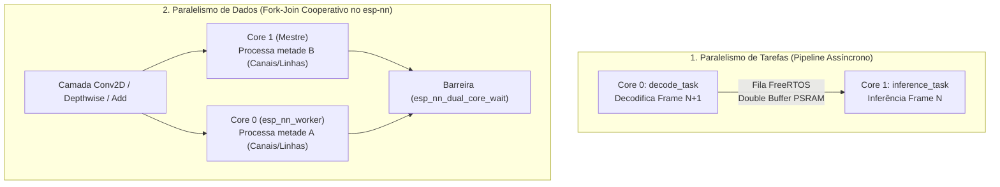

# ⚡ Otimização de Memória SRAM Interna, Paralelismo Dual-Core (`Fork-Join`) e Referência Técnica `esp-nn` (ESP32-S3)

**Data:** 07 de Novembro de 2026  
**Modelo Alvo:** `data/model_mbnet_int8.tflite` (`MobileNetV3Small Int8 v08`, entrada $160 \times 160 \times 3$, 11 classes)  
**Hardware:** ESP32-S3 (Dual-Core Xtensa LX7 @ 160/240 MHz, instruções vetoriais PIE/SIMD de 128 bits, 512 KB SRAM Interna, 8 MB Octal PSRAM)

---

## 1. Visão Geral e Diagnóstico de Memória

Durante a execução da inferência do modelo `MobileNetV3Small Int8 (v08)` no ESP32-S3, identificamos dois fatos fundamentais sobre o uso de memória e barramento:

### 1.1. Disponibilidade de SRAM Interna vs. `tensor_arena` na PSRAM
* **Uso estático de RAM interna (`.data` + `.bss`):** `65.628 bytes` de `327.680 bytes` (**20,0%**), restando `197.225 bytes` (**~192,6 KB**) de `DIRAM` estática livre após a compilação.
* **No boot do hardware (`heap_init`):** O ESP-IDF disponibiliza **~309 KB de RAM interna dinâmica**, restando **~110 KB a 130 KB de SRAM interna pura (`MALLOC_CAP_INTERNAL | MALLOC_CAP_8BIT | MALLOC_CAP_DMA`)** completamente livres mesmo com o Wi-Fi, pilha TCP/IP (LwIP) e servidor WebSocket ativos.
* **Por que a `tensor_arena` (800 KB) precisa ficar na PSRAM?**
  Inspecionando os 100 tensores do `model_mbnet_int8.tflite`, os mapas de ativação intermediários das camadas iniciais de resolução $80 \times 80$ exigem:
  * **Tensor 13 (`[1, 80, 80, 48]`):** `307.200 bytes` (**300 KB** sozinho)
  * **Tensores 7, 8 e 10 (`[1, 80, 80, 16]`):** `102.400 bytes` (**100 KB** cada)
  Como o interpretador precisa manter os tensores de entrada e saída de uma operação simultaneamente (*ping-pong*), o pico de memória de ativações atinge **~409 KB**, o que inviabiliza colocar a `tensor_arena` inteira na SRAM interna.

### 1.2. O Gargalo Oculto dos *Scratch Buffers* na PSRAM
Para executar instruções vetoriais SIMD de 128 bits (`ee.vld.128.ip`, `ee.vmulas.s8.accx`, `ee.vmulas.s8.qacc`), os kernels otimizados da biblioteca `esp-nn` precisam reorganizar os canais de entrada (`im2col`, *padding* assimétrico e transposição de painéis $1\times1$ e $3\times3$) em uma área temporária de trabalho chamada **Scratch Buffer** (que varia de **704 bytes a ~43 KB** no nosso modelo).

Por padrão, os wrappers do TFLite Micro em:
* [`conv.cc`](file:///home/victor/projects/sugarcane/managed_components/espressif__esp-tflite-micro/tensorflow/lite/micro/kernels/esp_nn/conv.cc#L154-L161) (`context->RequestScratchBufferInArena`)
* [`depthwise_conv.cc`](file:///home/victor/projects/sugarcane/managed_components/espressif__esp-tflite-micro/tensorflow/lite/micro/kernels/esp_nn/depthwise_conv.cc#L279-L286) (`context->RequestScratchBufferInArena`)

alocavam esse `scratch_buffer` **dentro da `tensor_arena` (na PSRAM externa a 40 MHz)**! Como consequência, o núcleo SIMD a 160/240 MHz sofria contenção de barramento ao gravar e reler painéis temporários na PSRAM dezenas de vezes por camada, disputando banda com a leitura dos pesos e mapas de ativação.

---

## 2. Estratégias de Paralelismo Multi-Core: Pipeline vs. `Fork-Join`

Na arquitetura do sistema, avaliamos duas abordagens de programação paralela para os dois núcleos do ESP32-S3 (`Core 0` e `Core 1`):



### 2.1. Por que o `JPEGDEC` permanece no modelo Sequencial por Frame + LUTs em SRAM?
Um arquivo JPEG padrão utiliza **Codificação de Entropia de Huffman** (comprimento variável de bits) acoplada à codificação diferencial do coeficiente `DC` ($DC_k = DC_{k-1} + \Delta$). Isso significa que não é possível descobrir em qual bit da memória começa o bloco $8\times8$ da metade inferior da imagem sem antes decodificar bit a bit toda a metade superior.
* Portanto, paralelizar a entropia JPEG de uma única imagem entre dois núcleos não traz ganho prático.
* Em vez disso, otimizamos a decodificação `Modo 7 (RGB8888 Nativo + BoxAvg)` em [`src/image_processor.cpp`](file:///home/victor/projects/sugarcane/src/image_processor.cpp#L25-L60) pré-calculando **LUTs de mapeamento espacial em SRAM interna (`s_src_to_dst_x[4096]` e `s_src_to_dst_y[4096]`, 16 KB)**, eliminando ~786.432 divisões inteiras por frame e reduzindo o tempo do `Modo 7` para **~47,5 ms** (overhead de apenas `+2,5 ms` sobre o modo mais simples).

### 2.2. A Arquitetura Híbrida Implementada (Pipeline + `Fork-Join` Dual-Core)
Para a inferência neural, **combinamos o melhor dos dois mundos** sem descartar a fila assíncrona já existente em [`src/main.cpp`](file:///home/victor/projects/sugarcane/src/main.cpp):
1. **Mantivemos o Pipeline Assíncrono com Double Buffer (`2x 76,8 KB` na PSRAM):** O `Core 0` recebe o JPEG via WebSocket e executa a `decode_task` (prioridade 5), enviando o tensor pronto para a `inference_task` no `Core 1` (prioridade 5).
2. **Adicionamos o `Fork-Join` Dual-Core Nativo do `esp-nn`:** Quando a `inference_task` (no `Core 1`) executa `interpreter->Invoke()`, ela aciona a task auxiliar `esp_nn_worker` (fixada no `Core 0`, prioridade `configMAX_PRIORITIES - 2`) a cada camada pesada (`Conv2D`, `DepthwiseConv2D`, `Add`, `Mul`).
   * **No uso típico (1 foto enviada por vez):** No instante em que a inferência começa, o `Core 0` já terminou a decodificação JPEG e estaria 100% ocioso. Agora, ele assume imediatamente metade das contas matriciais junto com o `Core 1`!
   * **Em rajadas contínuas de fotos:** O `Core 0` alterna rajadas curtas de auxílio vetorial SIMD (`~1 a 5 ms` por camada) com a decodificação do próximo frame nos intervalos entre camadas.

---

## 3. Referência Técnica da Biblioteca `esp-nn` no Projeto

Abaixo estão documentadas as funções e estruturas internas do componente `espressif__esp-nn` utilizadas na nossa implementação, com links diretos para os arquivos-fonte do projeto.

### 3.1. `Preferred Scratch Buffer` em SRAM Interna (`Conv2D` e `DepthwiseConv2D`)

* **Declarações Públicas:** [`managed_components/espressif__esp-nn/include/esp_nn_esp32s3.h`](file:///home/victor/projects/sugarcane/managed_components/espressif__esp-nn/include/esp_nn_esp32s3.h#L133-L159)
  ```c
  void esp_nn_set_conv_preferred_scratch_buf_esp32s3(void *buf, size_t size);
  void esp_nn_set_depthwise_conv_preferred_scratch_buf_esp32s3(void *buf, size_t size);
  ```
* **Implementação em `Conv2D`:** [`managed_components/espressif__esp-nn/src/convolution/esp_nn_conv_esp32s3.c`](file:///home/victor/projects/sugarcane/managed_components/espressif__esp-nn/src/convolution/esp_nn_conv_esp32s3.c#L611-L741)
  * Os engenheiros da Espressif documentaram nas [linhas 682–685](file:///home/victor/projects/sugarcane/managed_components/espressif__esp-nn/src/convolution/esp_nn_conv_esp32s3.c#L682-L685):
    > `/* Panel work + staging (24 * in_ch + 16 KB + 64) goes to the preferred (internal) scratch when it fits, like the batched path below; otherwise a PSRAM arena would host the very buffers the L1-resident scheme depends on. */`
  * Nas convoluções $1\times1$ com filtros grandes ($> 24\text{ KB}$, [linhas 686–691](file:///home/victor/projects/sugarcane/managed_components/espressif__esp-nn/src/convolution/esp_nn_conv_esp32s3.c#L686-L691)), o `esp-nn` exige `24 * in_ch + 16 KB + 64` bytes. No nosso modelo `v08`, o maior `in_ch` é `336`, exigindo no máximo **`24.512 bytes` (~23,94 KB)**.
  * Nas convoluções $1\times1$ com filtros $\le 24\text{ KB}$ ([linhas 735–741](file:///home/victor/projects/sugarcane/managed_components/espressif__esp-nn/src/convolution/esp_nn_conv_esp32s3.c#L735-L741)), exige `24 * in_ch + 8 * out_ch + 16`, cujo máximo no modelo `v08` é **`~8,5 KB`**.
  * **Extensão implementada para a Camada Inicial (`Op 0`, $3\times3$ Stem `160x160x3 -> 80x80x16`):** Em [`esp_nn_conv_esp32s3.c`](file:///home/victor/projects/sugarcane/managed_components/espressif__esp-nn/src/convolution/esp_nn_conv_esp32s3.c#L787-L802), adicionamos a verificação do `preferred_scratch_buffer` também na rota `esp_nn_conv_s8_im2col_s3` (que precisa de apenas `704 bytes`), garantindo que o buffer `im2col` e a cópia alinhada do filtro $3\times3$ (lidos $80 \times 80 \times 16 = 102.400$ vezes por frame) rodem na SRAM interna!

* **Implementação em `DepthwiseConv2D`:** [`managed_components/espressif__esp-nn/src/convolution/esp_nn_depthwise_conv_s8_esp32s3.c`](file:///home/victor/projects/sugarcane/managed_components/espressif__esp-nn/src/convolution/esp_nn_depthwise_conv_s8_esp32s3.c#L639-L900)
  * Nas [linhas 887–894](file:///home/victor/projects/sugarcane/managed_components/espressif__esp-nn/src/convolution/esp_nn_depthwise_conv_s8_esp32s3.c#L887-L894), toda chamada a `esp_nn_depthwise_conv_s8_esp32s3` verifica:
    ```c
    int16_t *active_scratch = scratch_buffer;
    if (preferred_scratch_buffer != NULL &&
            (((uintptr_t)preferred_scratch_buffer & 15) == 0) &&
            required_scratch <= preferred_scratch_size) {
        active_scratch = (int16_t *)preferred_scratch_buffer;
    }
    ```
  * Como todas as 15 camadas `DEPTHWISE_CONV_2D` do nosso `MobileNetV3Small v08` possuem filtros $3\times3$ e canais múltiplos de 16 (`16, 48, 96, 144, 192, 336`), o cálculo em [`esp_nn_get_depthwise_conv_scratch_size_esp32s3`](file:///home/victor/projects/sugarcane/managed_components/espressif__esp-nn/src/convolution/esp_nn_depthwise_conv_s8_esp32s3.c#L650-L670) limita o `required_scratch` (usando *strip-tiling* automático para entradas $> 40\text{ KB}$) a no máximo **`~43,9 KB`**.
  * **Conclusão de Dimensionamento:** Ao alocarmos **um único buffer compartilhado de `48 KB` (`49.152 bytes`) na SRAM Interna** e registrá-lo tanto em `conv` quanto em `depthwise_conv`, **100% das 52 camadas convolucionais da rede neural executam seus *workspaces* SIMD na SRAM interna!**

---

### 3.2. Motor `Fork-Join` Dual-Core (`esp_nn_multicore.h` / `esp_nn_multicore.c`)

* **Arquivos de Referência:**
  * Header: [`managed_components/espressif__esp-nn/include/esp_nn_multicore.h`](file:///home/victor/projects/sugarcane/managed_components/espressif__esp-nn/include/esp_nn_multicore.h#L1-L91)
  * Implementação: [`managed_components/espressif__esp-nn/src/common/esp_nn_multicore.c`](file:///home/victor/projects/sugarcane/managed_components/espressif__esp-nn/src/common/esp_nn_multicore.c#L1-L164)

* **API Principal:**
  1. [`void esp_nn_dual_core_enable(void)`](file:///home/victor/projects/sugarcane/managed_components/espressif__esp-nn/src/common/esp_nn_multicore.c#L68-L89):
     Cria um semáforo binário (`s_done`) e instancia a task FreeRTOS `esp_nn_worker` (8 KB de stack, prioridade `configMAX_PRIORITIES - 2`) fixada no **núcleo oposto ao núcleo chamador**:
     ```c
     const BaseType_t core = (xPortGetCoreID() == 0) ? 1 : 0;
     xTaskCreatePinnedToCore(esp_nn_worker_main, "esp_nn_worker", 8 * 1024,
                             NULL, configMAX_PRIORITIES - 2, &s_worker, core);
     ```
     > [!IMPORTANT]
     > **Regra Crítica de Afinidade de Núcleo:**  
     > Em [`esp_nn_dual_core_run()`](file:///home/victor/projects/sugarcane/managed_components/espressif__esp-nn/src/common/esp_nn_multicore.c#L106-L108), a biblioteca recusa o despacho se o chamador estiver rodando no mesmo núcleo do `s_worker` (`if (xPortGetCoreID() == s_worker_core) return false;`).  
     > Como no nosso projeto a `app_main()` roda no **Core 0** e a `inference_task()` roda fixada no **Core 1**, a função `esp_nn_dual_core_enable()` **jamais deve ser chamada no `app_main()`**, e sim dentro da `inference_task()` (no **Core 1**), garantindo que `s_worker_core = 0` (**Core 0**).

  2. [`void *esp_nn_dual_core_scratch(int size)`](file:///home/victor/projects/sugarcane/managed_components/espressif__esp-nn/src/common/esp_nn_multicore.c#L122-L145):
     Aloca um buffer de rascunho exclusivo na **SRAM Interna** (`MALLOC_CAP_INTERNAL | MALLOC_CAP_8BIT | MALLOC_CAP_SIMD`, alinhado em 16 bytes) para que a fatia executada pelo `esp_nn_worker` no Core 0 não colida com o `preferred_scratch_buffer` usado pelo Core 1.
     * Em [`classifier_init()`](file:///home/victor/projects/sugarcane/src/tflite_classifier.cpp#L95-L101), pré-alocamos esse buffer com **`25 KB` (`25.600 bytes`)** logo no boot (acima do pico real de `24.576 bytes` do modelo `v08`), eliminando realocações dinâmicas durante a primeira inferência.

* **Kernels que executam em Paralelo nos 2 Núcleos (bit-idênticos ao modo Single-Core):**

| Operação TFLite Micro | Kernel `esp-nn` (ESP32-S3) | Função Worker no Core Auxiliar | Estratégia de Divisão (`Fork-Join`) |
| :--- | :--- | :--- | :--- |
| **`CONV_2D` ($1\times1$, filtro $> 24\text{ KB}$)** | [`esp_nn_conv_s8_esp32s3`](file:///home/victor/projects/sugarcane/managed_components/espressif__esp-nn/src/convolution/esp_nn_conv_esp32s3.c#L697-L726) | `conv_1x1_panel_mt_worker` | Divide os canais de saída ao meio (`oc0 = ((out_ch / 2) + 7) & ~7`) |
| **`DEPTHWISE_CONV_2D` ($3\times3$, entrada $\le 40\text{ KB}$)** | [`dw3x3_run_split`](file:///home/victor/projects/sugarcane/managed_components/espressif__esp-nn/src/convolution/esp_nn_depthwise_conv_s8_esp32s3.c#L492-L526) | `dw3x3_mt_worker` | Divide as linhas de saída (`out_ht / 2`) entre Core 0 e Core 1 |
| **`DEPTHWISE_CONV_2D` ($3\times3$, entrada $> 40\text{ KB}$)** | [`esp_nn_depthwise_conv_s8_esp32s3`](file:///home/victor/projects/sugarcane/managed_components/espressif__esp-nn/src/convolution/esp_nn_depthwise_conv_s8_esp32s3.c#L984-L1002) | `dw3x3_strip_mt_worker` | Cada núcleo processa metade das faixas (*strips*) usando seu próprio tile em SRAM |
| **`CONV_2D` ($3\times3$, `in_ch % 16 == 0`)** | [`esp_nn_conv_s8_3x3_opt`](file:///home/victor/projects/sugarcane/managed_components/espressif__esp-nn/src/convolution/esp_nn_conv_s8_3x3_opt_esp32s3.c#L224-L260) | `conv3x3_staged_mt_worker` | Divide as posições espaciais de saída em blocos de 16 posições |
| **`ADD` (Conexões Residuais)** | [`esp_nn_add_elementwise_s8_mt_esp32s3`](file:///home/victor/projects/sugarcane/managed_components/espressif__esp-nn/src/basic_math/esp_nn_add_mt_esp32s3.c#L52-L83) | `add_s8_mt_worker` | Divide o vetor `size >= 4096` ao meio (alinhado em 16 bytes) |
| **`MUL` (Blocos Squeeze-and-Excitation)** | [`esp_nn_mul_elementwise_s8_mt`](file:///home/victor/projects/sugarcane/managed_components/espressif__esp-nn/src/basic_math/esp_nn_mul_mt.c#L49-L80) | `mul_s8_mt_worker` | Divide o vetor `size >= 4096` ao meio (alinhado em 16 bytes) |

---

### 3.3. Requantização Rápida em Assembly SIMD (`CONFIG_NN_SKIP_NUDGE` / `SKIP_NUDGE`)

* **Arquivos de Referência:**
  * Configuração Kconfig: [`managed_components/espressif__esp-nn/Kconfig.projbuild`](file:///home/victor/projects/sugarcane/managed_components/espressif__esp-nn/Kconfig.projbuild#L31-L41)
  * Macro C: [`managed_components/espressif__esp-nn/src/common/common_functions.h`](file:///home/victor/projects/sugarcane/managed_components/espressif__esp-nn/src/common/common_functions.h#L240-L249)
  * Rotina Assembly ESP32-S3: [`managed_components/espressif__esp-nn/src/common/esp_nn_multiply_by_quantized_mult_esp32s3.S`](file:///home/victor/projects/sugarcane/managed_components/espressif__esp-nn/src/common/esp_nn_multiply_by_quantized_mult_esp32s3.S#L19-L90)

* **Como funciona:**
  Na requantização de acumuladores de 32 bits para `int8_t` ($[-128, 127]$), o padrão de referência do TFLite soma uma constante de arredondamento (`nudge_val = 1 << 30`) ao produto de 64 bits antes do deslocamento de 31 bits. No Assembly do ESP32-S3, isso exige 13 instruções escalares extras (`l32r` + quatro cadeias de soma de 64 bits com *carry* `add.n` + `saltu` + `add.n`) para cada grupo de 4 canais de saída.
  Ao definir `CONFIG_NN_SKIP_NUDGE=y` / `SKIP_NUDGE`, o montador omite os blocos `.ifdef use_nudge`, acelerando a rotina de requantização em **~20%** com diferença máxima de $\pm 1$ LSB apenas em fronteiras exatas de meio-bit (sem impacto na acurácia de classificação).

---

## 4. Registro Completo das Alterações Implementadas

Todas as alterações foram sinalizadas no código-fonte com comentários `[IMPLEMENTAÇÃO: ... (v08)]`, preservando integralmente o trabalho anterior:

| Arquivo Modificado | O que foi implementado / sinalizado |
| :--- | :--- |
| **[`src/tflite_classifier.h`](file:///home/victor/projects/sugarcane/src/tflite_classifier.h#L8-L15)** | Declaração de [`classifier_enable_dual_core()`](file:///home/victor/projects/sugarcane/src/tflite_classifier.h#L15) documentando a chamada a partir do Core 1. |
| **[`src/tflite_classifier.cpp`](file:///home/victor/projects/sugarcane/src/tflite_classifier.cpp#L35-L108)** | 1. Inclusão de `<esp_nn.h>` e `<esp_nn_multicore.h>`.<br/>2. Alocação de `s_sram_scratch_buf` (**48 KB**, alinhado em 16 bytes na SRAM Interna DMA) e registro em `esp_nn_set_conv_preferred_scratch_buf_esp32s3()` e `esp_nn_set_depthwise_conv_preferred_scratch_buf_esp32s3()`.<br/>3. Pré-alocação de **25 KB** na SRAM Interna para o worker Dual-Core via `esp_nn_dual_core_scratch(25 * 1024)`.<br/>4. Implementação de [`classifier_enable_dual_core()`](file:///home/victor/projects/sugarcane/src/tflite_classifier.cpp#L53-L61) e guarda de segurança em [`classifier_run()`](file:///home/victor/projects/sugarcane/src/tflite_classifier.cpp#L144-L147). |
| **[`src/main.cpp`](file:///home/victor/projects/sugarcane/src/main.cpp#L81-L115)** | Preservado o pipeline assíncrono Dual-Core (`decode_task` no Core 0 + `inference_task` no Core 1 + *Double Buffer* na PSRAM) e adicionada a chamada [`classifier_enable_dual_core()`](file:///home/victor/projects/sugarcane/src/main.cpp#L93) na inicialização da `inference_task` (Core 1). |
| **[`esp_nn_conv_esp32s3.c`](file:///home/victor/projects/sugarcane/managed_components/espressif__esp-nn/src/convolution/esp_nn_conv_esp32s3.c#L787-L802)** | Adicionado suporte ao `preferred_scratch_buffer` na rota `esp_nn_conv_s8_im2col_s3` para que a primeira camada da rede (`Op 0`, $3\times3$ stem `160x160x3 -> 80x80x16`) também execute seu `im2col` na SRAM Interna. |
| **[`sdkconfig.defaults`](file:///home/victor/projects/sugarcane/sdkconfig.defaults#L14-L17)**, **[`sdkconfig.esp32-s3-devkitm-1`](file:///home/victor/projects/sugarcane/sdkconfig.esp32-s3-devkitm-1#L1103-L1106)** e **[`platformio.ini`](file:///home/victor/projects/sugarcane/platformio.ini#L21-L25)** | Habilitada a flag `CONFIG_NN_SKIP_NUDGE=y` (`-D CONFIG_NN_SKIP_NUDGE=1 -D SKIP_NUDGE=1`) para requantização rápida em Assembly SIMD. |
| **[`src/image_processor.cpp`](file:///home/victor/projects/sugarcane/src/image_processor.cpp)** e **[`src/image_processor.h`](file:///home/victor/projects/sugarcane/src/image_processor.h)** | Mantidas todas as implementações anteriores (`Opção C / Modo 7: RGB8888 Nativo + BoxAvg` como padrão em `process_jpeg()`, LUTs `s_src_to_dst_x`/`y` em SRAM, além das Opções A, B e Legado preservadas para referência). |

---

## 5. Resumo do Orçamento de SRAM Interna Utilizado

| Recurso Alocado na SRAM Interna (`MALLOC_CAP_INTERNAL`) | Tamanho | Finalidade |
| :--- | :---: | :--- |
| **`s_sram_scratch_buf` (`preferred_scratch_buffer`)** | `49.152 B` (**48 KB**) | Workspace SIMD primário (Core 1) compartilhado por todas as 52 camadas `Conv2D` e `DepthwiseConv2D` |
| **`s_worker_scratch` (`esp_nn_dual_core_scratch`)** | `25.600 B` (**25 KB**) | Workspace SIMD exclusivo do segundo núcleo (`esp_nn_worker` no Core 0) durante o `Fork-Join` |
| **Stack da task `esp_nn_worker`** | `8.192 B` (**8 KB**) | Pilha de execução da task trabalhadora fixada no Core 0 |
| **LUTs do `JPEGDraw` (`s_src_to_dst_x` / `s_src_to_dst_y`)** | `16.384 B` (**16 KB**) | Tabelas estáticas em `.bss` que eliminam divisões inteiras no *downsampling* BoxAvg |
| **Total Adicionado na SRAM Interna** | **`~97 KB`** | **Restam mais de ~95 KB a 110 KB de SRAM interna livres** para o FreeRTOS, Wi-Fi e WebSocket |
