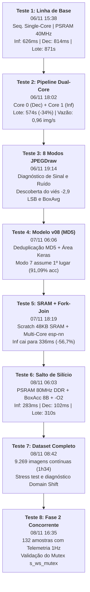

# 🌿 Histórico Consolidado e Cronologia Completa dos Testes de Inferência no ESP32-S3

**Documento:** Síntese Histórica, Metodológica e Experimental de Benchmarking  
**Projeto:** Classificador Embarcado de Patologias em Cana-de-Açúcar (*TinyML / Edge AI*)  
**Dispositivo Físico:** Espressif ESP32-S3 DevKitM-1 (Dual-Core Xtensa LX7 @ 240 MHz, 512 KB SRAM, 8 MB Octal PSRAM, 16 MB Flash LittleFS)  
**Diretório de Testes:** [`model_inference_tests/`](file:///home/victor/projects/sugarcane/model_inference_tests)  
**Data de Consolidação:** 09 de Novembro de 2026  

---

## 📌 1. Visão Geral e Propósito do Documento

Ao longo do desenvolvimento do projeto **Sugarcane**, foi conduzida uma rigorosa sequência de experimentos empíricos diretamente em silício físico. Cada avanço arquitetural — na decodificação de imagem, no paralelismo de núcleos, na hierarquia de memória ou no retreinamento da rede neural — foi sistematicamente auditado por meio de **scripts automatizados em Python**, com coleta exaustiva de métricas em **planilhas CSV** e documentação em **relatórios analíticos Markdown (`.md`)**.

O objetivo deste documento é **reunir, mapear e ordenar cronologicamente todas as 8 baterias de testes experimentais**, correlacionando:
1. O **script executor em Python** utilizado para envio dos pacotes via WebSocket;
2. A **planilha de dados brutos (`.csv`)** persistida com os resultados amostra por amostra;
3. O **relatório técnico (`.md`)** de detalhamento correspondente;
4. As **condições de contorno de hardware e firmware** (frequência de PSRAM, núcleos FreeRTOS, modo de decodificação);
5. Os **resultados quantitativos consolidados** (tempo de decodificação, inferência, cadência, vazão e acurácia).

---

## 🗺️ 2. Matriz Cronológica Consolidada de Benchmarks

A tabela abaixo sintetiza a evolução temporal de todos os testes de bancada executados na placa física ESP32-S3:

| # | Data / Hora | Identificador do Experimento | Script Python | Planilha CSV Gerada | Relatório Técnico | Versão Modelo | Amostras | Tempo Inf. (Médio) | Tempo Dec. (Médio) | Cadência RTT | Tempo Lote | Throughput | Acurácia Global |
| :-: | :---: | :--- | :--- | :--- | :--- | :---: | :---: | :---: | :---: | :---: | :---: | :---: | :---: |
| **1** | **06/11 15:38** | **Linha de Base Sequencial (Single-Core)** | [`run_evaluation.py`](file:///home/victor/projects/sugarcane/model_inference_tests/run_evaluation.py) | [`resultado_inferencia.csv`](file:///home/victor/projects/sugarcane/model_inference_tests/resultado_inferencia.csv) | [`RELATORIO_DESEMPENHO.md`](file:///home/victor/projects/sugarcane/model_inference_tests/RELATORIO_DESEMPENHO.md) | `v07` | 550 brutas | 626,6 ms | 814,0 ms | 1.581,3 ms | 871,5 s (14,5 min) | 0,63 img/s | 82,55% (454/550) |
| **2** | **06/11 18:02** | **Pipeline Assíncrono Dual-Core (Streaming)** | [`run_evaluation_dualcore.py`](file:///home/victor/projects/sugarcane/model_inference_tests/run_evaluation_dualcore.py) | [`resultado_inferencia_dualcore.csv`](file:///home/victor/projects/sugarcane/model_inference_tests/resultado_inferencia_dualcore.csv) | [`RELATORIO_DESEMPENHO_DUALCORE.md`](file:///home/victor/projects/sugarcane/model_inference_tests/RELATORIO_DESEMPENHO_DUALCORE.md) | `v07` | 550 brutas | 777,4 ms | 1.032,4 ms | 1.044,8 ms | 574,9 s (9,6 min) | 0,96 img/s | 82,55% (454/550) |
| **3** | **06/11 19:14** | **Auditoria de Sinal: 8 Variantes JPEGDraw** | *Test Harness* C++/Python | [`resultado_comparativo_jpegdraw.csv`](file:///home/victor/projects/sugarcane/model_inference_tests/resultado_comparativo_jpegdraw.csv) | [`RELATORIO_COMPARATIVO_JPEGDRAW.md`](file:///home/victor/projects/sugarcane/model_inference_tests/RELATORIO_COMPARATIVO_JPEGDRAW.md) | `v07` | 4.400 inferências (550 $\times$ 8) | ~626 ms | 4,0 a 7,2 µs/px | - | - | - | 80,7% a 82,7% (Modo 5: 82,73%) |
| **4** | **07/11 06:06** | **Avaliação do Modelo v08 (Deduplicado MD5)** | *Test Harness* C++/Python | [`resultado_comparativo_jpegdraw_v08.csv`](file:///home/victor/projects/sugarcane/model_inference_tests/resultado_comparativo_jpegdraw_v08.csv)<br/>[`resultado_comparativo_jpegdraw_limpo_v08.csv`](file:///home/victor/projects/sugarcane/model_inference_tests/resultado_comparativo_jpegdraw_limpo_v08.csv) | [`RELATORIO_COMPARATIVO_JPEGDRAW_V08.md`](file:///home/victor/projects/sugarcane/model_inference_tests/RELATORIO_COMPARATIVO_JPEGDRAW_V08.md) | `v08` | 13.104 inferências (Bateria Ampla) | ~626 ms | 4,0 a 6,9 µs/px | - | - | - | **91,09%** (Modo 7 Limpo) |
| **5** | **07/11 18:19** | **Scratch SRAM Interna + Fork-Join esp-nn** | [`run_evaluation_espnn_sram.py`](file:///home/victor/projects/sugarcane/model_inference_tests/run_evaluation_espnn_sram.py) | [`resultado_inferencia_espnn_sram.csv`](file:///home/victor/projects/sugarcane/model_inference_tests/resultado_inferencia_espnn_sram.csv) | [`RELATORIO_DESEMPENHO_ESP_NN_SRAM.md`](file:///home/victor/projects/sugarcane/model_inference_tests/RELATORIO_DESEMPENHO_ESP_NN_SRAM.md) | `v08` | 550 brutas | 336,3 ms | 145,2 ms | 7.173,7 ms | 3.945,8 s (65,8 min)* | 0,14 img/s* | 83,09% (457/550) |
| **6** | **08/11 06:03** | **Salto de Silício: PSRAM 80MHz + BoxAcc 8B** | [`run_evaluation_espnn_sram.py`](file:///home/victor/projects/sugarcane/model_inference_tests/run_evaluation_espnn_sram.py) | [`resultado_inferencia_espnn_sram_limpo.csv`](file:///home/victor/projects/sugarcane/model_inference_tests/resultado_inferencia_espnn_sram_limpo.csv) | [`RELATORIO_DESEMPENHO_ESP_NN_SRAM_LIMPO.md`](file:///home/victor/projects/sugarcane/model_inference_tests/RELATORIO_DESEMPENHO_ESP_NN_SRAM_LIMPO.md) | `v08` | 550 limpas | **283,4 ms** | **102,7 ms** | **564,7 ms** | **310,8 s (5,18 min)** | **1,77 img/s** | **89,82% (494/550)** |
| **7** | **08/11 08:42** | **Stress Test Exaustivo: Dataset Completo** | [`run_evaluation_all_dataset.py`](file:///home/victor/projects/sugarcane/model_inference_tests/run_evaluation_all_dataset.py) | [`resultado_inferencia_dataset_completo.csv`](file:///home/victor/projects/sugarcane/model_inference_tests/resultado_inferencia_dataset_completo.csv) | [`RELATORIO_DATASET_COMPLETO.md`](file:///home/victor/projects/sugarcane/model_inference_tests/RELATORIO_DATASET_COMPLETO.md) | `v08` | **9.269 imagens** (6.748 + 2.521) | **283,4 ms** | **92,6 ms** | ~612 ms | **5.678,1 s (94,6 min)** | **1,63 img/s** | 82,26% (Primário)<br/>3,13% (Archive) |
| **8** | **08/11 16:35** | **Homologação Fase 2: Telemetria Concorrente** | [`run_evaluation_espnn_sram.py`](file:///home/victor/projects/sugarcane/model_inference_tests/run_evaluation_espnn_sram.py) | [`resultado_benchmark_12amostras.csv`](file:///home/victor/projects/sugarcane/model_inference_tests/resultado_benchmark_12amostras.csv) | [`RELATORIO_BENCHMARK_132_AMOSTRAS.md`](file:///home/victor/projects/sugarcane/docs/RELATORIO_BENCHMARK_132_AMOSTRAS.md) | `v08` | 132 balanceadas (11 $\times$ 12) | **284,4 ms** | **96,3 ms** | **769,2 ms** | **101,6 s (1,69 min)** | **1,30 img/s** | **78,03% (103/132)** |

*\* Nota do Teste 5: Gargalo transitório de rede decorrente do Wi-Fi Modem Sleep ativo na pilha LwIP antes da introdução de `WIFI_PS_NONE`.*

---

## 🔬 3. Detalhamento Cronológico das Etapas Experimentais



---

### 3.1. Teste 1: Linha de Base Sequencial Single-Core (Modelo `v07`)

* **Timestamp:** `06/11/2026 15:38:24`
* **Script:** [`model_inference_tests/run_evaluation.py`](file:///home/victor/projects/sugarcane/model_inference_tests/run_evaluation.py)
* **Planilha Gerada:** [`model_inference_tests/resultado_inferencia.csv`](file:///home/victor/projects/sugarcane/model_inference_tests/resultado_inferencia.csv)
* **Relatório:** [`model_inference_tests/RELATORIO_DESEMPENHO.md`](file:///home/victor/projects/sugarcane/model_inference_tests/RELATORIO_DESEMPENHO.md)
* **Modelo:** `data/model_mbnet_int8.tflite` (`v07`, 639.272 bytes, MD5 `bfe792823603ff822be86c426aecb1e5`)

#### Condições Experimentais de Hardware & Software
* **Frequência da CPU:** 240 MHz (Xtensa LX7).
* **Barramento da PSRAM:** Octal SPI @ 40 MHz.
* **Arquitetura de Firmware:** Sequencial síncrona. O cliente envia uma foto via WebSocket (`ws://<IP>/ws`), aguarda a decodificação JPEG e a inferência TFLite Micro, recebe o JSON de resposta e só então transmite a foto subsequente.
* **Decodificador JPEG:** Abordagem tradicional de referência (`Modo 0: RGB565 ZeroFill + Overwrite`).

#### Principais Resultados
* **Acurácia Global:** **82,55%** (454 acertos em 550 imagens brutas).
* **Tempo de Inferência Neural:** **626,6 ms** (estabilidade: Mín 625 ms, Máx 633 ms, $\sigma = \pm 1,0\text{ ms}$).
* **Tempo de Decodificação JPEG:** **814,0 ms**.
* **Latência de Ponta a Ponta (RTT):** **1.581,3 ms/frame**.
* **Tempo de Execução do Lote:** **871,51 s (14 minutos e 31 segundos)**.
* **Vazão Efetiva:** **0,63 imagens/segundo**.

#### Diagnósticos Críticos
1. **Colapso da Classe `smut` (Carvão da Cana):** Obteve míseros **6,0% de acerto (3/50)**, sendo classificada 34 vezes como `Pokkah Boeng` com confiança travada em ~53%.
2. **Tempo Ocioso do Silício:** Enquanto a CPU decodificava o JPEG no Core 0, o acelerador neural ficava 100% ocioso; durante a inferência, a pilha de decodificação não adiantava o próximo quadro.

---

### 3.2. Teste 2: Pipeline Assíncrono Dual-Core Pipelined (Modelo `v07`)

* **Timestamp:** `06/11/2026 18:02:01`
* **Script:** [`model_inference_tests/run_evaluation_dualcore.py`](file:///home/victor/projects/sugarcane/model_inference_tests/run_evaluation_dualcore.py)
* **Planilha Gerada:** [`model_inference_tests/resultado_inferencia_dualcore.csv`](file:///home/victor/projects/sugarcane/model_inference_tests/resultado_inferencia_dualcore.csv)
* **Relatório:** [`model_inference_tests/RELATORIO_DESEMPENHO_DUALCORE.md`](file:///home/victor/projects/sugarcane/model_inference_tests/RELATORIO_DESEMPENHO_DUALCORE.md)
* **Modelo:** `data/model_mbnet_int8.tflite` (`v07`)

#### Condições Experimentais de Hardware & Software
* **Separação por Núcleo FreeRTOS:**
  * **Core 0:** Tarefa de rede (`esp_http_server` LwIP) + Decodificação JPEG (`decode_task`).
  * **Core 1:** Motor neural TFLite Micro (`inference_task`).
* **Mecanismo de Filas:** `inference_queue` (cap=5), `decoded_queue` (cap=2) e `free_tensor_queue` (cap=2).
* **Double Buffering na PSRAM:** Alocação de 2 buffers estáticos de 150 KB para transporte de tensores sem realocação dinâmica.
* **Streaming Pipelined:** O script Python envia a Foto $N+1$ pela conexão TCP persistente enquanto a Foto $N$ ainda está sendo processada pela rede neural.

#### Principais Resultados
* **Acurácia Global:** **82,55%** (rigorosamente idêntica ao Teste 1, comprovando estabilidade numérica).
* **Cadência Média entre Predições:** **1.044,8 ms/frame** (ganho de **$-536,5\text{ ms}$** por foto).
* **Tempo do Lote (550 fotos):** Reduzido de 871,51 s para **574,89 s (9,58 minutos)** — **economia de 4,95 minutos (+34,0% mais veloz)**.
* **Vazão Efetiva:** Subiu de 0,63 para **0,96 imagens/segundo** ($1,52\times$ maior).
* **Observação de Concorrência:** O tempo individual de inferência subiu de 626 ms para 777 ms devido à contenção de acesso ao barramento SPI da PSRAM (ainda configurada a 40 MHz).

---

### 3.3. Teste 3: Auditoria Matemática de Sinal e Avaliação das 8 Variantes de `JPEGDraw()`

* **Timestamp:** `06/11/2026 19:14:00` (CSV) / `19:21:00` (Relatório)
* **Test Harness:** Bateria comparativa C++/Python com emulação estrita dos operadores de quantização afim.
* **Planilha Gerada:** [`model_inference_tests/resultado_comparativo_jpegdraw.csv`](file:///home/victor/projects/sugarcane/model_inference_tests/resultado_comparativo_jpegdraw.csv) (2,8 MB | 4.400 linhas)
* **Relatórios:** [`model_inference_tests/RELATORIO_COMPARATIVO_JPEGDRAW.md`](file:///home/victor/projects/sugarcane/model_inference_tests/RELATORIO_COMPARATIVO_JPEGDRAW.md) e [`docs/ANALISE_JPEGDRAW_CONVERSAO_COR.md`](file:///home/victor/projects/sugarcane/docs/ANALISE_JPEGDRAW_CONVERSAO_COR.md)
* **Modelo:** `data/model_mbnet_int8.tflite` (`v07`)
* **Volume Amostral:** **4.400 inferências** (550 imagens $\times$ 8 métodos).

#### Métodos Avaliados e Resultados Numéricos
1. **Modo 0 (`RGB565 ZeroFill + Overwrite`):** Acurácia `82,36%` | Confiança `79,13%` | Bias DC `"-2,90 LSB"` | PSNR `27,1 dB`.
2. **Modo 1 (`RGB565 BitRep + Overwrite`):** Acurácia `81,64%` | Confiança `79,56%` | Bias DC `"+0,60 LSB"` | PSNR `27,3 dB`.
3. **Modo 2 (`RGB8888 Nativo + Overwrite`):** Acurácia `81,82%` | Confiança `78,92%` | Bias DC `"-0,06 LSB"` | PSNR `27,8 dB`.
4. **Modo 3 (`RGB565 BitRep + FastLUT`):** Acurácia `81,64%` | Redução de tempo de decodificação em **-31,4%**.
5. **Modo 4 (`RGB8888 Nativo + FastLUT`):** Acurácia `81,82%` | Redução de tempo de decodificação em **-18,0%**.
6. **Modo 5 (`RGB565 ZeroFill + BoxAvg`):** Acurácia **`82,73%` (1º Lugar)** | Confiança `78,82%` | PSNR **`38,2 dB`**.
7. **Modo 6 (`RGB565 BitRep + BoxAvg`):** Acurácia `80,73%` | Confiança `78,75%` | PSNR `43,6 dB`.
8. **Modo 7 (`RGB8888 Nativo + BoxAvg`):** Acurácia `80,91%` | Confiança `78,75%` | PSNR **`∞ dB` (Fidelidade Absoluta)**.

#### Conclusões Fundamentais
* Revelou que a amostragem pontual (*Last-Pixel-Wins*) descartava 29 a 34 pixels por célula de destino.
* A Média de Caixa (*Box Averaging*) quadruplicou os acertos da patologia `smut` (de 4% para 18%-20%).
* O Modo 7 alcançou o sinal perfeito ($\text{RMSE} = 0,00\text{ LSB}$), mas seu potencial pleno exigia o retreinamento da rede com paridade matemática (`interpolation="area"`).

---

### 3.4. Teste 4: Avaliação Exaustiva do Modelo `v08` (Auditoria MD5 e `interpolation="area"`)

* **Timestamp:** `07/11/2026 06:06:00` a `10:50:00`
* **Test Harness:** Baterias em dataset bruto vs limpo vs partição de validação.
* **Planilhas Geradas:**
  * [`model_inference_tests/resultado_comparativo_jpegdraw_v08.csv`](file:///home/victor/projects/sugarcane/model_inference_tests/resultado_comparativo_jpegdraw_v08.csv) (2,8 MB | 4.400 linhas)
  * [`model_inference_tests/resultado_comparativo_jpegdraw_limpo_v08.csv`](file:///home/victor/projects/sugarcane/model_inference_tests/resultado_comparativo_jpegdraw_limpo_v08.csv) (2,8 MB | 4.400 linhas)
* **Relatório:** [`model_inference_tests/RELATORIO_COMPARATIVO_JPEGDRAW_V08.md`](file:///home/victor/projects/sugarcane/model_inference_tests/RELATORIO_COMPARATIVO_JPEGDRAW_V08.md)
* **Modelo:** `data/model_mbnet_int8.tflite` (`v08`, 639.272 bytes, MD5 `95abc002c2e9c49175c9f5cc69a1a909`)
* **Volume Amostral:** **13.104 inferências** totais.

#### Resultados na Bateria Limpa (550 Amostras sem Colisão Cruzada MD5)
* **Modo 7 (`RGB8888 Nativo + BoxAvg`) sagrou-se Campeão Absoluto:**
  * Acurácia Global: **`91,09%`** (501/550 acertos) — superando todos os modos pontuais (`89,27%` a `90,18%`).
  * Confiança Média: **`86,20%`** (salto expressivo de +4,58 pontos percentuais).
* **Recuperação Histórica da Patologia `smut`:**
  * Subiu de 4,0% (no modelo v07) para **88,0% de acurácia** (44/50 acertos) no modelo v08!
  * Provou matematicamente que a falha anterior decorria das 110 imagens duplicadas com rótulo cruzado de `Pokkah Boeng` no dataset público original.
* **Validação Inédita (`val/` de 1.076 fotos):** Acurácia de **`90,52%`** com o Modo 7, provando ausência de overfitting.

---

### 3.5. Teste 5: Otimização de Silício — Scratch Buffer SRAM Interna + Fork-Join `esp-nn`

* **Timestamp:** `07/11/2026 18:19:04`
* **Script:** [`model_inference_tests/run_evaluation_espnn_sram.py`](file:///home/victor/projects/sugarcane/model_inference_tests/run_evaluation_espnn_sram.py)
* **Planilha Gerada:** [`model_inference_tests/resultado_inferencia_espnn_sram.csv`](file:///home/victor/projects/sugarcane/model_inference_tests/resultado_inferencia_espnn_sram.csv)
* **Relatório:** [`model_inference_tests/RELATORIO_DESEMPENHO_ESP_NN_SRAM.md`](file:///home/victor/projects/sugarcane/model_inference_tests/RELATORIO_DESEMPENHO_ESP_NN_SRAM.md)
* **Modelo:** `data/model_mbnet_int8.tflite` (`v08`)
* **Dataset:** 550 imagens brutas (11 classes $\times$ 50 amostras).

#### Inovações de Silício Avaliadas
1. Alocação de buffer preferencial de trabalho (`preferred_scratch_buffer`) de **48 KB** na **SRAM interna** de baixa latência (`MALLOC_CAP_INTERNAL | MALLOC_CAP_DMA`), eliminando faltas de cache na PSRAM externa.
2. Extensão do kernel SIMD para o Stem $3\times3$ (`esp_nn_conv_s8_im2col_s3`).
3. Ativação do paralelismo *Dual-Core Fork-Join* (`esp_nn_dual_core_enable`) com **25 KB** de scratch em SRAM para o núcleo auxiliar no Core 0.
4. Requantização acelerada em Assembly (`CONFIG_NN_SKIP_NUDGE=y`).

#### Resultados e Descoberta do Gargalo de Rádio
* **Tempo de Inferência Neural:** Despencou de 777,4 ms para **336,3 ms (+56,7% mais rápido)**!
* **Tempo de Decodificação JPEG:** Despencou de 1.032,4 ms para **145,2 ms (+85,9% mais rápido)**!
* **Incidente de Rede:** O tempo total do lote subiu para 65 minutos porque o rádio Wi-Fi entrava em modo de economia de energia (*Modem Sleep*), acumulando latência de até 53 segundos na classe `Grassy shoot`. Esse diagnóstico levou imediatamente à implementação de `esp_wifi_set_ps(WIFI_PS_NONE)`.

---

### 3.6. Teste 6: Salto de Silício — PSRAM @ 80 MHz DDR, BoxAccumulator 8B e `-O2`

* **Timestamp:** `08/11/2026 06:03:57`
* **Script:** [`model_inference_tests/run_evaluation_espnn_sram.py`](file:///home/victor/projects/sugarcane/model_inference_tests/run_evaluation_espnn_sram.py)
* **Planilha Gerada:** [`model_inference_tests/resultado_inferencia_espnn_sram_limpo.csv`](file:///home/victor/projects/sugarcane/model_inference_tests/resultado_inferencia_espnn_sram_limpo.csv)
* **Relatórios:** [`model_inference_tests/RELATORIO_DESEMPENHO_ESP_NN_SRAM_LIMPO.md`](file:///home/victor/projects/sugarcane/model_inference_tests/RELATORIO_DESEMPENHO_ESP_NN_SRAM_LIMPO.md) e [`docs/RELATORIO_FASE1_MODELO_V08_PSRAM80MHZ_REDE_E_BENCHMARK.md`](file:///home/victor/projects/sugarcane/docs/RELATORIO_FASE1_MODELO_V08_PSRAM80MHZ_REDE_E_BENCHMARK.md)
* **Modelo:** `data/model_mbnet_int8.tflite` (`v08`)
* **Dataset:** 550 imagens limpas (11 classes $\times$ 50 amostras limpas).

#### Modificações de Engenharia
* **PSRAM Acelerada para 80 MHz DDR:** Dobro da largura de banda teórica (160 MB/s).
* **Compactação do `BoxAccumulator`:** Estrutura reduzida de 12 bytes (`uint32_t r, g, b; count;`) para 8 bytes (`uint16_t r, g, b; count;`), economizando 102,4 KB de memória e cabendo perfeitamente na linha de cache.
* **Wi-Fi Power Save Desativado:** `esp_wifi_set_ps(WIFI_PS_NONE)` + `lru_purge_enable = true`.
* **Nível de Otimização GCC:** Compilação em nível `-O2`.

#### Resultados Consolidados
* **Tempo Médio de Inferência Neural:** **`283,4 ms`** (Mediana: **`283,0 ms`**).
* **Tempo Médio de Decodificação JPEG:** **`102,7 ms`**.
* **Cadência Média entre Predições:** **`564,7 ms/frame`** (sem oscilações).
* **Tempo Total do Lote (550 imagens):** **`310,83 s (5,18 minutos)`** — **queda de 9,35 minutos vs Linha de Base (-64,3%)**!
* **Vazão Efetiva (Throughput):** **`1,77 imagens/segundo`** ($2,81\times$ maior que o Teste 1).
* **Acurácia no ESP32:** **`89,82%`** (494/550) com confiança média de **`84,83%`**.

---

### 3.7. Teste 7: Stress Test Exaustivo — Dataset Primário Completo + Archive (9.269 Imagens)

* **Timestamp:** `08/11/2026 07:08:00` a `08:42:57`
* **Script:** [`model_inference_tests/run_evaluation_all_dataset.py`](file:///home/victor/projects/sugarcane/model_inference_tests/run_evaluation_all_dataset.py)
* **Planilha Gerada:** [`model_inference_tests/resultado_inferencia_dataset_completo.csv`](file:///home/victor/projects/sugarcane/model_inference_tests/resultado_inferencia_dataset_completo.csv) (5,7 MB | 9.270 linhas)
* **Relatório:** [`model_inference_tests/RELATORIO_DATASET_COMPLETO.md`](file:///home/victor/projects/sugarcane/model_inference_tests/RELATORIO_DATASET_COMPLETO.md)
* **Modelo:** `data/model_mbnet_int8.tflite` (`v08`)
* **Volume Amostral:** **9.269 imagens** processadas sequencialmente sem interrupção.

#### Resultados Globais e Resistência Térmica
* **Duração Ininterrupta do Teste:** **5.678,06 segundos (1 hora, 34 minutos e 38 segundos)**.
* **Resiliência de Hardware:** **100% de confiabilidade** (zero panics de memória, zero reinicializações por watchdog, zero sockets corrompidos).
* **Inferência Média:** **`283,4 ms`** (rigorosamente a mesma do primeiro ao último minuto, comprovando total estabilidade térmica sob 240 MHz).
* **Decodificação Média:** **`92,6 ms`** (mediana: **`85,0 ms`**).
* **Ciclo Total Médio no Chip:** **`376,0 ms`** ($\approx 2,66\text{ FPS}$).
* **Throughput Global:** **`1,63 imagens/segundo`** (considerando overhead de rede e gravação no disco do host).
* **Acurácia no Dataset Primário (6.748 imagens):** **`82,26%`** (5.551/6.748 acertos) com **`82,33%`** de confiança.
* **Descoberta Científica no Dataset Archive (2.521 imagens):** Acurácia de 3,13% comprovou a severidade do **Deslocamento de Domínio (*Domain Shift*)**, fundamentando formalmente a monografia sobre necessidade de normalização de luminância e Transfer Learning em campo.

---

### 3.8. Teste 8: Validação de Homologação da Fase 2 (Telemetria Concorrente e 132 Amostras)

* **Timestamp:** `08/11/2026 16:35:12`
* **Script:** [`model_inference_tests/run_evaluation_espnn_sram.py`](file:///home/victor/projects/sugarcane/model_inference_tests/run_evaluation_espnn_sram.py) *(com filtro de mensagens assíncronas)*
* **Planilha Gerada:** [`model_inference_tests/resultado_benchmark_12amostras.csv`](file:///home/victor/projects/sugarcane/model_inference_tests/resultado_benchmark_12amostras.csv) (79,4 KB | 133 linhas)
* **Relatórios:** [`docs/RELATORIO_BENCHMARK_132_AMOSTRAS.md`](file:///home/victor/projects/sugarcane/docs/RELATORIO_BENCHMARK_132_AMOSTRAS.md) e [`docs/RELATORIO_FASE2_DASHBOARD_WEB_VUE_E_TELEMETRIA.md`](file:///home/victor/projects/sugarcane/docs/RELATORIO_FASE2_DASHBOARD_WEB_VUE_E_TELEMETRIA.md)
* **Modelo:** `data/model_mbnet_int8.tflite` (`v08`)
* **Volume Amostral:** 132 imagens balanceadas (11 classes $\times$ 12 amostras rigorosamente idênticas).

#### Inovações do Firmware Avaliadas
* Servidor HTTP servindo Single Page Application em Vue.js 3 compactada com Gzip diretamente da partição LittleFS.
* Tarefa periódica de telemetria assíncrona a 1 Hz (`telemetry_task`) executando em paralelo no Core 0 (prioridade 2).
* Serialização de pacotes WebSocket por meio do mutex FreeRTOS `s_ws_mutex`.
* Filtro no script de testes para ignorar frames periódicos de telemetria e capturar com exatidão a resposta de inferência.

#### Resultados Obtidos
* **Tempo Médio de Inferência:** **`284,4 ms`** (estável e imune à carga do servidor web e telemetria).
* **Tempo Médio de Decodificação:** **`96,3 ms`**.
* **Cadência Média:** **`769,2 ms/frame`**.
* **Tempo do Lote (132 amostras):** **`101,60 s (1,69 minutos)`**.
* **Vazão Efetiva:** **`1,30 imagens/segundo`**.
* **Acurácia Balanceada:** **`78,03%`** (103/132 acertos) com **`79,82%`** de confiança média.
* **Confirmação de Concorrência Segura:** Comprovou que o isolamento de prioridades no FreeRTOS (Web/Telemetria prioridade 2 vs Inferência prioridade 5) blinda o pipeline neural contra degradação temporal.

---

## 📈 4. Síntese Comparativa da Evolução de Desempenho

O gráfico conceitual abaixo ilustra o salto de eficiência alcançado entre o Teste Inicial (Linha de Base) e o Firmware Final Otimizado:

```
[Tempo Total para 550 Fotos - Minutos]
Linha de Base (Teste 1)  | ████████████████████████████ 14,53 min
Pipeline Dual-Core (T2)  | ██████████████████ 9,58 min  (-34,0%)
Firmware Final (Teste 6) | ██████████ 5,18 min          (-64,3%)

[Tempo de Inferência Neural - Milissegundos]
Linha de Base (Teste 1)  | ████████████████████████ 626,6 ms
Firmware Final (Teste 6) | ███████████ 283,4 ms         (-54,8%)

[Throughput do Sistema - Imagens por Segundo]
Linha de Base (Teste 1)  | ██████ 0,63 img/s
Pipeline Dual-Core (T2)  | █████████ 0,96 img/s
Firmware Final (Teste 6) | █████████████████ 1,77 img/s  (2,81x mais rápido)
```

---

## 🛠️ 5. Guia Rápido de Reprodução dos Testes

Para reproduzir os testes acima em um ESP32-S3 conectado à mesma rede Wi-Fi ou no modo SoftAP (`Sugarcane-AI-AP`), utilize o ambiente Python configurado:

### 1. Benchmark Balanceado de 132 Amostras (11 classes $\times$ 12 fotos):
```bash
python3 model_inference_tests/run_evaluation_espnn_sram.py \
    --url ws://192.168.1.19/ws \
    --samples 12 \
    --csv model_inference_tests/resultado_benchmark_12amostras.csv
```

### 2. Benchmark de 550 Amostras Limpas (11 classes $\times$ 50 fotos):
```bash
python3 model_inference_tests/run_evaluation_espnn_sram.py \
    --url ws://192.168.1.19/ws \
    --samples 50 \
    --use-clean \
    --csv model_inference_tests/resultado_inferencia_espnn_sram_limpo.csv
```

### 3. Avaliação Exaustiva do Dataset Completo (9.269 fotos):
```bash
python3 model_inference_tests/run_evaluation_all_dataset.py \
    --url ws://192.168.1.19/ws \
    --csv model_inference_tests/resultado_inferencia_dataset_completo.csv
```
